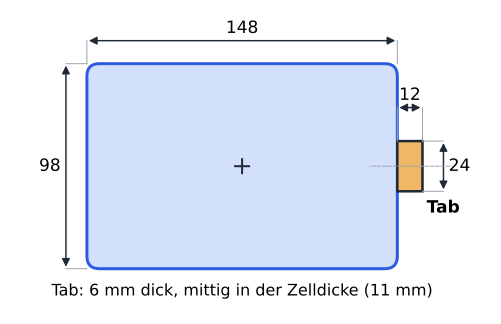
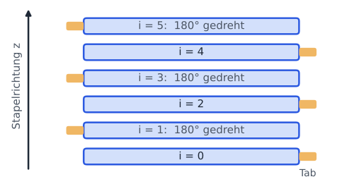
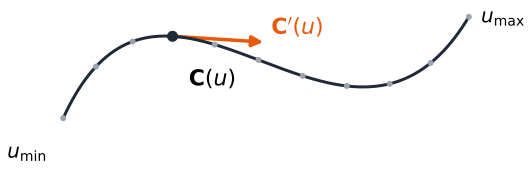
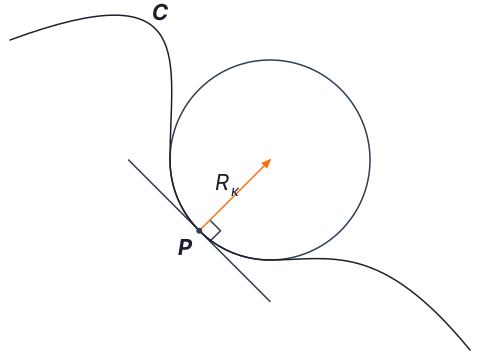
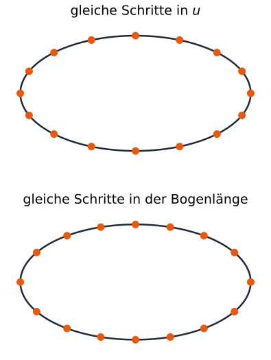
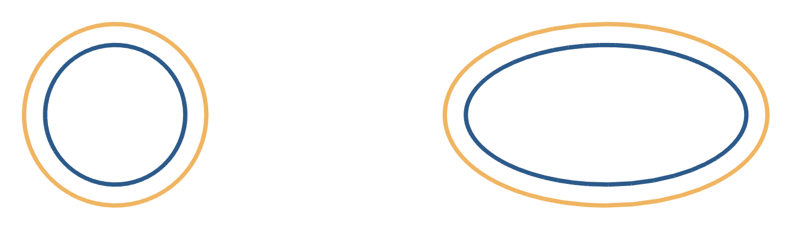

# Programmierung von CAx-Systemen

David Straub

### Gliederung

1. Einführung
2. Topologie
3. Grundformen
4. **Kurven**
5. Freiformgeometrie
6. Profile
7. Codequalität
8. Datenaustausch
9. Robustheit
10. Simulation
11. Optimierung

## Kurven

- Koordinatensysteme und Transformationen
- Reihenfolge von Drehen und Verschieben
- Was ist eine Kurve? Parametrische Darstellung
- Tangente, Bogenlänge, Krümmung
- Analytische Kurven und ihre Grenzen

*Durchgängiges Beispiel:* der alternierende Zell-Flip im Stapel; Kurven am eigenen Teil auslesen

### Rückblick: Stand des Projekts

Letzte Woche gebaut: Zellstapel (Muster-Schleife), Endplatten (Mirror), alles über einen `ModulParam`-Satz.

Dabei im Einsatz:

- `cf.Location` und `moved(...)` – Objekte im Raum platzieren
- `cf.Plane(origin=..., normal=...)` und `*` – auf einer Fläche platzieren und dort lokal weiter
- `moved(rz=90)` – drehen, und zwar **immer um den Ursprung**

**Heute:** Transformationen als Matrizen und Kurven als Geometrie der Kanten.

## Theorie A: Koordinatensysteme und Transformationen

### Verschieben und Drehen im Code

Im Code ist jede Transformation ein **expliziter Schritt** – und ihre **Reihenfolge** ist Ihre Entscheidung.

Die Klassen dafür in `cadquery`:

| Objekt | Bedeutung |
|---|---|
| `cf.Vector(x, y, z)` | Punkt oder Richtung; `.Length`, `.dot()`, `.cross()` |
| `cf.Plane(origin, normal=...)` | Ebene = lokales Koordinatensystem |
| `cf.Location` | Lage eines Objekts: Verschiebung **und** Drehung |

### Location: das Koordinatensystem eines Objekts

Jedes Objekt trägt eine **Location** – seine Lage relativ zur Welt. Sie kodiert zweierlei:

- **Translation:** Verschiebung $(dx,\, dy,\, dz)$
- **Rotation:** Orientierung

OCCT speichert beides zusammen als eine Transformationsmatrix.

```python
from cadquery import func as cf

teil = cf.box(60, 10, 6).moved(x=40)        # nur Verschiebung
teil = cf.box(60, 10, 6).moved(x=40, rz=30) # Verschiebung + Drehung
```

`moved(...)` nimmt Verschiebung (`x, y, z`) und Drehung (`rx, ry, rz`, in Grad) gemeinsam entgegen und liefert ein **neues** Objekt – das Original bleibt.

### Drehung: Achse plus Winkel

Eine Drehung im Raum ist vollständig durch **Achse + Winkel** beschrieben:

$$\text{Drehung} = (\hat{\mathbf{e}},\ \varphi)$$

Intern wird daraus eine **Rotationsmatrix** $\mathbf{R} \in \mathbb{R}^{3\times3}$, die auf jeden Punkt wirkt: $\mathbf{p}' = \mathbf{R}\,\mathbf{p}$.

- `rz=90` dreht um die Z-Achse (Rechte-Hand-Regel)
- Gedreht wird **immer um den Ursprung** – nicht um den Bauteilmittelpunkt, außer der liegt zufällig dort

### Wo landen `a` und `b`?

```python
a = cf.box(60, 10, 6).moved(rz=90).moved(x=40)
b = cf.box(60, 10, 6).moved(x=40).moved(rz=90)
```

`cf.box` liegt mittig auf dem Ursprung. Jedes `moved` wirkt im globalen Koordinatensystem.

**Sagen Sie zuerst voraus:** Wo liegt jeweils die Mitte der Box?

A) beide bei (40, 0) &nbsp;&nbsp; B) `a` bei (40, 0), `b` bei (0, 40)
C) `a` bei (0, 40), `b` bei (40, 0) &nbsp;&nbsp; D) beide bei (0, 40)

Probieren Sie es danach aus: `print(a.Center(), b.Center())`

### Reihenfolge als Matrixprodukt: $\mathbf{T}\mathbf{R} \neq \mathbf{R}\mathbf{T}$

Mit $\mathbf{T}$ für eine Translation und $\mathbf{R}$ für eine Rotation:

Translationen **kommutieren** – Reihenfolge egal:
$$\mathbf{T}_1\mathbf{T}_2 = \mathbf{T}_2\mathbf{T}_1$$

Drehung und Verschiebung **kommutieren nicht**:
$$\mathbf{T}\mathbf{R} \neq \mathbf{R}\mathbf{T}$$

Ein Matrixprodukt wirkt **von rechts nach links**: In $\mathbf{T}\mathbf{R}$ wirkt zuerst $\mathbf{R}$, dann $\mathbf{T}$ – das ist `a`. Die Zeile `b` ist $\mathbf{R}\mathbf{T}$.

## Praktikum A: Zellstapel mit alternierendem Flip

### Aufgabe 1: Zelle mit Terminal-Tab



Ergänzen Sie `zelle_bauen(p)` aus Einheit 3 um einen **Terminal-Tab** an der kurzen Seite (Maße in der Skizze).

- Tab-Maße als neue Felder in `ModulParam`
- Lage des Tabs aus `p` berechnen, ohne fest eingetippte Positionen

*Hinweise:* `cf.box`, `.moved(cf.Location(...))`, `+`. Die Unterseite von `cf.box` liegt bei z = 0.

*Prüfen:* Das Volumen wächst um 24 · 12 · 6 = 1728 mm³. `BoundingBox().xmax` ist 86.

### Aufgabe 2: Alternierend flippen und stapeln



Stapeln Sie **12 Zellen** im Abstand **12,5 mm**. Für die Reihenschaltung wird **jede zweite Zelle um 180° um Z gedreht**.

1. **Sagen Sie zuerst voraus:** Ändert die Reihenfolge hier etwas – erst drehen, dann heben, oder umgekehrt? Bauen Sie dann beide Varianten.
2. Warum ist das hier so – anders als bei `a` und `b`?
3. `stapel.isValid()`; der Tab wechselt von Zelle zu Zelle die Seite.

*Hinweise:* `.moved(rz=...)`, `.moved(cf.Location((0, 0, ...)))`, `i % 2`; Vergleich zweier Stapel über `(stapel1 - stapel2).Volume()`

### Aufgabe 3 *(Zusatz)*: Drehen um einen anderen Punkt

Drehen Sie eine Zelle um **+90°** um die senkrechte Achse durch die **Tab-Mitte**: Der Tab bleibt an seinem Platz, die Zelle schwenkt herum.

1. `moved` dreht nur um den Ursprung. Wie kommen Sie trotzdem ans Ziel?
2. Schreiben Sie Ihre Schritte als Produkt aus $\mathbf{T}$- und $\mathbf{R}$-Matrizen.

*Prüfen:* `BoundingBox()` reicht in x von 31 bis 129 und in y von −154 bis 6.

### Aufgabe 4 *(Zusatz)*: Plus- und Minus-Tab

Eine echte Pouch-Zelle hat zwei Tabs an derselben kurzen Seite, beide 24 mm breit, 6 mm dick und mittig in der Zelldicke:

- **Plus:** ragt 12 mm heraus, Mitte 25 mm neben der Zellmitte (+y)
- **Minus:** ragt 16 mm heraus, damit Sie die beiden unterscheiden, Mitte 25 mm auf der anderen Seite (−y)

Für die Reihenschaltung muss über jedem Plus-Tab der Minus-Tab der nächsten Zelle liegen.

1. Leistet das der Flip um Z aus Aufgabe 2?
2. Welche Drehung leistet es? Wo steht sie in der Reihenfolge mit dem Anheben?

*Prüfen:* `stapel.isValid()`; der Stapel reicht in z von 0 bis 148,5; im Viewer wechseln über jeder Tab-Position kurze und lange Tabs ab.

## Theorie B: Was ist eine Kurve?

### Geometrie im B-Rep: was eine Kante trägt

In Einheit 2 gab `geomType()` Namen wie `LINE`, `CIRCLE` zurück. Diese Namen benennen die **Geometrie**, die ein Element trägt:

| Topologie | trägt als Geometrie |
|---|---|
| `Vertex` | einen Punkt |
| `Edge` | eine Kurve, begrenzt auf ein Stück davon |
| `Face` | eine Fläche, begrenzt auf einen Bereich davon |

Heute geht es um die Geometrie der Kanten: **Was ist eine Kurve?**

### Drei Arten, eine Kurve aufzuschreiben

Am Beispiel Kreis mit Radius $R$:

| Form | Kreis | Problem |
|---|---|---|
| **explizit** | $y = \pm\sqrt{R^2 - x^2}$ | mehrwertig; senkrechte Tangente bricht |
| **implizit** | $x^2 + y^2 - R^2 = 0$ | kein Startpunkt, kein „nächster Punkt“ |
| **parametrisch** | $x = R\cos u,\ y = R\sin u$ | jeder $u$ → genau ein Punkt |

> CAD-Kerne wie OCCT speichern die **parametrische** Form – nur sie beantwortet „welcher Punkt liegt bei $u$?“ und „wohin zeigt die Kurve hier?“ direkt.

### Kurve als Funktion eines Parameters

Eine Kurve ordnet jedem Parameterwert $u$ genau einen Punkt zu:

$$\mathbf{C}(u) = \begin{pmatrix} x(u) \\ y(u) \\ z(u) \end{pmatrix}, \qquad u \in [u_{\min}, u_{\max}]$$



Läuft $u$ von $u_{\min}$ bis $u_{\max}$, fährt der Punkt die Kurve einmal ab. Die grauen Punkte liegen in gleichen Schritten von $u$.

### Tangente und Bogenlänge

**Tangentenvektor** = Ableitung, zeigt in die Laufrichtung:
$$\mathbf{C}'(u) = \frac{d\mathbf{C}}{du}$$

**Bogenlänge** = tatsächlich zurückgelegter Weg:
$$s(u) = \int_{u_0}^{u} |\mathbf{C}'(\tilde u)|\, d\tilde u$$

Die Länge von $\mathbf{C}'$ ist eine „Geschwindigkeit“ im Parameterraum – sie hängt von der Parametrisierung ab, nicht von der Form.

### Krümmung

Die **Krümmung** $\kappa$ misst, wie stark sich die Tangentenrichtung pro Weglänge dreht:

$$\kappa(u) = \frac{|\mathbf{C}'(u) \times \mathbf{C}''(u)|}{|\mathbf{C}'(u)|^3}$$

- Gerade: $\kappa = 0$  $\quad|\quad$  Kreis mit Radius $R$: $\kappa = 1/R$ überall
- $R_\kappa = 1/\kappa$: **Krümmungsradius** – Radius des anschmiegenden Kreises



### Wie stark krümmt sich eine Ellipse?

```python
ell = cf.ellipse(30.0, 15.0)    # Halbachsen 30 und 15 mm
```

Entlang der Ellipse ändert sich die Krümmung. Ihr größter und ihr kleinster Wert:

$$\kappa = 0{,}133\ \text{mm}^{-1} \qquad \kappa = 0{,}0167\ \text{mm}^{-1}$$

**Sagen Sie zuerst voraus:** Wo auf der Ellipse liegt welcher Wert? Wie groß sind die Krümmungsradien dort?

### Krümmung der Ellipse

```python
print(ell.curvatureAt(0.0), ell.curvatureAt(0.25))
# 0.133  0.0167
```

- $t = 0$: Scheitel (30, 0), spitzes Ende – $R_\kappa = 7{,}5$ mm
- $t = 0{,}25$: Scheitel (0, 15), flaches Ende – $R_\kappa = 60$ mm
- Die Krümmung ändert sich um den Faktor 8

Allgemein gilt an den Scheiteln einer Ellipse mit Halbachsen $a > b$: $R_\kappa = b^2/a$ (spitz) und $R_\kappa = a^2/b$ (flach).

Warum liegt $t = 0{,}25$ genau am flachen Scheitel? Das klärt die nächste Folie.

### Parameter und Bogenlänge



Der Parameter $u$ läuft **gleichmäßig** – die Punkte auf der Kurve liegen es **nicht** (oben). Gleiche Wege liefert erst die Bogenlänge (unten).

- `positionAt(t)`, `tangentAt(t)`, `curvatureAt(t)` – CadQuery-Standard `mode="length"`: $t \in [0, 1]$ ist der Bruchteil der **Bogenlänge**. Ein Viertel des Umfangs endet aus Symmetriegründen am flachen Scheitel.
- `mode="parameter"`: $t$ ist der Kurvenparameter $u$, wie OCCT ihn speichert – bei Kreis und Ellipse läuft er von 0 bis $2\pi$.

### Der Rohparameter hängt vom Kurventyp ab

```python
linie = cf.segment((0, 0, 0), (50, 0, 0))
print(linie.paramAt(0), linie.paramAt(1))   # 0.0 50.0
```

| Kante | Rohparameter $u$ in OCCT |
|---|---|
| Linie der Länge $L$ | $0 \ldots L$ |
| Kreis, Ellipse (geschlossen) | $0 \ldots 2\pi$ |
| Bogen, z. B. Eckenrundung | Teilstück, z. B. $\pi/2 \ldots \pi$ |
| Spline | je nach Aufbau, z. B. $0 \ldots 22{,}36$ |

- CadQuery rechnet mit `e.paramAt(d)` einen Bruchteil $d$ der Bogenlänge in $u$ um
- Die Laufrichtung folgt der Orientierung der Kante: `e.startPoint()` liegt bei $t = 0$

### Versatz: Kreis und Ellipse

Ein **Versatz** (Offset) verschiebt jeden Punkt einer Kurve um $d$ entlang ihrer Normalen.

```python
kreis   = cf.circle(10.0)
ell     = cf.ellipse(20.0, 10.0)
v_kreis = cf.offset2D(cf.wire(kreis), 3.0)
v_ell   = cf.offset2D(cf.wire(ell), 3.0)
```

Der Kreis wird ein Kreis mit $R = 13$.

**Und die Ellipse?** Wird sie eine Ellipse mit den Halbachsen 23 und 13? Prüfen Sie es über die Krümmungsradien an den Scheiteln.

*Tipp:* In der Nähe eines Punktes verhält sich jede Kurve wie ihr Krümmungskreis.

### Versatz: das Ergebnis

```python
print([e.geomType() for e in v_kreis.Edges()])   # ['CIRCLE']
print([e.geomType() for e in v_ell.Edges()])     # ['OFFSET', 'OFFSET', 'OFFSET', 'OFFSET']
```

- Am spitzen Scheitel hat die Ellipse $R_\kappa = 10^2/20 = 5$, der Versatz also $5 + 3 = 8$
- Eine Ellipse mit 23 und 13 hätte dort $13^2/23 \approx 7{,}35$ – passt nicht
- Der Versatz ist keine Ellipse mehr. OCCT speichert ihn als „Ellipse plus Abstand“, Typ `OFFSET`

### Warum es Freiformkurven braucht



Konstante Krümmung (Kreis) → Versatz bleibt Kreis. Variable Krümmung (Ellipse) → etwas Neues, das keine analytische Formel mehr trägt.

> CAD-Systeme brauchen eine Darstellung für **beliebige** glatte Kurven: Bézier, B-Spline, NURBS.

## Praktikum B: Kurven am eigenen Teil auslesen

### Aufgabe 5: Geometrietypen und Radien

Nehmen Sie Ihre Grundplatte (mit Bohrungen und Zapfen) und gehen Sie ihre Kanten durch.

1. Welche `geomType`-Werte kommen vor?
2. Lesen Sie die Radien aller Kreiskanten aus. Ordnen Sie jeden Wert einem Konstruktionsmaß zu. Wie viele Kreiskanten liefert jedes Feature?

*Hinweise:* `for e in grundplatte.Edges():`, `grundplatte.edges("%CIRCLE").Edges()`, `e.geomType()`, `e.radius()`

### Aufgabe 6: Bogenlänge und Parameter an der Ellipse

```python
import math
ell = cf.ellipse(30.0, 15.0)
```

1. Setzen Sie 9 Punkte in gleichen Schritten der **Bogenlänge**: `ell.positionAt(i / 8)` für `i` von 0 bis 8. Berechnen Sie die Abstände benachbarter Punkte.
2. Dasselbe in gleichen Schritten des **Parameters**: `ell.positionAt(i * 2 * math.pi / 8, mode="parameter")`.
3. Welche Folge ist gleichmäßig? Warum sind die Abstände auch in 1. nicht ganz gleich?
4. Wohin zeigt `ell.tangentAt(0.25)`? In welcher Richtung läuft die Ellipse also um?

*Hinweise:* `for i in range(9):`, Punkte in einer Liste sammeln; Abstand zweier Punkte: `(p2 - p1).Length`

### Aufgabe 7: Versatz an der Grundplatte

Die Außenkontur Ihrer Grundplatte hat Ecken mit r = 6 mm. So holen Sie sie heraus:

```
kontur = grundplatte.faces("<Z").outerWire()
```

1. **Sagen Sie zuerst voraus:** Welche Eckenradien hat die Kontur nach einem Versatz um +3 mm, −3 mm und −8 mm?
2. Prüfen Sie mit `cf.offset2D(kontur, d)` und den Radien der Kreiskanten.
3. Was passiert bei −8 mm, und warum? Wo brauchen Sie solche Versätze in der Konstruktion?

*Hinweise:* `.edges("%CIRCLE").Edges()`, `e.radius()`, `.Edges()`, `e.geomType()`

### Aufgabe 8 *(Zusatz)*: Versatz nach innen

Versetzen Sie die Ellipse aus Aufgabe 6 (Halbachsen 30 und 15) **nach innen**, also mit negativem `d`.

1. **Sagen Sie zuerst voraus:** Ab welchem Betrag von `d` kann der Versatz nicht mehr glatt sein? Begründen Sie es mit den Krümmungsradien.
2. Prüfen Sie mit Werten knapp unter und knapp über Ihrer Grenze: Welche `geomType`-Werte kommen heraus, wie viele Kanten?
3. Skizzieren Sie, was an den spitzen Enden geometrisch passiert.

*Hinweise:* `cf.offset2D(cf.wire(ell), d)`, `.Edges()`, `e.geomType()`

## Abschluss

### Leseauftrag & Ausblick

- **Leseauftrag:** Buch Kapitel 6
- **Wer mehr will:** Krümmung entlang der Ellipse an 50 Stellen mit `curvatureAt` abtasten und über $t$ plotten
- **Nächste Woche:** Freiformgeometrie – Freiformkurven (Bézier, B-Spline, NURBS) und das Kühlkanal-Profil
- Bis dahin: `w04/` committet und gepusht
