# Programmierung von CAx-Systemen

David Straub

### Gliederung

1. Einführung
2. Topologie
3. Grundformen
4. Kurven
5. **Freiformgeometrie**
6. Profile
7. Codequalität
8. Datenaustausch
9. Robustheit
10. Simulation
11. Optimierung

## Freiformgeometrie

- Von Kontrollpunkten zu Freiformkurven: Bézier → B-Spline → NURBS
- Stetigkeit: $C^0$, $G^1$, $G^2$ – und wo sie wirklich zählt
- Freiformflächen: was Loft & Co. eigentlich erzeugen

*Durchgängiges Beispiel:* das Kühlkanal-Profil – Einlass- und Auslass-Querschnitt als Spline

### Rückblick: die analytische Familie ist zu klein

Letzte Woche: schon der Versatz einer **Ellipse** war keine Ellipse mehr (`OFFSET`).

Der **Kühlkanal** des Moduls braucht ein frei geformtes Profil – über Linie, Kreis und Ellipse hinaus:

- Bisher: Profile aus analytischen Kurven
- Heute: ein frei geformtes, glattes Profil

**Frage:** Wie beschreibt man eine *beliebige* glatte Kurve mathematisch?

## Theorie A: Von Kontrollpunkten zu B-Splines

### Warum Polynome – aber niedrigen Grades?

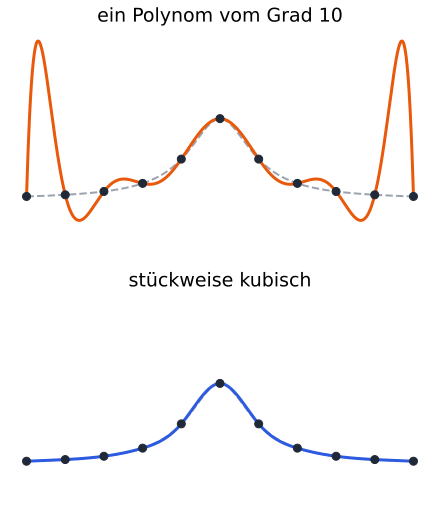

Eine Kurve ist $\mathbf{C}(u) = (x(u), y(u), z(u))$ – welche Funktion?

| Ansatz | Problem |
|---|---|
| Lineare Interpolation | Knick an jedem Stützpunkt |
| Sinus/Kosinus | schwer zu verketten, teuer |
| Ein Polynom hohen Grades | Runge-Phänomen: Oszillation (rechts oben) |
| **Stückweise Polynome niedrigen Grades** | ✓ flexibel, stabil, lokal steuerbar |

→ Alle Freiformkurven (Bézier, B-Spline, NURBS) sind **stückweise Polynome niedrigen Grades**.

### Erster Ansatz: Potenzbasis

Zuerst ein einzelnes Stück: Wie schreibt man ein Polynom so auf, dass man seine Form gut steuern kann? Naheliegend sind die Koordinaten direkt als Polynom in $u$:

$$\mathbf{C}(u) = \mathbf{a}_0 + \mathbf{a}_1 u + \mathbf{a}_2 u^2 + \cdots + \mathbf{a}_n u^n$$

In der Praxis ungeeignet:

- **Kein geometrischer Bezug:** aus $\mathbf{a}_3$ liest man den Kurvenverlauf nicht ab
- **Numerisch empfindlich** bei hohem Grad

→ Gesucht: eine Basis, deren Parameter **selbst Punkte im Raum** sind.

### Bézier: Kontrollpunkte als Gewichte

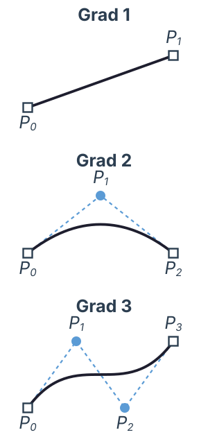

Renault, 1962 (Karosseriedesign): Die Kurve wird direkt aus **Kontrollpunkten** $\mathbf{P}_i$ gemischt, $u \in [0, 1]$.

**Grad 1**, zwei Punkte – eine Strecke:

$$\mathbf{C}(u) = (1-u)\,\mathbf{P}_0 + u\,\mathbf{P}_1$$

Jeder Kurvenpunkt ist ein **gewichteter Mittelwert** der Kontrollpunkte.

**Grad 2**, drei Punkte:

$$\mathbf{C}(u) = (1-u)^2\,\mathbf{P}_0 + 2u(1-u)\,\mathbf{P}_1 + u^2\,\mathbf{P}_2$$

**Rechnen Sie:** $\mathbf{P}_0 = (0, 0)$, $\mathbf{P}_1 = (10, 20)$, $\mathbf{P}_2 = (20, 0)$. Wo liegt $\mathbf{C}(0{,}5)$?

### Die Bernstein-Polynome

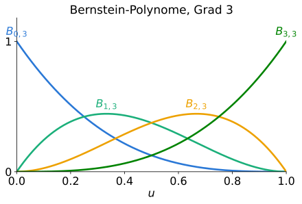

Allgemein, Grad $n$ mit $n+1$ Kontrollpunkten:

$$\mathbf{C}(u) = \sum_{i=0}^{n} B_{i,n}(u)\, \mathbf{P}_i, \qquad B_{i,n}(u) = \binom{n}{i} u^i (1-u)^{n-i}$$

Die Gewichte von eben sind genau diese **Bernstein-Polynome**: $B_{0,2} = (1-u)^2$, $B_{1,2} = 2u(1-u)$, $B_{2,2} = u^2$.

- nie negativ, Summe immer 1 → jeder Kurvenpunkt ist ein gewichteter Mittelwert (**Konvexkombination**) → die Kurve bleibt in der **konvexen Hülle**, dem kleinsten konvexen Polygon um alle $\mathbf{P}_i$
- bei $u = 0$ ist nur $B_{0,n} = 1$ → die Kurve beginnt in $\mathbf{P}_0$ und endet in $\mathbf{P}_n$; Tangente in $\mathbf{P}_0$: Richtung $\mathbf{P}_1 - \mathbf{P}_0$

### Die Grenzen der einzelnen Bézier-Kurve

Eine einzelne Bézier-Kurve über *alle* Punkte hat zwei Schwächen:

- **Grad = Punktzahl − 1:** 20 Punkte → Grad 19 → numerisch instabil, wellig
- **Globale Kontrolle:** Jedes Bernstein-Polynom ist auf ganz $[0, 1]$ ungleich null (Plot auf der Folie davor). Jeder Punkt beeinflusst also die **ganze** Kurve.

### Stückweise Bézier: Übergänge

**Ausweg:** die Kurve in **Segmente** teilen, jedes ein kubisches Bézier-Stück mit 4 Kontrollpunkten. Am Übergang trifft der letzte Kontrollpunkt $\mathbf{P}_3$ eines Segments auf den ersten $\mathbf{Q}_0$ des nächsten.

Wie glatt ist der Übergang?

- $C^0$: $\mathbf{Q}_0 = \mathbf{P}_3$ – kein Spalt
- $C^k$: zusätzlich stimmen die ersten $k$ **Ableitungen nach $u$** überein
- $G^1$: nur die **Richtung** der Tangente stimmt, ihre Länge darf springen

$C$ steht für die Parametrisierung, $G$ für die Geometrie: $G^1$ fragt nur, ob die Kurve glatt *aussieht*.

### Übergänge im Editor ausprobieren

[Piecewise Bézier Editor](https://davidstraub.de/teaching-apps/bezier-editor/) – stellen Sie **kubisch** ein, dann nacheinander $C^0$, $G^1$, $C^1$, $C^2$. Ziehen Sie jeweils einen Griff direkt neben einem Übergang.

| Bedingung | Was bewegt sich auf der anderen Seite des Übergangs mit? |
|---|---|
| $C^0$ | |
| $G^1$ | |
| $C^1$ | |
| $C^2$ | |

Wie viele der vier Kontrollpunkte eines Segments können Sie bei $C^2$ noch frei setzen?

### Wo stückweise Bézier eingesetzt wird


Für wenige, von Hand gesetzte Segmente ist stückweise Bézier bis heute der Standard:

- **SVG-Pfade** und Vektorgrafik-Programme
- **Schriften:** jeder Buchstabe ein Umriss aus Bézier-Segmenten – rechts das „c“ der Buchschrift. An den Quadraten liegen beide Griffe auf einer Linie, an den Rauten sitzt ein gewollter Knick.
- OCCT kennt `BEZIER` als eigenen `geomType`, etwa nach einem STEP-Import

**Für CAD-Flächen ungünstig:** Die Glätte ist eine **Nebenbedingung** zwischen den Punkten. Jede Änderung – von Hand oder per Algorithmus – muss die abhängigen Punkte an jedem Übergang mitführen, sonst entsteht ein Knick.

### Der B-Spline: überlappende Fenster

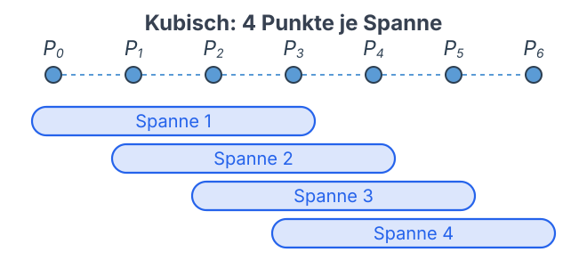

Beim **B-Spline** ist die Glätte in die Darstellung eingebaut. Er besteht aus **Spannen** – Abschnitten, in denen die Kurve jeweils ein Polynom ist. Benachbarte Spannen teilen sich alle Kontrollpunkte **bis auf einen**.

- **Eine Bézier-Kurve:** eine Spanne, jeder Punkt wirkt überall
- **Stückweise Bézier:** eigene Punkte je Spanne, Glätte als Nebenbedingung an jedem Übergang
- **B-Spline:** überlappende Spannen → Stetigkeit entsteht **von selbst**

→ Jede Lage der Kontrollpunkte ergibt eine glatte Kurve – ohne Nebenbedingungen, mit lokaler Kontrolle.

### B-Spline und Bézier: gleiche Summe, andere Basis

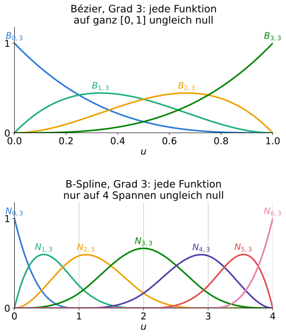

$$\text{Bézier:} \quad \mathbf{C}(u) = \sum_{i=0}^{n} B_{i,n}(u)\, \mathbf{P}_i$$

$$\text{B-Spline:} \quad \mathbf{C}(u) = \sum_{i=0}^{n} N_{i,p}(u)\, \mathbf{P}_i$$

| | Bézier | B-Spline |
|---|---|---|
| Grad | $n$ = Punktzahl − 1 | $p$ frei wählbar, meist 3 |
| Basisfunktion $\neq 0$ | auf ganz $[0, 1]$ | nur auf $p + 1$ Spannen |
| festgelegt durch | nur $n$ | $p$ und den **Knotenvektor** |

Auch die $N_{i,p}$ summieren sich überall zu 1 – die Kurve bleibt in der konvexen Hülle.

### Der Knotenvektor am Beispiel

Die B-Spline-Basis von eben gehört zum Knotenvektor $U = (0, 0, 0, 0,\ 1,\ 2,\ 3,\ 4, 4, 4, 4)$.

Die **Knoten** sind die senkrechten Linien, dazwischen liegt je eine **Spanne**. 7 Basisfunktionen gehören zu 7 Kontrollpunkten $\mathbf{P}_0 \ldots \mathbf{P}_6$.

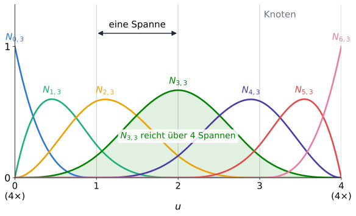

### Was der Knotenvektor festlegt

$U = (0, 0, 0, 0,\ 1,\ 2,\ 3,\ 4, 4, 4, 4)$

- **Innere Knoten** (1, 2, 3) teilen die Kurve in Spannen; in jeder Spanne ist sie ein Polynom vom Grad $p$
- Bei lauter einfachen inneren Knoten ist die Kurve überall $C^{p-1}$ – kubisch also $C^2$, der CAD-Standard
- **Randknoten** (0 und 4) stehen je viermal da: Die Kurve beginnt genau in $\mathbf{P}_0$ und endet in $\mathbf{P}_6$
- Wie oft ein Knotenwert vorkommt, heißt seine **Multiplizität**

### Lokale Kontrolle: ein Punkt verschoben

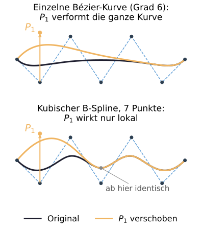

Gleiche 7 Kontrollpunkte, $\mathbf{P}_1$ gleich weit verschoben:

- **Bézier, Grad 6:** die ganze Kurve ändert sich
- **Kubischer B-Spline:** nur der Anfang ändert sich; ab der Markierung ist die Kurve identisch mit dem Original

Der Grund steht im Plot der Basisfunktionen: $N_{1,3}$ ist nur auf den ersten Spannen ungleich null.

### Knoten im Editor ausprobieren

[B-Spline-Editor](https://davidstraub.de/teaching-apps/bspline-editor/) – kubisch, unten die Basisfunktionen $N_{i,3}$ und die Knoten-Ticks

1. **Sagen Sie zuerst voraus:** Was passiert an einer Stelle, an der zwei innere Knoten zusammenfallen? Und bei drei?
2. Probieren Sie es aus: Schieben Sie Knoten-Ticks aufeinander. Achten Sie auf die Kurve und auf die Basisfunktionen.

### Knotenvektor lesen

B-Spline vom Grad $p$ mit Knotenvektor $U = (u_0, u_1, \ldots)$:

| Frage | Regel |
|---|---|
| Wie viele Kontrollpunkte? | Länge von $U$ minus $p$ minus 1 |
| Stetigkeit an einem inneren Knoten, der $m$-mal vorkommt? | $C^{p-m}$ – bei $m = p$ ein Knick |
| Läuft die Kurve durch $\mathbf{P}_0$? | ja, wenn der erste Knoten $(p+1)$-mal vorkommt |
| Wo wirkt $\mathbf{P}_i$? | nur für $u$ von $u_i$ bis $u_{i+p+1}$ |

**Üben Sie:** kubisch, $U = (0, 0, 0, 0,\ 1, 1,\ 2,\ 3, 3, 3, 3)$

1. Wie viele Kontrollpunkte hat die Kurve?
2. Welche Stetigkeit hat sie bei $u = 1$ und bei $u = 2$?
3. In welchem Bereich von $u$ wirkt der letzte Kontrollpunkt?

### Interpolation: Kurve durch gegebene Punkte

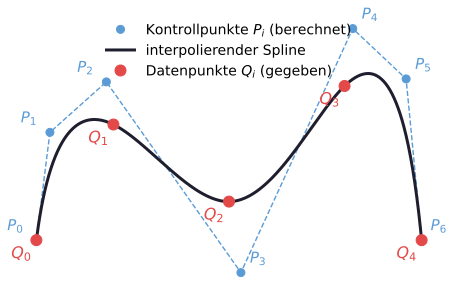

Kontrollpunkte sind Hebel – die Kurve läuft an ihnen vorbei. Oft liegen die Punkte aber **fest**: gemessen, aus einer Tabelle, aus einer Formel. Dann soll die Kurve **genau hindurch**.

Das ist **Interpolation**: Zu den Datenpunkten $\mathbf{Q}_i$ löst der Kern die passenden Kontrollpunkte $\mathbf{P}_i$ – ein lineares Gleichungssystem. `cf.spline(punkte)` macht genau das.

Rechts: die Kurve trifft jeden Datenpunkt (rot), die dafür berechneten Kontrollpunkte (blau) liegen woanders.

## Praktikum A: Kühlkanal-Querschnitt als Spline

### Aufgabe 1: Spline durch Punkte

Legen Sie eine Kurve durch fünf frei gewählte Punkte – einmal als **Spline**, einmal als **Polyline**.

1. Aus wie vielen Kanten bestehen beide, und welchen `geomType` haben die Kanten?
2. **Sagen Sie zuerst voraus:** Sie verschieben einen mittleren Punkt um 5 mm. Ändert sich der Spline nur in der Nähe dieses Punktes oder überall? Prüfen Sie es.
3. Passt das Ergebnis zur lokalen Kontrolle aus der Theorie?

*Hinweise:* `cf.spline`, `cf.polyline`, `.Edges()`, `e.geomType()`; beide Splines im Viewer übereinander zeigen

### Aufgabe 2: Der Einlass-Querschnitt

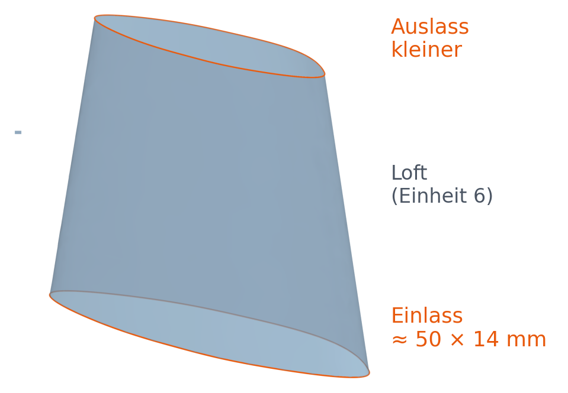

Der Kühlkanal verjüngt sich vom Einlass zum Auslass (rechts; den Körper baut Einheit 6).

Bauen Sie den Einlass-Querschnitt als **geschlossene, glatte** Kurve aus etwa acht Punkten (Breite ≈ 50 mm, Höhe ≈ 14 mm) und daraus eine Fläche.

1. Prüfen Sie `IsClosed()` und den Flächeninhalt – plausibel ist ein Wert nahe $\frac{\pi}{4} \cdot 50 \cdot 14 \approx 550$ mm².
2. Vergleichen Sie mit `periodic=False` und dupliziertem Endpunkt: Wo entsteht der Knick?

*Hinweise:* `cf.spline(*pts, periodic=True)` schließt die Kurve glatt vom letzten zum ersten Punkt – den Startpunkt am Ende **nicht** wiederholen; `cf.face`, `.IsClosed()`, `.Area()`

## Theorie B: NURBS, Stetigkeit, Flächen

### Kreisbogen als B-Spline

In jeder Spanne eines B-Splines sind $x(u)$ und $y(u)$ **Polynome** in $u$. Gesucht ist eine Spanne, die genau auf dem Einheitskreis liegt:

$$x(u)^2 + y(u)^2 = 1 \quad \text{für alle } u$$

1. Versuchen Sie es mit Grad 1: $x = a_0 + a_1 u$, $y = b_0 + b_1 u$. Multiplizieren Sie $x^2 + y^2$ aus und bestimmen Sie die Koeffizienten.
2. Versuchen Sie es mit Grad 2: $x = a_0 + a_1 u + a_2 u^2$, $y = b_0 + b_1 u + b_2 u^2$.

*Tipp:* Ein Polynom ist genau dann für alle $u$ gleich 1, wenn sein konstanter Term 1 ist und alle anderen Koeffizienten null sind.

### NURBS: Kurven mit Gewichten

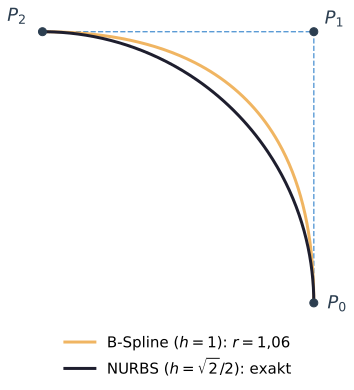

Jeder Kontrollpunkt bekommt ein **Gewicht** $h_i > 0$. Die Kurve wird ein Bruch zweier Polynome – eine **rationale** Kurve:

$$\mathbf{C}(u) = \frac{\sum_i h_i\, \mathbf{P}_i\, N_{i,p}(u)}{\sum_i h_i\, N_{i,p}(u)}$$

Sind alle Gewichte gleich, kürzen sie sich heraus. Wegen $\sum_i N_{i,p} = 1$ wird der Nenner 1 – übrig bleibt der gewöhnliche B-Spline.

NURBS = **N**on-**U**niform **R**ational **B**-**S**pline.

Viertelkreis exakt: 3 Punkte, Gewichte $1, \tfrac{\sqrt2}{2}, 1$. Rechts: gleiche Punkte – mit gleichen Gewichten wölbt sich die Kurve, mit dem kleineren Gewicht in der Mitte trifft sie den Bogen exakt.

### NURBS ist die universelle Darstellung

**Linie ⊂ Bézier ⊂ B-Spline ⊂ NURBS**

Jede analytische Kurve ist ein NURBS-Spezialfall → **einheitlicher Standard** (CATIA, SolidWorks, NX, OCCT).

| `geomType` | Bedeutung |
|---|---|
| `LINE`, `CIRCLE`, `ELLIPSE` | analytisch, exakt gespeichert |
| `BSPLINE` | Freiformkurve (B-Spline / NURBS – dieselbe Klasse) |

Beim STEP-Import erscheinen Freiformkurven als `BSPLINE`, teils sogar ursprüngliche Kreise – je nach exportierendem System.

### Stetigkeit: $C^0$, $G^1$, $G^2$

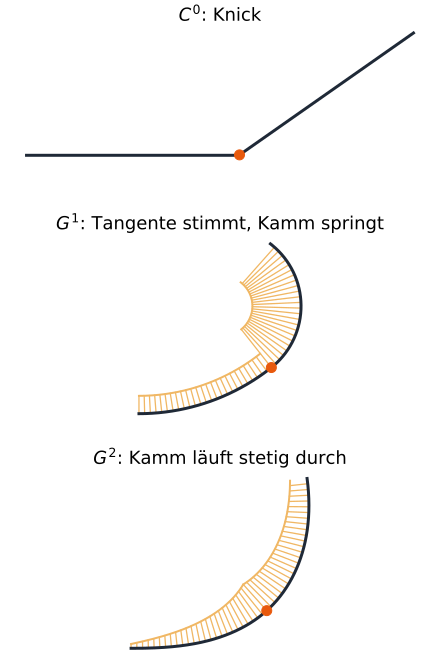

Aus Theorie A: $C$ fragt nach den Ableitungen nach $u$, $G$ nur nach der Geometrie. Beim Aneinanderstoßen von Kurven und Flächen zählen im CAD vor allem:

| Klasse | stimmt überein | sichtbar |
|---|---|---|
| $C^0$ | Position | Knick erlaubt |
| $G^1$ | Tangentenrichtung | glatt fürs Auge |
| $G^2$ | Krümmung | reflexionsglatt |

Rechts der **Krümmungskamm**: Striche senkrecht zur Kurve, ihre Länge ist proportional zur Krümmung.

### Wo Stetigkeit wirklich zählt

$G^2$ ist nicht überall nötig. Hier schon:

| Anwendung | warum $G^2$ |
|---|---|
| Optik / Design | Lichtreflexion folgt der Krümmung – ein Sprung ist sichtbar |
| Fertigung | Fräserbahn = Versatz der Fläche – Krümmungssprung → Maßfehler |
| Aerodynamik | Grenzschicht reagiert auf Krümmungsänderung |
| Kontakt / Implantate | Spannungsspitze genau am Krümmungssprung |

Faustregel: $C^0$ für boolesche Kanten, $G^2$ für Karosserie und Strömung.

### Von Kurven zu Flächen

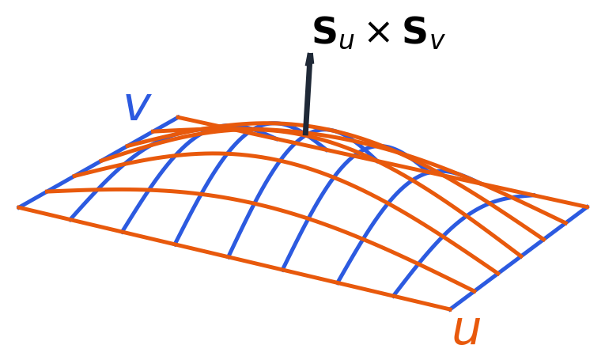

Eine Fläche hat **zwei** Parameter:
$$\mathbf{S}(u, v) = \begin{pmatrix} x(u,v) \\ y(u,v) \\ z(u,v) \end{pmatrix}$$

Alles von den Kurven gilt eine Dimension höher weiter. Die **analytische Familie** (Ebene, Zylinder, Kegel, Kugel, Torus) reicht für Standardkörper – der Rest wird `BSPLINE`.

Hält man $u$ oder $v$ fest, entsteht eine Kurve auf der Fläche (rechts). Die Normale ist $\mathbf{S}_u \times \mathbf{S}_v$ (normiert) – genau das, was `normalAt()` berechnet.

### Was Loft erzeugt: `ruled` vs. glatt

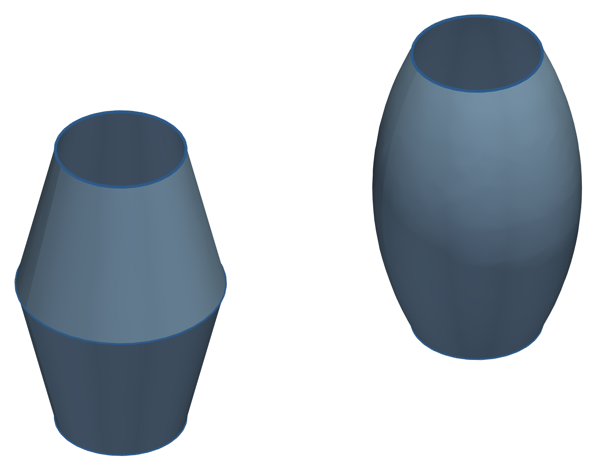

Das **Eingangsprofil** bestimmt die Ausgabefläche. Loft hat zusätzlich eine Stetigkeits-Entscheidung:

```python
from cadquery import func as cf

secs = [cf.wire(cf.circle(10)),
        cf.wire(cf.circle(16)).moved(z=25),
        cf.wire(cf.circle(10)).moved(z=50)]

cf.loft(secs, ruled=True)    # ['CONE', 'CONE'] – Knick in der Mitte
cf.loft(secs, ruled=False)   # ['BSPLINE'] – eine glatte Fläche
```

`ruled=True`: gerade Verbindung, $C^0$ (Bézier-Analogon). Default glatt: eine B-Spline-Fläche über alle Schnitte.

### `fillet` ist ein Flächenerzeuger

```python
box = cf.box(50, 30, 20)
box_f = cf.fillet(box, box.edges(), 3.0)
print(sorted(set(f.geomType() for f in box_f.Faces())))
# ['CYLINDER', 'PLANE', 'SPHERE']
```

- Zylinderfläche entlang jeder gerundeten Kante
- Kugelfläche in jeder Ecke

Das ist dieselbe Verrundung wie seit Einheit 1 – jetzt sehen Sie, *welche* Flächen sie erzeugt.

### Welche Stetigkeit hat die Verrundung?

An `box_f` stößt eine ebene Seitenfläche an die Zylinderfläche der Verrundung ($r = 3$ mm).

**Welche Stetigkeit hat dieser Übergang?**

A) $C^0$ &nbsp;&nbsp; B) $G^1$ &nbsp;&nbsp; C) $G^2$

### Stetigkeit sehen: Zebra-Streifen

Der Reiter *Zebra* im Viewer spiegelt parallele Lichtstreifen auf der Oberfläche – wie die Leuchtröhren im Karosseriebau. An jedem Übergang zeigt der Streifenverlauf die Stetigkeit:

| Klasse | Streifen am Übergang |
|---|---|
| $C^0$ | reißen ab, versetzt |
| $G^1$ | laufen durch, mit Knick |
| $G^2$ | laufen glatt durch |

**Prüfen Sie Ihre Antwort:** Zeigen Sie `box_f`, `cf.loft(secs, ruled=True)` und `cf.loft(secs)` im Viewer und öffnen Sie den Reiter *Zebra*. Welche Stetigkeit hat jeder Übergang?

## Praktikum B: Kurveneigenschaften und Auslass-Querschnitt

### Aufgabe 3: Kurveneigenschaften auslesen

1. `geomType()` Ihrer Splines – und eines Kreises (`cf.circle`). Was fällt auf?
2. Tasten Sie `curvatureAt(t)` an 100 Stellen entlang Ihres Einlass-Profils ab. Wo ist die Krümmung am größten, und wie groß ist dort der Krümmungsradius?
3. Für die Strömung soll der Kanal nirgends enger als **R = 3 mm** gekrümmt sein. Erfüllt Ihr Profil das?

*Hinweise:* `for i in range(100):` mit `t = i / 100`, `max(...)`, `.positionAt(t)`

### Aufgabe 4 *(Zusatz)*: Profil glätten

Verschieben Sie Punkte Ihres Einlass-Profils, bis der kleinste Krümmungsradius **mindestens 3 mm** beträgt – bei unveränderter Breite und Höhe.

1. Welche Punkte bewirken am meisten?
2. Wie ändert sich dabei der Flächeninhalt?

### Aufgabe 5 *(Zusatz)*: Der Auslass-Querschnitt

Der Kanal verjüngt sich zum Auslass (gleichmäßige Flussverteilung). Bauen Sie den Auslass als zweiten Querschnitt:

- gleiche Form wie Ihr Einlass, aber nur **≈ 36 × 10 mm**
- **40 mm** über dem Einlass (`.moved(z=40)`)

Einheit 6 verbindet Einlass und Auslass per Loft – erledigen Sie diese Aufgabe spätestens bis dahin.

*Prüfen:* Fläche nahe $\frac{\pi}{4} \cdot 36 \cdot 10 \approx 280$ mm²; `BoundingBox().zmin` ≈ 40

## Abschluss

### Leseauftrag & Ausblick

- **Leseauftrag:** Buch Kapitel 6 ab „Building Curves from Control Points“
- **Wer mehr will:** einen Loft der beiden Profile schon vorab probieren (`cf.loft`) – und `ruled=True` vs. `False` vergleichen
- **Nächste Woche:** Profile – Sweep und Loft: die beiden Querschnitte werden zum verjüngten Kühlkanal (Loft), der Kanal läuft als Sweep durch die Platte
- Bis dahin: `w05/` (beide Profile) committet und gepusht
