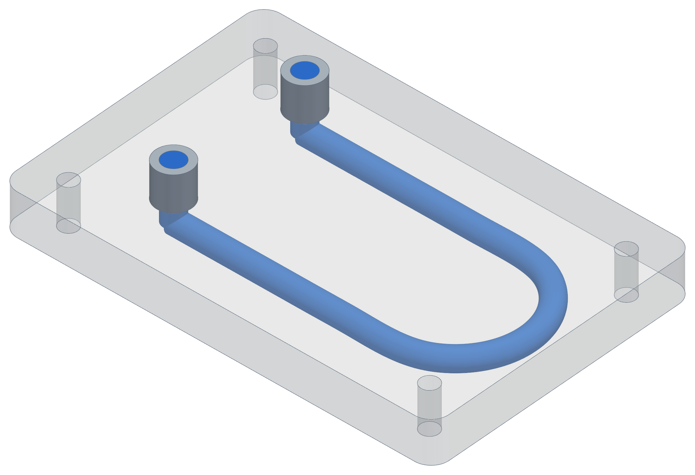
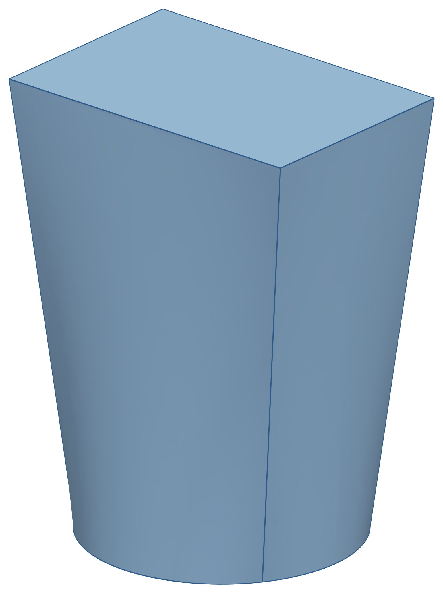
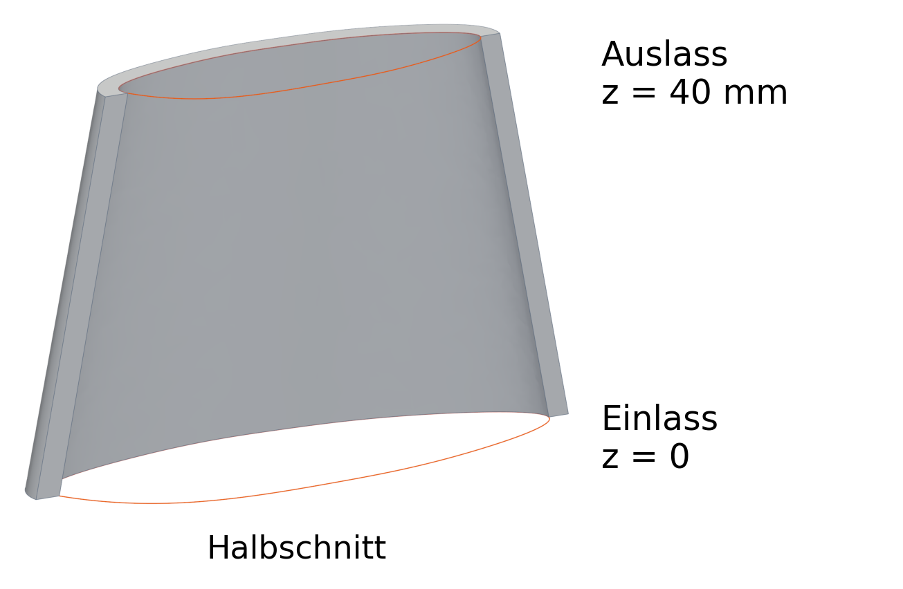
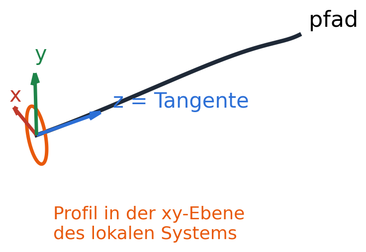
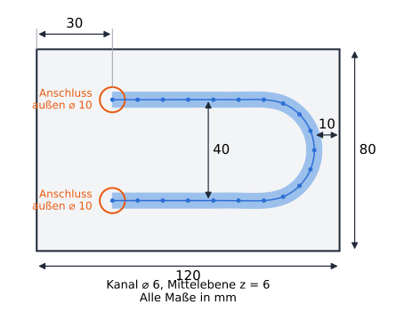
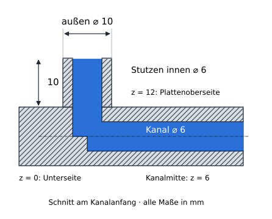

# Programmierung von CAx-Systemen

David Straub

### Gliederung

1. Einführung
2. Topologie
3. Grundformen
4. Kurven
5. Freiformgeometrie
6. **Profile**
7. Codequalität
8. Datenaustausch
9. Robustheit
10. Simulation
11. Optimierung

## Profile

- **Loft:** ein Körper zwischen zwei Profilen
- **Sweep:** ein Profil entlang eines Pfades
- **Boolean, Fillet:** Körper kombinieren und verrunden



Zwei Werkstücke: ein **verjüngtes Kanalstück** aus den Profilen von Einheit 5 und eine **Cold Plate** mit rundem Kanal und zwei runden Anschlüssen. Rechts die Cold Plate, der Hohlraum ist blau dargestellt.

### Rückblick: Einlass und Auslass

Aus Ihren Profilen aus Einheit 5 entsteht heute ein **verjüngtes Kanalstück**. Fehlt der Auslass, gibt es Referenzprofile.

Die beiden Werkstücke entstehen mit unterschiedlichen Operationen:

- Kanalstück zwischen den beiden Profilen (Loft)
- Serpentinen-Kanal mit ⌀ 6 mm in der Platte (Sweep)
- Runde Anschlussstutzen auf der Platte (Boolean)

## Theorie A: Loft

### Referenzprofile

Für alle, denen der Auslass aus Einheit 5 (Aufgabe 5) fehlt:

```python
from cadquery import func as cf

einlass = [(25, 0, 0), (15, 6, 0), (0, 7, 0), (-15, 5, 0),
           (-25, 0, 0), (-15, -5, 0), (0, -7, 0), (15, -6, 0)]
auslass = [(18, 0, 0), (11, 4.3, 0), (0, 5, 0), (-11, 3.6, 0),
           (-18, 0, 0), (-11, -3.6, 0), (0, -5, 0), (11, -4.3, 0)]

w_ein = cf.wire(cf.spline(*einlass, periodic=True))
w_aus = cf.wire(cf.spline(*auslass, periodic=True)).moved(z=40)
```

### Loft zwischen verschiedenen Formen



```python
rund      = cf.wire(cf.circle(25.0))
eckig     = cf.wire(cf.rect(60.0, 40.0)).moved(z=80)
uebergang = cf.loft([rund, eckig], cap=True)
```

- Die Profile dürfen ganz verschiedene Formen haben: hier ein Übergangsstück von rund auf eckig, wie im Rohrleitungs- und Lüftungsbau
- Eingang: Wires oder Faces in verschiedenen Ebenen
- `cap=True` schließt die beiden Enden mit Deckelflächen
- `ruled` und glatt aus Einheit 5 gelten weiter; bei nur zwei Profilen sind beide gleich

### Ein Loft auf einen Punkt

Statt eines zweiten Profils darf am Ende ein einzelner Punkt stehen:

```python
form = cf.loft([cf.wire(cf.circle(10)), cf.vertex((0, 0, 30))], cap=True)
```

**Sagen Sie zuerst voraus:** Welchen `geomType` hat die Mantelfläche von `form`?

Prüfen Sie es dann mit `[f.geomType() for f in form.Faces()]`.

### Eine Wand aus dem Versatz



Der Loft `cf.loft([w_ein, w_aus], cap=True)` aus Ihren Profilen ist der **Hohlraum** des Kanalstücks. Für die Wand braucht er eine Außenform:

- `cf.offset2D(w, 2.0)` versetzt jedes Profil um 2 mm nach außen (Einheit 4)
- der Loft der versetzten Profile ist die **Außenform**
- Außenform minus Hohlraum ergibt das **hohle Kanalstück**

## Praktikum A: Verjüngtes Kanalstück (Loft)

### Aufgabe 1: Der Hohlraum

Loften Sie Ihre beiden Profile zum Hohlraum `innen`: Einlass auf z = 0, Auslass auf z = 40. Liegt Ihr Auslass schon auf z = 40, verschieben Sie ihn nicht noch einmal.

1. Wie groß ist das Volumen, wie viele Faces hat der Körper?
2. Ist das Volumen plausibel? Es muss zwischen 40 · (Fläche des Auslasses) und 40 · (Fläche des Einlasses) liegen.

*Hinweise:* `cf.loft([...], cap=True)`, `.Volume()`, `.Faces()`, `cf.face(w).Area()`

### Aufgabe 2: Ohne Deckel

1. **Sagen Sie zuerst voraus:** Was liefert `cf.loft([w_ein, w_aus])` ohne `cap=True`? Welcher Typ, und was melden `isValid()`, `Volume()` und `len(Solids())`?
2. Prüfen Sie Ihre Vorhersage. Vergleichen Sie dabei auch `Volume()` mit `Area()`.
3. Übergeben Sie statt der Wires Flächen (`cf.face(w_ein)`, `cf.face(w_aus)`), wieder ohne `cap`. Was entsteht jetzt?
4. Woran erkennen Sie im Code zuverlässig, dass das Ergebnis ein Körper ist?

*Hinweise:* `type(...)`, `.isValid()`, `.Volume()`, `.Area()`, `.Solids()`

### Aufgabe 3: Die Wand


Bauen Sie die Wand des Kanalstücks: Profile je 2 mm nach außen versetzen, daraus die Außenform loften und den Hohlraum abziehen.

1. Prüfen Sie `isValid()` und `len(Solids())`.
2. Schätzen Sie das Wandvolumen ab: mittlerer Umfang · 2 mm · Höhe. Passt Ihr Ergebnis?

*Hinweise:* `cf.offset2D(w, 2.0)`, `cf.loft([...], cap=True)`, `-`, `w.Length()` für den Umfang

## Theorie B: Sweep, Boolean, Fillet

### Sweep: ein Profil entlang eines Pfades



```python
pfad   = cf.segment((0, 0, 0), (40, 0, 30))
profil = cf.face(cf.circle(3)).moved(pfad.locationAt(0.0))
kanal  = cf.sweep(profil, pfad)
```

- `sweep` zieht ein **konstantes** Profil entlang einer Pfadkurve
- `pfad.locationAt(0.0)` ist das lokale Koordinatensystem am Pfadstart: Seine z-Achse ist die **Tangente**, das Profil liegt quer dazu
- Ein `Face` als Profil liefert einen Körper

### Wo liegt das Ende einer Polyline?

```python
zickzack = cf.polyline((0, 0, 0), (30, 0, 0), (30, 30, 0), (60, 30, 0))
```

Die Polyline besteht aus drei Kanten.

**Sagen Sie zuerst voraus:** Wo liegen `zickzack.positionAt(1.0)` und `zickzack.positionAt(1.0, mode="parameter")`?

Prüfen Sie es dann im Notebook. Denken Sie an den Rohparameter aus Einheit 4.

### Ecken im Pfad: `transition`

```python
kanal = cf.sweep(profil, pfad, transition="round")
```

`transition` legt fest, was an einer **Ecke** des Pfades passiert, also dort, wo zwei Kanten mit einem Knick aufeinandertreffen:

- `"transformed"` *(Standard)*: Das Profil wird nur mitgedreht
- `"right"`: scharfe Ecke
- `"round"`: abgerundete Ecke

Bei einem glatten Pfad ohne Ecken spielt `transition` keine Rolle.

### Eine Serpentine mit scharfen Ecken

```python
pfad_eckig   = cf.polyline((-30, 20, 6), (50, 20, 6), (50, -20, 6), (-30, -20, 6))
profil_eckig = cf.face(cf.circle(3)).moved(pfad_eckig.locationAt(0.0))
```

Dieses Profil wird mit allen drei Einstellungen entlang der Polyline gezogen.

**Sagen Sie zuerst voraus:** Mit welcher `transition` entsteht ein durchgehender Kanal?

A) `"transformed"` &nbsp;&nbsp; B) `"right"` &nbsp;&nbsp; C) `"round"` &nbsp;&nbsp; D) `"right"` und `"round"`

### Boolean und Fillet

| Operation | Operator |
|---|---|
| Vereinigung (Union) | `a + b` |
| Differenz (Cut) | `a - b` |
| Schnittmenge (Intersect) | `a * b` |

```python
platte     = cf.box(120, 80, 12)
cold_plate = platte - kanal
cold_plate = cf.fillet(cold_plate, cold_plate.edges("|Z"), 5.0)
```

Achtung: `&` bildet die Schnittmenge von **Auswahlen**, etwa von zwei Kantenlisten. Für zwei Körper liefert es ein leeres Ergebnis ohne Fehlermeldung.

Zum Verrunden wählt ein Selektor die Kanten. Er fragt den **aktuellen Stand** ab (Einheit 3). Prüfen Sie vor dem Verrunden, welche Kanten er trifft.

## Praktikum B: Cold Plate mit Serpentinen-Kanal

### Aufgabe 4: Ein gerader Kanal

Die Cold Plate ist **120 × 80 × 12 mm** (`cf.box` liegt mittig in x und y, die Unterseite bei z = 0). Ziehen Sie einen runden Kanal (⌀ 6 mm) **geradlinig** durch die Mittelebene z = 6, von Rand zu Rand.

1. Prüfen Sie `isValid()`, `len(Solids())` und `Volume()`.
2. **Sagen Sie zuerst voraus:** Sie lassen das Profil in der XY-Ebene liegen, ohne `locationAt`. Was melden die drei Prüfungen jetzt? Probieren Sie es dann aus.

*Hinweise:* `cf.segment`, `cf.circle` + `cf.face`, `pfad.locationAt(0.0)`, `cf.sweep(profil, pfad)`

### Aufgabe 5: Die Serpentine



Ersetzen Sie den geraden Pfad durch die Serpentine rechts. Die Kehre ist ein Halbkreis mit Radius 20 mm um (30, 0). Die Enden liegen **in** der Platte, dort sitzen später die Stutzen.

1. Bauen Sie den Pfad als Spline und sweepen Sie erneut.
2. Wie klein ist der kleinste Krümmungsradius des Pfades? Warum muss er größer sein als der Kanalradius von 3 mm?

*Hinweise:* `cf.spline(*punkte)` mit dicht gesetzten Punkten entlang der Spuren und um die Kehre, sonst weicht der Spline zwischen ihnen von der Bahn ab; `curvatureAt(t)`

### Die Anschlüsse im Schnitt



An beiden Kanalenden sitzt ein runder **Rohrstutzen**:

- außen ⌀ 10 mm, innen ⌀ 6 mm
- 10 mm hoch, auf der Plattenoberseite: z = 12 bis 22
- der senkrechte Durchgang reicht von z = 6 bis 22

Stutzen, Bohrung und Kanal haben denselben **Innendurchmesser von 6 mm**.

### Aufgabe 6: Die Cold Plate zusammenbauen


1. Schneiden Sie den Serpentinen-Kanal aus der Platte. Ist die Volumendifferenz plausibel?
2. Fügen Sie an **beiden Kanalenden** je einen Zylinder zur Platte hinzu: ⌀ 10 mm, von z = 12 bis 22.
3. Schneiden Sie an beiden Enden einen senkrechten Durchgang aus: ⌀ 6 mm, von z = 6 bis 22.
4. Verrunden Sie die vier senkrechten Außenkanten (r = 5 mm). Wie viele Kanten trifft `edges("|Z")`?

*Hinweise:* `pfad.positionAt(0.0)` und `pfad.positionAt(1.0)` liefern die Endpunkte; `cf.cylinder(d=..., h=...)`, `.moved(cf.Location((x, y, z)))`

### Aufgabe 7: Kollisionsprüfung

Die Platte wird mit vier Schrauben befestigt: durchgehende Bohrungen ⌀ 5 mm bei (±50, ±30).

1. Bohren Sie die vier Löcher.
2. Prüfen Sie im Code, dass keine Bohrung den Kanal anschneidet.
3. Wie groß ist der kleinste Abstand zwischen Kanal und Befestigungsbohrungen? Und zwischen Stutzen und Befestigungsbohrungen?
4. Was meldet Ihre Prüfung, wenn Sie eine Bohrung auf (50, 0) setzen?

*Hinweise:* Schnittvolumen `(kanal * bohrung).Volume()`, Abstand `kanal.distance(bohrung)`

### Aufgabe 8 *(Zusatz)*: Eine Funktion für die Anschlüsse

Fassen Sie das Hinzufügen des Zylinders und das Ausschneiden des Durchgangs aus Aufgabe 6 in einer Funktion zusammen.

Die Funktion erhält den bisherigen Körper und einen Kanalendpunkt und gibt den Körper mit Anschluss zurück. Rufen Sie sie für beide Endpunkte auf.

Prüfen Sie, dass Volumen und Anzahl der Körper mit Ihrer bisherigen Lösung übereinstimmen.

*Hinweise:* `pfad.positionAt(0.0)`, `pfad.positionAt(1.0)`; Funktionen mit Parametern wie in Einheit 3

### Aufgabe 9 *(Zusatz)*: Ein Kanal, der sich verjüngt

Ein **Multisection-Sweep** zieht mehrere Profile entlang eines Pfades und geht dazwischen wie ein Loft von einem Profil ins nächste über:

```
kanal = cf.sweep([profil_anfang, profil_ende], pfad)
```

Bauen Sie die Serpentine mit ⌀ 8 mm am Anfang und ⌀ 5 mm am Ende. Prüfen Sie: Liegt das Volumen zwischen dem eines ⌀-5- und eines ⌀-8-Kanals gleicher Länge?

Passen Sie auch die Durchgänge und Stutzen an: innen jeweils der Durchmesser des Kanalendes, außen 4 mm mehr.

*Hinweise:* `pfad.locationAt(0.0)` und `pfad.locationAt(1.0)` für die beiden Profile, `pfad.Length()`

## Abschluss

### Leseauftrag & Ausblick

- **Leseauftrag:** Buch Kapitel 7
- **Wer mehr will:** der Flügel aus Kapitel 7, ein Loft durch NACA-Profile entlang einer gekrümmten Kurve
- **Nächste Woche:** Codequalität mit Type Hints und Unittests für den Modul-Code: Massenbudget, Zell-Passung, CI auf Ihrem Repo
- Bis dahin: `w06/` committet und gepusht
