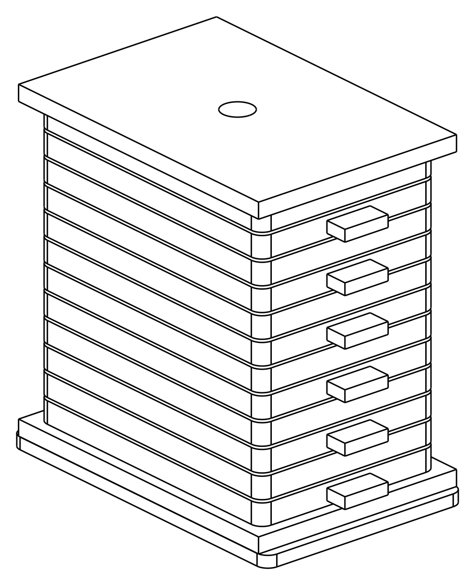

# Programmierung von CAx-Systemen

David Straub

### Gliederung

1. Einführung
2. Topologie
3. Grundformen
4. Kurven
5. Freiformgeometrie
6. Profile
7. Codequalität
8. **Datenaustausch**
9. Robustheit
10. Simulation
11. Optimierung

## Datenaustausch



- **Assembly:** Teile getrennt halten, mit Namen, Farben und Angaben zum Teil
- **Formate:** STEP, BREP, STL, wofür welches
- **Stückliste und Release:** alle Lieferdateien aus einem Aufruf

*Durchgängiges Beispiel:* Ihr Modul aus Einheit 7 wird eine **Baugruppe**: Grundplatte, zwei Endplatten, zwölf Zellen

### Rückblick: alles in einem Körper

In Einheit 7 haben Sie den Modul-Code in `w07/modul.py` gesammelt. `stapel_bauen` verbindet die Zellen mit `+` zu einem einzigen Shape.

Ein Zulieferer soll Ihr Modul bekommen. Sie exportieren:

```python
stapel_bauen(ModulParam()).exportStep("stapel.step")
```

**Was findet der Zulieferer in dieser Datei?**

### Zwölf Körper ohne Namen

- zwölf Solids mit den Namen `1` bis `12`, ohne Farben
- kein Hinweis, dass die Zellen **Kaufteile** sind und die Platten Eigenfertigung
- Grundplatte und Endplatten fehlen. Nimmt man sie mit `+` dazu, verschmelzen sie mit den Zellen, die sie berühren: 12 statt 14 Körper.

Für den Austausch braucht es mehr als Geometrie: welches Teil was ist, wie oft es vorkommt, wo es sitzt.

**Heute:** Die Teile bleiben getrennt und bekommen Namen, als **Baugruppe** (Assembly).

## Theorie A: Assembly und STEP

### Assembly: Teile getrennt halten

```python
import cadquery as cq                     # Assembly und Color liegen in cadquery selbst
from cadquery import func as cf

assy = cq.Assembly(name="pouch_modul")
assy.add(grundplatte(), name="grundplatte", color=cq.Color("gray"),
         metadata={"teil": "grundplatte", "material": "alu"})
assy.add(zelle, name="zelle_0", color=cq.Color("steelblue"),
         loc=cf.Location((0, 0, 14)),
         metadata={"teil": "zelle", "material": "kaufteil"})
```

- `name`: eindeutig in der Baugruppe
- `loc`: die Lage des Teils. Die Geometrie selbst bleibt unverändert.
- `metadata`: beliebige Angaben zum Teil, als **`dict`**: Paare aus Schlüssel und Wert in `{...}`. `metadata["teil"]` liest den Wert zum Schlüssel `"teil"`.

`+` verschmilzt Körper. `add` hängt sie nebeneinander in einen **Baum**.

### Zwölf Zellen, eine Schleife

```python
zelle = zelle_bauen(p)
gedreht = zelle.moved(rz=180)                      # Flip aus Einheit 4
pitch = p.zell_t + p.spacer
for i in range(p.n_zellen):
    z = GRUNDPLATTE_T + p.platten_t + i * pitch    # 6 + 8 + i · 12,5
    teil = zelle
    if i % 2:
        teil = gedreht
    assy.add(teil, name=f"zelle_{i}", color=cq.Color("steelblue"),
             loc=cf.Location((0, 0, z)),
             metadata={"teil": "zelle", "material": "kaufteil"})
```

- `GRUNDPLATTE_T = 6.0` steht oben in der Datei. Die unterste Zelle liegt auf der unteren Endplatte, die auf der Grundplatte liegt.
- `f"zelle_{i}"` ist ein **f-String**: Er setzt den Wert von `i` in den Text ein, also `zelle_0`, `zelle_1`, …

### Verschachteln: Modul → Pack

Ein Teil einer Baugruppe darf selbst eine Baugruppe sein:

```python
pack = cq.Assembly(name="pack")
for i in range(2):
    pack.add(modul(p), name=f"modul_{i}", loc=cf.Location((0, i * 130, 0)))

print([c.name for c in pack.children])   # ['modul_0', 'modul_1']
```

- `children` sind nur die Teile **direkt** darunter.
- Die Lage setzt sich **den Baum hinab** fort: Jedes Modul wird einmal platziert, seine Zellen bleiben relativ dazu.

### Skripte über Wochenordner hinweg: `-m`

`w08/baugruppe.py` importiert Ihren Code aus Einheit 7:

```python
from w07.modul import ModulParam, endplatten, zelle_bauen
```

```bash
uv run python w08/baugruppe.py     # ModuleNotFoundError: No module named 'w07'
uv run python -m w08.baugruppe     # läuft
```

- Python sucht Importe im Ordner des gestarteten Skripts, hier also in `w08/`.
- Mit `-m` sucht Python im aktuellen Ordner, also im Projektordner, und findet `w07/`, so wie pytest in Einheit 7.
- ▷ in VS Code startet wie die erste Zeile. Starten Sie ab heute im Terminal.

### Die Baugruppe im Viewer

```python
if __name__ == "__main__":
    from ocp_vscode import show
    show(modul(ModulParam()))
```

- Reiter *Tree*: derselbe Baum wie im Code, mit Namen und Farben aus `add`. Das Auge blendet ein Teil aus.
- *Explode* in der Werkzeugleiste zieht die Baugruppe auseinander. Jedes Teil bleibt ein eigenes Objekt.
- *Distance*: Abstand zwischen zwei Zellen nachmessen. Stimmt `zell_t + spacer`?

### Dateiformate: wofür welches

| Format | Typ | Inhalt | Einsatz |
|---|---|---|---|
| **STEP** | B-Rep | exakte Geometrie, Namen, Farben, Baum | Austausch mit anderen CAD-Systemen |
| **BREP** | B-Rep | exakte Geometrie im Format des Kernels | eigene Zwischenergebnisse |
| **STL** | Netz | Dreiecke auf der Oberfläche, keine Namen | 3D-Druck, Darstellung |

**B-Rep** (Einheit 2) hält exakte Kurven und Flächen. Ein **Netz** nähert die Oberfläche durch Dreiecke an.

**STEP** ist die Norm ISO 10303. Alle professionellen CAD-Systeme lesen es, etwa FreeCAD, Fusion 360, CATIA und NX.

### Welches Format?

1. Ein Zulieferer fräst die Endplatte.
2. Sie lassen die Grundplatte als Prototyp drucken.
3. Ein Kollege rechnet die Endplatte mit einem FEM-Programm.
4. Ein Zwischenergebnis braucht eine Minute zum Bauen, Sie wollen es morgen weiterverwenden.

**Ordnen Sie jedem Fall ein Format zu.**

### Auflösung

1. **STEP:** Der Zulieferer braucht die exakte Geometrie.
2. **STL:** Der Drucker arbeitet mit Dreiecken.
3. **STEP:** Ein FEM-Programm vernetzt selbst, und zwar aus der exakten Geometrie. Ein STL-Netz beschreibt nur die Oberfläche und taugt nicht als Volumennetz (Einheit 10).
4. **BREP:** schnell und verlustfrei, aber nur für den Eigenbedarf

### STEP: hin und zurück

```python
assy.export("w08/pouch_modul.step")              # das Format folgt aus der Endung

zurueck = cq.Assembly.load("w08/pouch_modul.step")
for kind in zurueck.children:
    print(kind.name, kind.loc.toTuple(), kind.color.toTuple(), kind.metadata)
```

`cq.Assembly.load` liest die Datei wieder als Baugruppe ein, so wie es ein anderes CAD-System täte.

**Was übersteht den Rundlauf?** Namen, Lage, Farben, Geometrie, `metadata`? Stimmen Sie ab.

## Praktikum A: das Modul als Baugruppe

### Aufgabe 1: Das Modul als Baugruppe

Legen Sie `w08/baugruppe.py` an:

1. `grundplatte()` mit Ihrer Grundplatte aus Einheit 3, Unterseite bei z = 0.
2. `modul(p)` mit Grundplatte, unterer und oberer Endplatte und zwölf Zellen. Jedes Teil hat einen Namen, eine Farbe und `metadata` mit `"teil"` und `"material"` (`"alu"`, `"stahl"`, `"kaufteil"`).
3. Zeigen Sie die Baugruppe unter `if __name__ == "__main__":` an.

*Prüfen:* `len(assy.children)` ist 15. Im Viewer liegt die unterste Zelle auf der unteren Endplatte.

*Hinweise:* `endplatten(p)` liefert beide Platten als ein Shape, `unten, oben = endplatten(p).Solids()` verteilt sie auf zwei Namen. Start mit `uv run python -m w08.baugruppe`. Farbnamen sind z. B. `"gray"`, `"gray40"`, `"steelblue"`.

### Aufgabe 2: Der STEP-Rundlauf

1. Exportieren Sie die Baugruppe nach `w08/pouch_modul.step`.
2. Laden Sie die Datei mit `cq.Assembly.load` und geben Sie für die ersten drei Teile Name, Lage, Volumen und `metadata` aus. Stimmt Ihre Vorhersage?
3. *Optional:* Öffnen Sie die Datei in FreeCAD (freecad.org). Erscheinen Baum, Namen und Farben?

*Hinweise:* `kind.obj` ist die Geometrie. Vor `kind.obj.Volume()` verengen Sie mit `assert isinstance(kind.obj, cf.Shape)` wie in Einheit 7.

## Theorie B: Stückliste und Release

### Die Stückliste aus dem Modell

```python
from collections import Counter

anzahl: Counter[str] = Counter()
for _, teil in assy.traverse():
    if teil.obj is not None:             # Baugruppen selbst haben keine Geometrie
        anzahl[teil.metadata["teil"]] += 1

print(anzahl)    # Counter({'zelle': 12, 'endplatte': 2, 'grundplatte': 1})
```

- `traverse()` läuft durch den **ganzen** Baum, auch durch verschachtelte Baugruppen. Es liefert Paare aus Name und Teil. `_` steht für den Namen, der hier nicht gebraucht wird.
- `Counter` zählt, wie oft ein Wert vorkommt. `Counter[str]` sagt mypy, dass die gezählten Werte Texte sind.

Der Rundlauf hat gezeigt: `metadata` geht beim STEP-Export verloren. Die Stückliste entsteht deshalb **aus dem Modell**, nicht aus der Datei.

### Masse: Eigenfertigung und Kaufteil

```python
DICHTE = {"alu": 2.7e-6, "stahl": 7.85e-6}      # kg/mm³
ZELLMASSE = 0.86                                 # kg je Zelle, Datenblatt

def masse(teil: cq.Assembly) -> float:
    if teil.metadata["material"] == "kaufteil":
        return ZELLMASSE
    assert isinstance(teil.obj, cf.Shape)
    return teil.obj.Volume() * DICHTE[teil.metadata["material"]]
```

- **Eigenfertigung:** Volumen aus dem Modell mal Dichte
- **Kaufteil:** Masse aus dem Datenblatt. Ihre Zelle ist nur die Hülle, innen sind Elektroden, Separator und Elektrolyt.

Die Masse des ganzen Moduls brauchen Sie in Einheit 11 für die Energiedichte in Wh/kg.

### BREP und STL

```python
koerper.exportBrep("w08/stapel.brep")              # Kernel-Format, verlustfrei
wieder = cf.Shape.importBrep("w08/stapel.brep")

assy.export("w08/modul.stl", tolerance=0.1)        # Netz, Abweichung bis 0,1 mm
```

- **BREP** speichert genau die Struktur, die der Kernel im Speicher hält: keine Umrechnung, kein Rundungsfehler. Es ist kein Industriestandard.
- **STL** ersetzt jede Fläche durch Dreiecke. `tolerance` legt fest, wie weit sie von der exakten Fläche abweichen dürfen.

### Release: alle Lieferdateien aus einem Aufruf

```python
from pathlib import Path

def release(p: ModulParam, ordner: str) -> None:
    Path(ordner).mkdir(parents=True, exist_ok=True)     # Ordner anlegen
    assy = modul(p)
    assy.export(f"{ordner}/modul.step")                 # Austausch
    assy.export(f"{ordner}/modul.stl")                  # Druck
    schreibe_bom(assy, f"{ordner}/bom.csv")             # Stückliste
```

Aus einem Parametersatz entsteht ein vollständiges, zueinander passendes Paket. Eine neue Variante ist ein neuer Aufruf, kein kopiertes Skript.

### Was die Pipeline nicht prüft

```python
release(ModulParam(zapfen_d=12.0), "w08/release_zapfen12")
```

Der Aufruf läuft ohne Fehler durch. STEP, STL und Stückliste sind vollständig.

**Lässt sich dieses Modul bauen?**

### Auflösung: eine Kopie, die zufällig passte

- Die Endplatte liest den Durchmesser ihrer Zentrierbohrung aus `p.zapfen_d`, jetzt also 12 mm.
- Der Zapfen der Grundplatte stammt aus Einheit 3 und hat fest ⌀ 16. Grundplatte und Endplatte durchdringen sich um 704 mm³.

Keiner der Schritte prüft das: Die Baugruppe legt Teile dorthin, wo `loc` sagt. STEP speichert, was es bekommt. Die Stückliste zählt Namen.

Es helfen beide Lehren aus Einheit 7: **den Kernel fragen** (`*`) und **die Kopie beseitigen**, sodass `grundplatte(p)` den Durchmesser aus `p` liest.

## Praktikum B: Stückliste und Release

### Aufgabe 3: Die Stückliste

Schreiben Sie in `w08/release.py` eine Funktion `schreibe_bom(assy, pfad)`. Sie schreibt eine CSV-Datei mit einer Zeile je Teil: `teil`, `anzahl`, `masse_kg` je Stück und `gesamt_kg`.

```python
with open(pfad, "w", newline="") as datei:     # schließt die Datei am Blockende
    tabelle = csv.writer(datei)
    tabelle.writerow(["teil", "anzahl", "masse_kg", "gesamt_kg"])
```

*Prüfen:* Die Zellen wiegen zusammen 10,32 kg, Grundplatte und Endplatten zusammen etwa 2,5 kg.

*Hinweise:* `import csv`. Gleiche Teile wiegen gleich viel, also genügt eine Masse je Stück, etwa in einem `dict`.

### Aufgabe 4: Release

1. Schreiben Sie `release(p, ordner)`.
2. Erzeugen Sie Releases für `n_zellen=12` und `n_zellen=16` in getrennten Ordnern. Was unterscheidet die beiden Stücklisten?
3. Erzeugen Sie dasselbe Release zweimal in zwei Ordnern. Sagen Sie vorher, welche Dateien identisch sind. Vergleichen Sie dann in VS Code: zwei Dateien markieren, Rechtsklick → *Ausgewählte vergleichen* (*Compare Selected*). Was unterscheidet sich?

*Hinweise:* Die erzeugten Dateien gehören nicht ins Repo, committen Sie nur die Skripte.

### Aufgabe 5: Was die Pipeline nicht prüft

1. Erzeugen Sie Releases für `zapfen_d=12.0` und für `zapfen_d=None`. Läuft beides durch?
2. Schreiben Sie in `tests/test_w08.py` einen Test: Grundplatte und untere Endplatte durchdringen sich nicht, für `zapfen_d` gleich 16, 12 und `None`.
3. Beheben Sie die Ursache, bis der Test für alle drei Werte grün ist.

*Hinweise:* `assy.objects["grundplatte"]` liefert das Teil mit diesem Namen. Seine Geometrie an ihrem Platz ist `teil.obj.moved(teil.loc)`, vorher verengen wie in Aufgabe 2. Eine Schleife über die drei Werte genügt.

### Aufgabe 6 *(Zusatz)*: Platzierung lösen statt rechnen

Statt die Höhe der untersten Zelle auszurechnen, kann ein Solver sie bestimmen:

```python
paar = cq.Assembly(name="paar")
paar.add(unten, name="platte")
paar.add(zelle, name="zelle", loc=cf.Location((0, 0, 50)))     # Platzhalter
paar.constrain("platte", unten.faces(">Z"), "zelle", zelle.faces("<Z"), "Plane")
paar.solve()
```

1. Welche Lage hat die Zelle nach `solve()`? Lesen Sie sie mit `paar.objects["zelle"].loc` aus.
2. Was liefert dasselbe mit der Grundplatte statt der Endplatte, und warum?

### Aufgabe 7 *(Zusatz)*: Ein Pack aus zwei Modulen

Bauen Sie `pack(p)` aus zwei Modulen und schreiben Sie die Stückliste mit Ihrer `schreibe_bom`. Müssen Sie dafür etwas ändern?

## Abschluss

### Leseauftrag & Ausblick

- **Leseauftrag:** Buch Kapitel 9
- **Wer mehr will:** der geometrische Vergleich zweier Revisionen aus Kapitel 9, `(a - b) + (b - a)`
- **Nächste Woche:** Robustheit: wenn Parameter das Modell sprengen
- Bis dahin: die Skripte in `w08/` und `tests/test_w08.py` committet und gepusht, Pipeline grün
