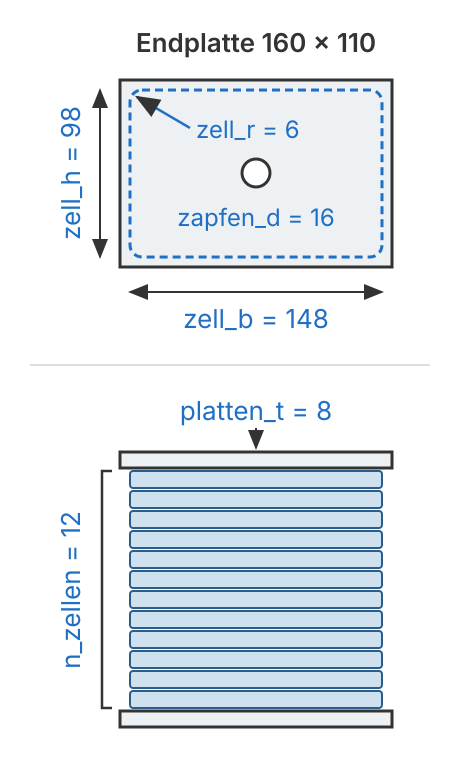
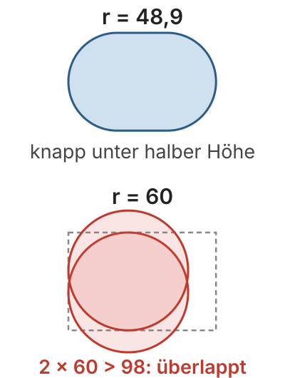
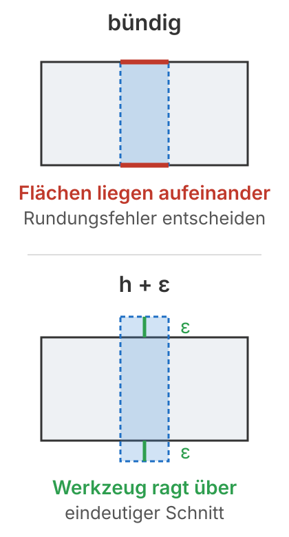
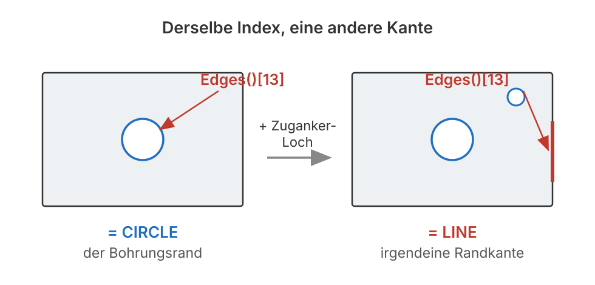

# Programmierung von CAx-Systemen

David Straub

### Gliederung

<style scoped>ol { columns: 2; }</style>

1. Einführung
2. Topologie
3. Grundformen
4. Kurven
5. Freiformgeometrie
6. Profile
7. Codequalität
8. **Robustheit**
9. Baugruppen
10. Fertigung
11. Simulation
12. Optimierung

## Robustheit

**Parametrische Robustheit:** Ein Modell liefert für jeden zulässigen Parametersatz ein richtiges Teil und lehnt alle anderen Parametersätze mit einer klaren Meldung ab.

- **Eingaben prüfen:** Ungültige Parameter werden abgelehnt, bevor der Kernel rechnet.
- **Ergebnisse prüfen:** Ein gültiges Shape ist noch kein richtiges Teil.
- **Kanten beschreiben:** Ein Selektor findet die Kante auch nach einer Änderung am Modell.
- **Bereich abtasten:** Eine Schleife prüft viele Varianten und läuft bei Fehlern weiter.

*Durchgängiges Beispiel:* Ihr Modul aus Einheit 7 wird parametrisch robust. Das braucht die Optimierung in Einheit 12.

### Ausgangspunkt: der Modul-Code aus Einheit 7

```python
from dataclasses import replace

from cadquery import func as cf

from w07.modul import ModulParam, endplatten, stapel_bauen, zelle_bauen

p = ModulParam()
```

Die Funktionen sind der Stand aus Einheit 7, ohne Änderungen.

### Rückblick: Was passiert an den Rändern?



Bisher haben Sie das Modul nur mit sinnvollen Maßen gebaut.

```python
endplatten(replace(p, platten_t=-4))
stapel_bauen(replace(p, n_zellen=0))
endplatten(replace(p, zapfen_d=200))
zelle_bauen(replace(p, zell_r=49))
```

**Was passiert bei jedem Aufruf: eine Exception, ein falsches Teil oder ein richtiges Teil?**

Notieren Sie Ihre Vorhersage. In Aufgabe 1 führen Sie die Aufrufe aus und prüfen sie.

### Von Hand und in der Schleife

- Am Bildschirm sehen Sie einen Fehler und korrigieren den Wert.
- In einer Schleife über hundert Varianten stoppt eine einzige Exception den ganzen Lauf.
- Ein falsches Teil ohne Exception bleibt dort unbemerkt.

Ein Optimierer (Einheit 12) probiert Parameter aus, die niemand von Hand eingeben würde.

## Theorie A: Eingaben und Ergebnisse prüfen

### Fehler melden und abfangen

```python
def zellen_pruefen(n: int) -> None:
    if n < 1:
        raise ValueError(f"n_zellen muss mindestens 1 sein, war {n}")

try:
    zellen_pruefen(0)
except ValueError as fehler:
    print("abgelehnt:", fehler)
```

- `raise` bricht die Funktion ab und meldet einen Fehler mit Typ und Text.
- `try`/`except` fängt einen Fehler dieses Typs ab, danach läuft das Programm weiter.
- Ohne `except` beendet der Fehler das Skript mit einem Traceback.

### Eingaben zuerst prüfen

```python
def pruefe(p: ModulParam) -> None:
    if p.platten_t <= 0:
        raise ValueError(f"platten_t muss positiv sein, war {p.platten_t}")
    if p.n_zellen < 1:
        raise ValueError(f"n_zellen muss mindestens 1 sein, war {p.n_zellen}")

pruefe(replace(p, platten_t=-4))
```

- Jede Baufunktion ruft `pruefe(p)` in ihrer ersten Zeile auf.
- Die Meldung nennt den Parameter und seinen Wert.

### Ablehnen oder anpassen?

Ein Parameter liegt außerhalb des baubaren Bereichs. Die Funktion kann ihn ablehnen (`raise`) oder auf den nächsten baubaren Wert setzen.

| Parameter | Bedeutung | ablehnen oder anpassen? |
|---|---|---|
| `platten_t = -4` | Dicke der Endplatten in mm | |
| `n_zellen = 0` | Anzahl der Zellen im Stapel | |
| `zell_r = 60` | Eckradius der Zelle 148 × 98 mm; 2 × 60 > 98 | |

**Welche Werte darf die Funktion anpassen, welche muss sie ablehnen? Wer bemerkt eine Anpassung?**

### Ablehnen oder anpassen: Kriterien



- **Ablehnen:** Der Wert beschreibt kein sinnvolles Teil, etwa ein negatives Maß.
- **Anpassen:** Der Wert ist eine Gestaltungsvorgabe mit klarer geometrischer Grenze.
- Eine Anpassung ändert das Teil unbemerkt. Sie gehört deshalb in den Docstring.

```python
# größter baubarer Radius: knapp unter der halben Seite
grenze = min(p.zell_b, p.zell_h) / 2 - 0.1
r = min(p.zell_r, grenze)
```

### Stilles Versagen

Zwei Aufrufe aus dem Rückblick laufen ohne Exception durch:

```python
platten = endplatten(replace(p, zapfen_d=200))
print(platten.isValid(), len(platten.Solids()), platten.Volume())

stapel = stapel_bauen(replace(p, n_zellen=0))
print(stapel.isValid(), len(stapel.Solids()))
```

**Was meldet `isValid()`? Woran erkennen Sie, dass beide Ergebnisse falsch sind?**

### Was `isValid()` prüft

- `isValid()` prüft, ob die Topologie in sich stimmig ist. Ob ein Körper entstanden ist, prüft es nicht.
- Auch der Loft ohne `cap=True` aus Einheit 6 liefert ein gültiges Shape ohne Volumen.
- Manchmal baut der Code etwas anderes als verlangt, weil eine Schleife oder ein Startwert nicht zum Randfall passt.

Nur eine Prüfung des Ergebnisses findet solche Fehler.

### Ergebnisprüfung (Guard): auf einen Körper bestehen

```python
def ein_solid(s: cf.Shape) -> cf.Solid:
    solids = s.Solids()
    assert len(solids) == 1, f"erwartet 1 Solid, erhalten {len(solids)}"
    return solids[0]

zelle = ein_solid(zelle_bauen(p))
```

- Die Ergebnisprüfung steht nach jedem Schritt, der genau einen Körper liefern soll.
- Er findet leere Booleans, offene Lofts und Teile, die in Stücke zerfallen.

### Warum ist die Bohrung länger als die Platte?

In `endplatten` steht seit Einheit 7:

```python
bohrung = cf.cylinder(d=p.zapfen_d, h=p.platten_t + 2).moved(cf.Location((0, 0, -1)))
```

**Die Platte ist 8 mm dick. Warum ist die Bohrung 10 mm lang und 1 mm nach unten verschoben?**

### Werkzeug überstehen lassen: `h + ε`



- Liegen zwei Flächen genau aufeinander, entscheiden Rundungsfehler über das Ergebnis.
- Möglich sind eine hauchdünne Restschicht oder ein fehlerhafter Körper.
- **Regel:** Das Werkzeug ragt auf beiden Seiten um ein kleines ε über das Teil hinaus.

### Zwischenstände sehen: Visual Debugging

Wo genau geht ein Modell kaputt? Der Viewer zeigt es beim schrittweisen Ausführen:

1. Setzen Sie einen Haltepunkt (Klick links neben die Zeilennummer) und starten Sie das Skript mit **F5** im Debugger.
2. Gehen Sie mit **F10** Zeile für Zeile weiter. Der Viewer zeigt nach jedem Schritt alle CAD-Objekte aus den lokalen Variablen mit ihren Namen.
3. Ein- und ausschalten lässt sich das in der Statusleiste: `OCP: <port>·DEBUG`.

Der Reiter *Clip* legt eine Schnittebene durch den Körper. So sehen Sie auch Flächen und Hohlräume im Inneren.

## Praktikum A: das Modul absichern

### Aufgabe 1: Die Ränder ausprobieren

1. Kopieren Sie `w07/modul.py` nach `w08/modul.py`.
2. Schreiben Sie die vier Aufrufe aus dem Rückblick in den `__main__`-Block von `w08/modul.py` und führen Sie sie einzeln aus. Welche Meldung kommt bei den Exceptions? Wie sehen die beiden falschen Teile im Viewer aus?
3. Gehen Sie `endplatten(replace(p, zapfen_d=200))` im Debugger Schritt für Schritt durch. In welcher Zeile verschwindet der Körper?

*Hinweise:* Eine Exception beendet das Skript. Kommentieren Sie die anderen drei Aufrufe aus oder fangen Sie die Exception mit `try`/`except` ab.

### Aufgabe 2: Eingaben absichern

1. Schreiben Sie `pruefe(p)`: Maße der Zelle, `platten_t` und `zell_r` müssen positiv sein, `n_zellen` mindestens 1, `spacer` nicht negativ. Rufen Sie `pruefe` am Anfang jeder Baufunktion auf.
2. Begrenzen Sie den Radius in `zelle_bauen`, sodass ein zu großes `zell_r` keine Exception mehr auslöst.
3. Sichern Sie in `zelle_bauen` und für die untere Endplatte das Ergebnis mit `ein_solid` ab.
4. Führen Sie die vier Aufrufe noch einmal aus. Was meldet jetzt `zapfen_d=200`?

*Hinweise:* `raise ValueError(f"...")`, `min(a, b)`, Rückgabetyp von `zelle_bauen` jetzt `cf.Solid`

## Theorie B: `assert`, Naming Problem, Sweep

### Programmfehler oder ungültige Eingabe?

Bei `zapfen_d=200` schlägt jetzt die Ergebnisprüfung an:

```text
AssertionError: erwartet 1 Solid, erhalten 0
```

**Ist das ein Fehler im Programm oder eine ungültige Eingabe? Wo sollte er gemeldet werden?**

### `raise` und `assert`

- **`raise`** prüft Eingaben von außen. Die Prüfung ist immer aktiv.
- **`assert`** prüft Annahmen im eigenen Code, die bei gültigen Eingaben immer gelten. `python -O` schaltet `assert` ab.
- Schlägt ein `assert` an, fehlt meist eine Eingabeprüfung oder der Code hat einen Fehler.

### Topological Naming Problem

Ein Fillet soll den Rand der Zentrierbohrung runden. Die Kante wird über ihre Nummer ausgewählt:

```python
platte = cf.box(172, 110, 8)
bohrung = cf.cylinder(d=16, h=10).moved(cf.Location((0, 0, -1)))
zuganker = cf.cylinder(d=6, h=10).moved(cf.Location((70, 40, -1)))

teil = platte - bohrung
print(teil.Edges()[13].geomType())      # CIRCLE: ein Rand der Bohrung

teil = platte - bohrung - zuganker      # Revision: Loch für einen Zuganker
print(teil.Edges()[13].geomType())
```

**Was trifft der Fillet nach der Revision? Was passiert in Ihrem CAD-System mit einer Verrundung, wenn Sie davor im Baum ein Loch einfügen?**

### Derselbe Index nach der Revision



Nach jeder Boolean-Operation baut der Kernel die Topologie neu auf und nummeriert die Kanten neu.

### Kanten über Selektoren auswählen

- Ein Selektor beschreibt die Kante durch Lage und Typ und findet sie nach jeder Änderung.

```python
# Kreiskanten der Deckfläche
rand = teil.faces(">Z").edges("%CIRCLE")
rund = cf.fillet(teil, rand, 1.0)
```

Der Selektor trifft jetzt beide Bohrungsränder. Ob das gewollt ist, entscheidet die Konstruktion.

### Parameterbereich abtasten: `ist_baubar`

```python
def ist_baubar(p: ModulParam) -> bool:
    try:
        zelle = zelle_bauen(p)
        platten = endplatten(p)
    except Exception:
        return False
    return len(zelle.Solids()) == 1 and len(platten.Solids()) == 2

for d in [16, 60, 100, 120, 200]:
    print(d, ist_baubar(replace(p, zapfen_d=d)))
```

**Was meldet `ist_baubar`, wenn in `endplatten` ein Tippfehler steht, etwa `p.platen_t`?**

### Tests vor dem Sweep

- `except Exception` fängt jeden Fehler ab, auch Fehler im eigenen Code.
- Unittests aus Einheit 7 prüfen, ob der Code tut, was er soll.
- `ist_baubar` prüft, für welche Parameter das Modell entsteht.

Ein Sweep setzt deshalb Funktionen voraus, deren Tests grün sind.

### Skripte, die Ihr Modul importieren: `-m`

`w08/sweep.py` beginnt mit `from w08.modul import ModulParam, endplatten, zelle_bauen`.

```bash
uv run python w08/sweep.py     # ModuleNotFoundError: No module named 'w08'
uv run python -m w08.sweep     # läuft
```

- Ohne `-m` sucht Python Importe im Ordner des Skripts, hier `w08/`.
- Mit `-m` sucht Python im Projektordner und findet `w08/`, wie pytest in Einheit 7.
- ▷ und F5 in VS Code starten ohne `-m`. Starten Sie solche Skripte im Terminal.

## Praktikum B: Naming Problem und Sweep

### Aufgabe 3: Das Naming Problem auslösen und beheben

1. Bauen Sie in `w08/naming.py` die Platte mit Bohrung aus Theorie B. Unter welchem Index steht ein Rand der Bohrung?
2. Fügen Sie das Zuganker-Loch hinzu. Zeigt derselbe Index noch auf den Bohrungsrand?
3. Runden Sie die Bohrungsränder mit `faces(">Z").edges("%CIRCLE")`, mit und ohne Zuganker-Loch. Prüfen Sie beide Ergebnisse mit `isValid()`.

*Hinweise:* `for i, e in enumerate(teil.Edges()):` zählt die Kanten durch, `e.geomType()` und `e.Center()` beschreiben sie.

### Aufgabe 4: Den baubaren Bereich abtasten

1. **Sagen Sie zuerst voraus:** Bis zu welchem `zapfen_d` entsteht eine brauchbare Endplatte? Wie hängt die Grenze von `zell_h` ab?
2. Schreiben Sie `ist_baubar` in `w08/sweep.py`. Tasten Sie `zell_h` von 60 bis 100 mm (Schritt 10) und `zapfen_d` von 20 bis 140 mm (Schritt 20) ab.
3. Geben Sie die Ergebnisse als Tabelle aus: eine Zeile pro `zell_h`, eine Spalte pro `zapfen_d`. Stimmt die Grenze mit Ihrer Vorhersage?
4. Ergänzen Sie `pruefe` um eine Bedingung für `zapfen_d`.

*Hinweise:* zwei verschachtelte `for`-Schleifen, `replace(p, zell_h=h, zapfen_d=d)`, `print(..., end=" ")` schreibt ohne Zeilenumbruch. Start mit `uv run python -m w08.sweep`.

### Was hat der Sweep gezeigt?

**Wo lag die Grenze, und warum? Hätten Sie sie ohne die Tabelle gefunden?**

### Aufgabe 5 *(Zusatz)*: Prüfungen testen

Auch eine Eingabeprüfung braucht einen Test. `pytest.raises` prüft, dass ein Fehler kommt:

```python
import pytest

def test_negative_platte():
    with pytest.raises(ValueError):
        endplatten(replace(ModulParam(), platten_t=-4))
```

1. Schreiben Sie in `tests/test_w08.py` einen Test für jede Bedingung in `pruefe`.
2. Schreiben Sie einen Test, dass `zell_r=60` eine gültige Zelle liefert.

## Abschluss

### Checkliste für robusten CAD-Code

- **Eingaben zuerst:** `pruefe(p)` steht vor dem ersten Kernel-Aufruf.
- **Anpassen nur bei Gestaltungsvorgaben,** alles andere wird abgelehnt.
- **Werkzeug überstehen lassen:** Schnittflächen liegen nie genau aufeinander.
- **Kanten beschreiben:** Kanten über Selektoren auswählen.
- **Ergebnis prüfen:** Anzahl der Solids und Volumen kontrollieren.

### Leseauftrag & Ausblick

- **Leseauftrag:** Buch Kapitel 5 und 8
- **Vertiefung:** den Sweep als Test schreiben, mit `@pytest.mark.parametrize` über viele Parameter (Buch Kapitel 8)
- **Nächste Woche:** Baugruppen: Das Modul wird eine Baugruppe aus getrennten Teilen, mit Stückliste und Lieferdateien.
- Bis dahin: `w08/` und `tests/test_w08.py` committet und gepusht, Pipeline grün
