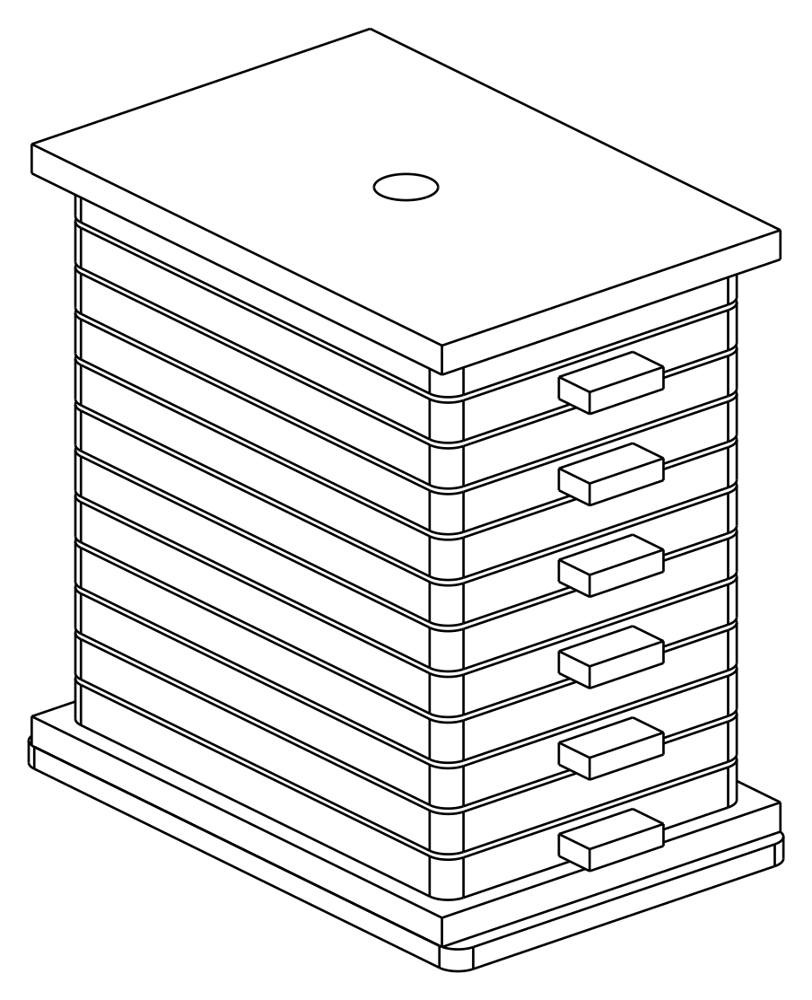
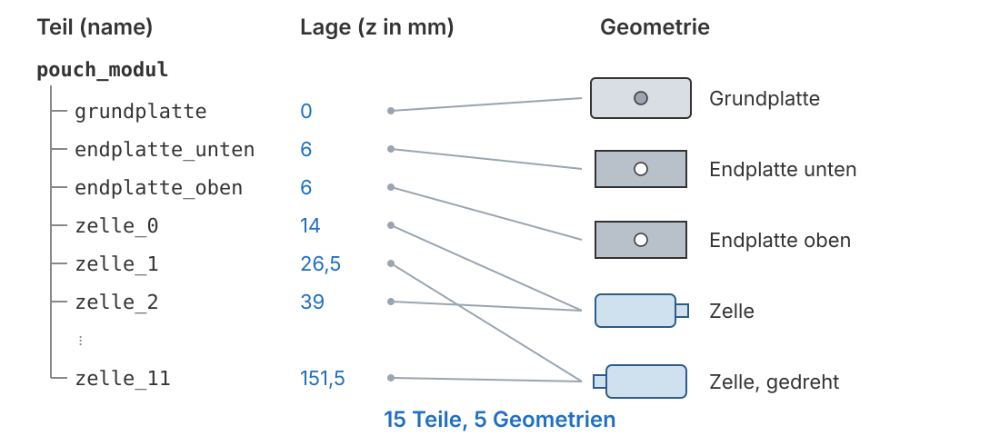
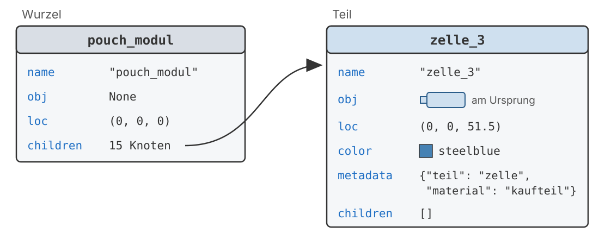
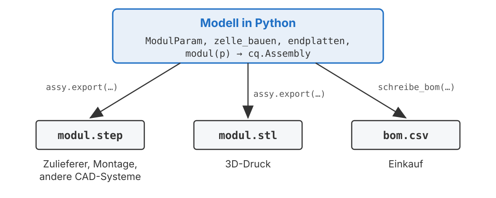

# Programmierung von CAx-Systemen

David Straub

### Gliederung

<style scoped>ol { columns: 2; }</style>

1. Einführung
2. Topologie
3. Grundformen
4. Kurven
5. Freiformgeometrie
6. Profile
7. Codequalität
8. Robustheit
9. **Baugruppen**
10. Fertigung
11. Simulation
12. Optimierung

## Baugruppen

- **Baugruppe** (*assembly*): Teile mit Lage, Namen und eigenen Angaben, als Baum (*tree*)
- **Datenaustausch** (*data exchange*): was in der STEP-Datei steht und was nur im Python-Modell
- **Stückliste** (*bill of materials*, BOM) und **Release**: alle Lieferdateien aus einer Quelle, abgesichert durch einen Test

*Durchgängiges Beispiel:* Ihr Modul aus Einheit 8 wird eine **Baugruppe** aus Grundplatte, zwei Endplatten und zwölf Zellen.

### Ausgangspunkt: der Modul-Code aus Einheit 8

```python
import cadquery as cq
from cadquery import func as cf

from w08.modul import ModulParam, endplatten, stapel_bauen, zelle_bauen

p = ModulParam()
```

Die Funktionen sind Ihr Stand aus Einheit 8, mit `pruefe`.

### Einstieg: Wer braucht welche Daten?



Ein naheliegender Export ist der Zellstapel als ein Körper:

```python
stapel_bauen(p).exportStep("stapel.step")
```

| Empfänger | braucht |
|---|---|
| Zulieferer, fräst die Endplatten | |
| Einkauf, bestellt Zellen und Material | |
| Montage, baut das Modul zusammen | |

**Was braucht jeder Empfänger? Was davon steht in `stapel.step`?**

## Theorie A: Baugruppe und STEP

### Eine Baugruppe ist ein Baum



- **Teil** (*part*): eine Geometrie an einer Lage (*location*), mit Namen
- **Instanz** (*instance*): dieselbe Geometrie an mehreren Lagen

**Wie bauen Sie diese Baugruppe in Ihrem CAD-System auf? Was müssen Sie tun, wenn sich die Zelldicke ändert?**

### Ein Knoten im Baum: `cq.Assembly`



Jeder Knoten (*node*) ist ein `cq.Assembly`.

- **Wurzel** (*root*): keine Geometrie (`obj` ist `None`), die 15 Teile als Kinder (*children*)
- **Teil:** Geometrie in `obj`, keine Kinder (`children` ist leer)

### Ein Teil anhängen: `add`

```python
assy = cq.Assembly(name="pouch_modul")          # Wurzel, noch ohne Kinder
zelle = zelle_bauen(p)
assy.add(zelle, name="zelle_0",
         loc=cf.Location((0, 0, 14)),
         color=cq.Color("steelblue"),
         metadata={"teil": "zelle", "material": "kaufteil"})
```

| Argument | Bedeutung |
|---|---|
| `zelle` | die Geometrie, sie bleibt am Ursprung |
| `name` | eindeutig in der Baugruppe, sonst `ValueError` |
| `loc` | Lage: `cf.Location((x, y, z))` verschiebt um x, y, z in mm |
| `color` | Farbe aus einem Namen, z. B. `"gray"`, `"steelblue"` |
| `metadata` | eigene Angaben als **`dict`**: Paare aus Schlüssel und Wert |

### Auf Teile zugreifen

```python
teil = assy.objects["zelle_0"]          # Knoten über seinen Namen
print(teil.loc.toTuple())              # ((0.0, 0.0, 14.0), (0.0, -0.0, 0.0))
print(teil.metadata["teil"])           # zelle
print(len(assy.children))              # 1
```

- `assy.objects`: alle Knoten im Baum als `dict`, Schlüssel ist der Name. Die Wurzel gehört dazu.
- `assy.children`: Liste der Knoten direkt darunter
- `loc.toTuple()`: Verschiebung in x, y, z und Drehwinkel um x, y, z in Grad
- Geometrie an ihrem Platz: `teil.obj.moved(teil.loc)`. Weil `obj` auch `None` sein kann, vorher verengen mit `assert isinstance(teil.obj, cf.Shape)` (Einheit 7).

### Zwölf Zellen, eine Schleife

```python
GRUNDPLATTE_T = 6.0                                 # mm, steht oben in der Datei

assy = cq.Assembly(name="pouch_modul")
gedreht = zelle.moved(rz=180)                       # um z gedreht, Flip aus Einheit 4
pitch = p.zell_t + p.spacer
for i in range(p.n_zellen):
    z = GRUNDPLATTE_T + p.platten_t + i * pitch     # 6 + 8 + i · 12,5
    teil = zelle
    if i % 2 == 1:                                  # ungerades i: jede zweite Zelle
        teil = gedreht
    assy.add(teil, name=f"zelle_{i}", loc=cf.Location((0, 0, z)),
             color=cq.Color("steelblue"),
             metadata={"teil": "zelle", "material": "kaufteil"})
```

- `f"zelle_{i}"` ist ein **f-String**: Er setzt `i` in den Text ein, also `zelle_0`, `zelle_1`, …
- `zelle` und `gedreht` sind zwei Geometrien. Die Schleife hängt sie zwölfmal an.

### Wohin die Information geht



Das Modell in Python ist die Quelle, jede Datei wird daraus erzeugt. `modul(p)` bauen Sie in Aufgabe 1, `schreibe_bom` in Aufgabe 3.

### Dateiformate

| Format | enthält | wer liest es |
|---|---|---|
| **STEP** | exakte Geometrie (B-Rep) | jedes CAD-System, genormt als ISO 10303 |
| **STL** | Dreiecke auf der Oberfläche, ein Netz (Einheit 2) | Software für den 3D-Druck, Viewer |
| **BREP** | exakte Geometrie eines einzelnen Shapes, im eigenen Format des Kernels ohne Umwandlung | nur Programme mit OCCT, z. B. CadQuery, FreeCAD |

```python
assy.export("zellen.step")                    # das Format folgt aus der Endung
assy.export("zellen.stl")
zurueck = cq.Assembly.load("zellen.step")     # STEP wieder als Baugruppe einlesen
```

Eine Baugruppe lässt sich nicht als BREP speichern, ein einzelnes Shape schon: `shape.exportBrep("teil.brep")`.

### Welches Format?

1. Ein Zulieferer fräst die Endplatte.
2. Sie lassen die Grundplatte als Prototyp drucken.
3. Die Berechnungsabteilung prüft die Endplatte mit einem FEM-Programm.
4. Ein Zwischenergebnis braucht eine Minute zum Bauen. Sie wollen es morgen weiterverwenden.

**Ordnen Sie jedem Fall ein Format zu und begründen Sie.**

### Vorhersage: Was steht in der STEP-Datei?

Sie exportieren Ihre Baugruppe als STEP und laden sie mit `cq.Assembly.load` wieder ein.

| Angabe | bleibt erhalten? |
|---|---|
| Namen der Teile | |
| Lage | |
| Farbe | |
| Geometrie | |
| `metadata` | |

**Notieren Sie Ihre Vorhersage.** In Aufgabe 2 prüfen Sie sie.

## Praktikum A: das Modul als Baugruppe

### Aufgabe 1: Das Modul als Baugruppe

Legen Sie `w09/baugruppe.py` an:

1. `grundplatte()` mit Ihrer Grundplatte aus Einheit 3, Unterseite bei z = 0.
2. `modul(p)` mit Grundplatte, unterer und oberer Endplatte und zwölf Zellen. Jedes Teil hat einen Namen, eine Farbe und `metadata`:

| Teil | `"teil"` | `"material"` |
|---|---|---|
| Grundplatte | `"grundplatte"` | `"alu"` |
| Endplatten | `"endplatte"` | `"stahl"` |
| Zellen | `"zelle"` | `"kaufteil"` |

### Aufgabe 1: Anzeigen und prüfen

3. Zeigen Sie die Baugruppe unter `if __name__ == "__main__":` an.

*Prüfen:* `len(assy.children)` ist 15. Im Viewer zeigt der Reiter *Tree* alle Teile mit Namen. *Explode* zieht die Baugruppe auseinander.

*Hinweise:* `unten, oben = endplatten(p).Solids()` verteilt die beiden Platten auf zwei Namen. Starten Sie mit `uv run python -m w09.baugruppe` (Einheit 8).

### Aufgabe 2: Der STEP-Rundlauf (*round trip*)

1. Exportieren Sie die Baugruppe nach `w09/pouch_modul.step`.
2. Laden Sie die Datei mit `cq.Assembly.load`. Geben Sie für die ersten drei Teile Name, Lage, Farbe, Volumen und `metadata` aus.
3. Vergleichen Sie mit Ihrer Vorhersage.
4. *Optional:* Öffnen Sie die Datei in FreeCAD (freecad.org). Was erscheint dort?

*Hinweise:* `for kind in zurueck.children[:3]:` läuft über die ersten drei Kinder. `kind.color.toTuple()` liefert Rot, Grün, Blau und Deckkraft, je zwischen 0 und 1. Vor `kind.obj.Volume()` verengen Sie wie auf der Folie „Auf Teile zugreifen“.

## Theorie B: Stückliste und Release

### Was die STEP-Datei enthält

| in der STEP-Datei (ISO 10303, für jedes CAD-System) | nur im Python-Modell, geht beim Export verloren |
|---|---|
| Geometrie als B-Rep | `metadata` |
| Baum mit Namen | Parameter (`ModulParam`) |
| Lagen | Funktionen, die die Teile bauen |
| Farben | |
| jede Geometrie einmal: 15 Teile, 5 Körper | |

Wer nur die STEP-Datei hat, kann das Modul nicht mehr über Parameter ändern.

### Die Stückliste aus dem Modell

```python
from collections import Counter

anzahl: Counter[str] = Counter()
for teil in assy.objects.values():
    if teil.obj is not None:                 # die Wurzel hat keine Geometrie
        anzahl[teil.metadata["teil"]] += 1

print(anzahl)    # Counter({'zelle': 12})
```

- `assy.objects.values()`: alle Knoten im Baum, ohne ihre Namen
- `Counter` zählt. `anzahl["zelle"] += 1` beginnt bei 0. `Counter[str]` sagt mypy, dass Texte gezählt werden.
- Mit Ihrer Baugruppe aus Aufgabe 1 kommen Grundplatte und Endplatten dazu.

**In vielen Firmen pflegt jemand die Stückliste in Excel, neben dem CAD-Modell. Was kann dabei schiefgehen?**

### Release: alle Lieferdateien aus einem Aufruf

```python
from pathlib import Path

def release(p: ModulParam, ordner: str) -> None:
    Path(ordner).mkdir(parents=True, exist_ok=True)
    assy = modul(p)                              # Aufgabe 1
    assy.export(f"{ordner}/modul.step")          # Zulieferer, Montage
    assy.export(f"{ordner}/modul.stl")           # 3D-Druck
    schreibe_bom(assy, f"{ordner}/bom.csv")      # Einkauf, Aufgabe 3
```

- `Path(ordner).mkdir(...)` legt den Ordner an. `parents=True` legt fehlende Ordner darüber mit an. `exist_ok=True` meldet keinen Fehler, wenn es den Ordner schon gibt.
- Die drei Pfeile aus „Wohin die Information geht“ stehen hier in einer Funktion.
- Alle drei Dateien entstehen aus demselben Parametersatz `p`.

## Praktikum B: Stückliste und Release

### Aufgabe 3: Die Stückliste

Schreiben Sie in `w09/release.py` eine Funktion `schreibe_bom(assy, pfad)`. Sie schreibt eine CSV-Datei mit einer Zeile je Teil: `teil`, `anzahl`, `material`.

```python
import csv

with open("probe.csv", "w", newline="") as datei:
    tabelle = csv.writer(datei)
    tabelle.writerow(["teil", "anzahl", "material"])
    tabelle.writerow(["zelle", 12, "kaufteil"])
```

- `with open(...)` öffnet die Datei zum Schreiben (`"w"`) und schließt sie am Blockende. `newline=""` verhindert leere Zeilen unter Windows.
- `writerow` schreibt eine Zeile aus einer Liste.

### Aufgabe 3: Prüfen und Hinweise

*Prüfen:* drei Zeilen, `grundplatte` 1, `endplatte` 2, `zelle` 12.

*Hinweise:*

- `for name in anzahl:` läuft über die gezählten Teile, `anzahl[name]` ist ihre Anzahl.
- Gleiche Teile haben dasselbe Material, ein `dict` von Teil zu Material genügt.
- `from w09.baugruppe import modul` holt Ihre Baugruppe. Start mit `uv run python -m w09.release`.

### Aufgabe 4: Release

1. Schreiben Sie `release(p, ordner)`.
2. Erzeugen Sie Releases für `n_zellen=12` und `n_zellen=16` in getrennten Ordnern. Was unterscheidet die beiden Stücklisten?
3. *(Zusatz)* Erzeugen Sie dasselbe Release zweimal in zwei Ordnern. Sagen Sie vorher, welche Dateien identisch sind. Vergleichen Sie dann in VS Code: zwei Dateien markieren, Rechtsklick → *Ausgewählte vergleichen* (*Compare Selected*).

**Warum gehören die erzeugten Dateien nicht ins Repo?**

### Aufgabe 5: Ein anderer Zapfen

1. Erzeugen Sie Releases für `zapfen_d=12.0` und für `zapfen_d=None`. Läuft beides durch?
2. Welche Teile lesen `zapfen_d`, welche nicht? Suchen Sie in `w08/modul.py` und `w09/baugruppe.py`.
3. Schreiben Sie in `tests/test_w09.py` einen Test: Grundplatte und untere Endplatte durchdringen sich nicht, für `zapfen_d` gleich 16, 12 und `None`.
4. Beheben Sie die Ursache, bis der Test für alle drei Werte grün ist.

*Hinweise:* `assy.objects["grundplatte"]` liefert den Knoten, `teil.obj.moved(teil.loc)` seine Geometrie an ihrem Platz. Zwei Teile durchdringen sich (*interference*), wenn `(a * b).Volume()` größer als 0 ist (Einheit 7).

### Was hat der Test gefunden?

**Wo steckte die Ursache?**

**Warum hat `pruefe` aus Einheit 8 den Fehler nicht gemeldet?**

**Welche Regel aus Einheit 7 hätte ihn verhindert?**

### Aufgabe 6 *(Zusatz)*: Lage über einen Constraint

In einem klassischen CAD-System legen Verknüpfungen (*constraints*) zwischen Flächen die Lage fest. Eine `cq.Assembly` kann das auch:

```python
unten, oben = endplatten(p).Solids()
paar = cq.Assembly(name="paar")
paar.add(unten, name="platte")
paar.add(zelle, name="zelle", loc=cf.Location((0, 0, 50)))     # Startwert
paar.constrain("platte", unten.faces(">Z"), "zelle", zelle.faces("<Z"), "Plane")
paar.solve()
```

- `constrain(teil_1, fläche_1, teil_2, fläche_2, "Plane")`: Die Mittelpunkte der beiden Flächen fallen zusammen, ihre Normalen zeigen gegeneinander.
- `solve()` berechnet die Lage aller Teile. Das erste Teil bleibt, wo es ist.

### Aufgabe 6 *(Zusatz)*: Fragen zum Constraint

1. Welche Lage hat die Zelle nach `solve()`? Lesen Sie `paar.objects["zelle"].loc.toTuple()` aus.
2. Ersetzen Sie die Endplatte durch Ihre Grundplatte. Wo landet die Zelle, und warum?

### Aufgabe 7 *(Zusatz)*: Ein Pack aus zwei Modulen

Eine Baugruppe kann selbst ein Knoten in einer Baugruppe sein:

```python
pack = cq.Assembly(name="pack")
pack.add(assy, name="modul_0")
pack.add(assy, name="modul_1", loc=cf.Location((0, 130, 0)))
```

1. Bauen Sie `pack(p)` aus zwei Modulen mit Ihrer Funktion `modul(p)`.
2. Schreiben Sie die Stückliste des Packs mit Ihrer `schreibe_bom`. Müssen Sie dafür etwas ändern?

## Abschluss

### Wer bekommt was?

| Empfänger | Datei | erzeugt von |
|---|---|---|
| Zulieferer, fräst die Endplatten | | |
| Einkauf, bestellt Zellen und Material | | |
| Montage, baut das Modul zusammen | | |

**Ergänzen Sie die Tabelle vom Anfang der Einheit.**

### Leseauftrag & Ausblick

- **Leseauftrag:** Buch Kapitel 9
- **Vertiefung:** die Masse des Moduls in der Stückliste: Volumen mal Dichte für Grundplatte (Alu, 2,7 g/cm³) und Endplatten (Stahl, 7,85 g/cm³), 0,86 kg je Zelle laut Datenblatt
- **Nächste Woche:** Fertigung: vom Modell zum gedruckten und gefrästen Teil
- Bis dahin: `w09/` und `tests/test_w09.py` committet und gepusht, Pipeline grün
