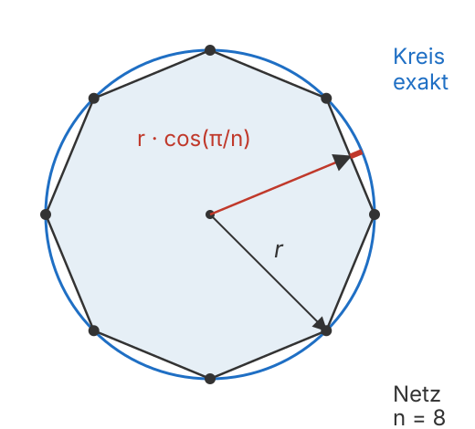
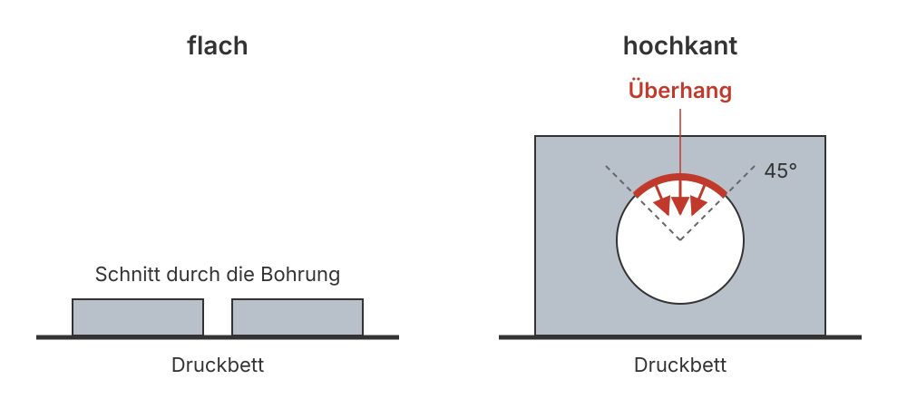

# Programmierung von CAx-Systemen

David Straub

### Gliederung

<style scoped>ol { columns: 2; }</style>

1. Einführung
2. Topologie
3. Grundformen
4. Kurven
5. Freiformgeometrie
6. Profile
7. Codequalität
8. Robustheit
9. Baugruppen
10. **Fertigung**
11. Simulation
12. Optimierung

## Fertigung

- **Netz** (*mesh*): wie aus exakter Geometrie Dreiecke werden und was dabei verloren geht
- **Spiel** (*clearance*): ein Parameter, den die Fertigung bestimmt
- **Fertigungsregeln** (*design for manufacturing*, DfM): als Prüffunktion über das Modell
- **Übergabe** (*handover*): welche Datei an welches Verfahren geht und was nicht darin steht

*Durchgängiges Beispiel:* die Endplatte aus Einheit 8 und die Grundplatte aus Einheit 9.

### Ausgangspunkt: der Modul-Code aus Einheit 8

```python
import math

import cadquery as cq
from cadquery import func as cf

from w08.modul import ModulParam, endplatten

p = ModulParam()
unten, oben = endplatten(p).Solids()
```

`unten` ist die untere Endplatte: 160 × 110 × 8 mm, Bohrung Ø 16 für den Zapfen der Grundplatte.

### Einstieg: Die Fertigung fragt zurück

Ihr Release aus Einheit 9 enthält `modul.step`, `modul.stl` und `bom.csv`.

| Empfänger | Rückfrage |
|---|---|
| 3D-Druck-Labor | „Der Zapfen der Grundplatte soll in die Bohrung der Endplatte. Passt das?“ |
| Laserwerkstatt | „Wir schneiden die Endplatten aus 8-mm-Blech. Bitte die Kontur als DXF.“ |
| Fräserei | „Welche Toleranz hat die Bohrung Ø 16?“ |

**Welche Rückfrage beantwortet Ihr Release?**

## Theorie A: Vom Solid zum Netz

### Ein Netz aus Dreiecken

- Das Modell ist ein **B-Rep**: Jede Fläche ist exakt, eine Bohrung ist ein echter Zylinder.
- Bildschirm, Slicer und FEM-Programm (Einheit 11) brauchen ein **Netz** (*mesh*) aus einfachen Stücken, für die Oberfläche aus Dreiecken.
- **Tessellierung** (*tessellation*): exakte Geometrie in Dreiecke zerlegen. Ein ebenes Dreieck berührt eine gekrümmte Fläche nur, es fällt nie mit ihr zusammen.
- **STL** ist eine Liste von Dreiecken, je drei Punkte und eine Normale. Keine Einheiten, keine Namen, kein Baum.

### Vorhersage: die Bohrung im Netz

Sie exportieren die Endplatte als STL. Die Bohrung hat im Modell Ø 16.

**Ist die Bohrung im Netz größer, kleiner oder gleich groß?**

### Der Kreis wird ein Vieleck



- Die Punkte des Netzes liegen auf dem Kreis, die Sehnen (*chords*) dazwischen innen.
- Kleinster Durchmesser im Netz bei n Punkten auf dem Kreis:

$$d_\text{min} = d \cdot \cos\frac{\pi}{n}$$

- Das gilt für die Bohrung und für den Zapfen: Beide werden im Netz kleiner.

### Das Netz im Code: `tessellate`

```python
punkte, ecken = unten.tessellate(0.1, 0.5)   # tolerance, angularTolerance
print(len(punkte), len(ecken))               # 130 120
print(punkte[0].x, punkte[0].y, punkte[0].z)
```

- `punkte`: Liste von `cq.Vector` mit `x`, `y`, `z`
- `ecken`: ein Tupel je Dreieck mit drei Nummern aus `punkte`

| Argument | Bedeutung |
|---|---|
| `tolerance` | größter Abstand zwischen Dreieck und Fläche, relativ zur Größe der Kante |
| `angularTolerance` | größter Winkel zwischen benachbarten Dreiecken, in rad |

Beide Grenzen gelten, die strengere bestimmt das Netz.

### Das Netz als Datei

```python
unten.exportStl("endplatte.stl", tolerance=0.01, angularTolerance=0.1,
                relative=False)                 # tolerance absolut in mm
cq.exporters.export(unten, "endplatte.3mf")     # 3MF: Netz mit Einheiten
```

- **STL** kennt keine Einheit. Millimeter sind nur eine Verabredung mit dem Slicer.
- **3MF** speichert Einheiten und mehrere Objekte. CadQuery exportiert 3MF für ein einzelnes Shape, eine Baugruppe nicht.
- Ein gültiges Solid ergibt ein geschlossenes, **wasserdichtes** (*watertight*) Netz. `isValid()` prüft die Topologie, ob die Form physikalisch Sinn ergibt, prüft es nicht.
- Ein Shape merkt sich sein Netz und vernetzt nur feiner neu, nie gröber. Zum Vergleichen jedes Mal frisch bauen.

### Spiel als Parameter

- Zapfen Ø 16 in Bohrung Ø 16: Die Teile durchdringen sich nicht, Schnittmenge 0 mm³. Montieren lässt sich das trotzdem nicht.
- **Spiel** (*clearance*): Die Bohrung ist um `spiel` größer als der Zapfen.
- Ein FDM-Drucker druckt Bohrungen meist etwas zu klein und Außenmaße etwas zu groß. Wie viel, hängt vom Drucker ab.
- Den passenden Wert findet man mit einem **Probekörper** (*test coupon*): mehrere Bohrungen mit verschiedenem Spiel, einmal drucken, ausprobieren.

## Praktikum A: Netz und Spiel

### Aufgabe 1: Das Netz messen

Legen Sie `w10/netz.py` an.

1. Vernetzen Sie die untere Endplatte mit `tolerance=0.1` und `angularTolerance` 0.5, 0.2 und 0.1. Bauen Sie die Platte dafür jedes Mal neu.
2. Geben Sie jeweils die Anzahl der Dreiecke aus.
3. Zählen Sie die Punkte auf der oberen Kante der Bohrung und berechnen Sie den kleinsten Durchmesser im Netz.
4. Vergleichen Sie mit Ihrer Vorhersage.

*Hinweise:* Ein Punkt liegt auf der Kante, wenn `abs(math.hypot(pt.x, pt.y) - 8) < 1e-6` und `abs(pt.z - 8) < 1e-6`. Benachbarte Flächen liefern dieselben Punkte doppelt. Ein `set` zählt jeden Punkt einmal: `kante.add((round(pt.x, 6), round(pt.y, 6)))`.

### Aufgabe 2: Spiel als Parameter

1. Ergänzen Sie `ModulParam` in `w08/modul.py` um `spiel: float = 0.2`. Die Bohrung der Endplatten bekommt den Durchmesser `zapfen_d + spiel`.
2. `pruefe` lehnt ein negatives Spiel ab.
3. Schreiben Sie in `tests/test_w10.py` einen Test: Mit `angularTolerance=0.5` ist die Bohrung im Netz noch größer als `zapfen_d`.
4. Läuft der Test auch mit `spiel=0.1`? Welche `angularTolerance` brauchen Sie dann?

*Prüfen:* Die Tests aus Einheit 8 und 9 laufen weiter.

*Hinweis:* Machen Sie aus der Zählung von Aufgabe 1 eine Funktion mit Durchmesser und Höhe der Kante als Argumente.

### Aufgabe 3: Ein Probekörper

Schreiben Sie in `w10/probe.py` eine Funktion `probekoerper(zapfen_d, spiele)`:

- eine Platte, 4 mm dick, mit einer Bohrung `zapfen_d + s` für jedes Spiel `s` aus der Liste `spiele`
- dazu ein einzelner Zapfen `zapfen_d` auf einer kleinen Scheibe

Exportieren Sie beides als STL. Wählen Sie die Toleranz so, dass das Netz das kleinste Spiel nicht auffrisst, und begründen Sie die Wahl in einem Kommentar.

*Prüfen:* Mit `spiele=[0.0, 0.1, 0.2, 0.3]` hat die Platte vier Zylinderflächen: `len(platte.faces("%CYLINDER").Faces())`.

Wer Zugang zu einem Drucker hat, kann den Probekörper drucken.

## Theorie B: Fertigungsregeln und Übergabe

### Fertigungsregeln

Jedes Verfahren kann manche Formen nicht oder nur mit Aufwand herstellen. Die Grenzwerte gibt die Fertigung vor.

| Verfahren | Regel, Beispielwert | prüfbar an |
|---|---|---|
| 3D-Druck (FDM) | Überhang (*overhang*) höchstens 45° ohne Stützstruktur (*support*) | Normalen der Dreiecke |
| Laserschneiden | Loch-Ø mindestens so groß wie die Blechdicke | Kreiskanten der Kontur |
| Fräsen | Innenradius mindestens so groß wie der Fräserradius | Kanten der Rundungen |

Fertigungsgerecht konstruieren (*design for manufacturing*, DfM) heißt, diese Regeln schon im Modell einzuhalten.

### Überhang

Ein FDM-Drucker legt Schicht auf Schicht. Jede Schicht braucht Material darunter. Eine Fläche, die flacher als 45° nach unten zeigt, hängt über.

**Die Endplatte soll gedruckt werden. Welche Flächen hängen über, wenn sie flach auf dem Druckbett liegt? Welche, wenn sie hochkant steht?**

### Überhang: flach und hochkant



- Die **Normale** (*normal*) eines Dreiecks zeigt aus dem Körper heraus. Überhang: $n_z < -\cos 45° \approx -0{,}71$
- Dreiecke, die auf dem Druckbett liegen, zählen nicht.

### Die Dreiecke als Daten

```python
def dreiecke(shape: cf.Shape) -> list[tuple[cq.Vector, float, float]]:
    """Je Dreieck: Normale mit Länge 1, Fläche in mm², Höhe des Mittelpunkts."""
    punkte, ecken = shape.tessellate(0.01, 0.1)
    liste = []
    for a, b, c in ecken:
        A, B, C = punkte[a], punkte[b], punkte[c]
        kreuz = (B - A).cross(C - A)
        if kreuz.Length > 0:                         # entartete Dreiecke weglassen
            liste.append((kreuz.normalized(), kreuz.Length / 2, (A.z + B.z + C.z) / 3))
    return liste

print(len(dreiecke(unten)))
```

- `(B - A).cross(C - A)`: das **Kreuzprodukt** (*cross product*) zweier Kanten. Es steht senkrecht auf dem Dreieck, seine Länge ist die doppelte Fläche.
- `normalized()`: gleiche Richtung, Länge 1. Die Reihenfolge der Punkte sorgt dafür, dass die Normale nach außen zeigt.

### Eine Regel als Funktion

```python
def zu_kleine_loecher(platte: cf.Shape, blech_t: float) -> list[float]:
    """Laser: Durchmesser aller Löcher, die kleiner als die Blechdicke sind."""
    zu_klein = []
    for kante in platte.edges("%CIRCLE").Edges():
        d = 2 * kante.radius()
        if d < blech_t:
            zu_klein.append(d)
    return zu_klein

print(zu_kleine_loecher(unten, p.platten_t))     # []
```

- Das Muster kennen Sie von `pruefe` aus Einheit 8: über Teile des Modells laufen, mit dem Grenzwert vergleichen, Verstöße sammeln.
- Eine leere Liste heißt: Die Regel ist erfüllt.
- `edges("%CIRCLE")` wählt alle Kreiskanten, `.Edges()` macht daraus eine Liste.

### Übergabe an die Fertigung

| Verfahren | Empfänger | Datei | steht nicht in der Datei |
|---|---|---|---|
| 3D-Druck | Slicer im Labor | STL oder 3MF | Orientierung, Material, Füllung |
| Laserschneiden | Werkstatt mit CAM-Software | DXF, 2D-Kontur | Blechdicke, Material, Stückzahl |
| Fräsen | CAM-Programmierung | STEP | Toleranzen, Passungen, Nullpunkt |

- Werkzeugbahnen (*toolpaths*) und Maschinenbefehle erzeugen Slicer und CAM-System, nicht das CAD-Modell.
- Was nicht in der Datei steht, geht als Text oder Zeichnung mit.

### Wer gleicht aus?

Der Laserstrahl schneidet einen Spalt von etwa 0,2 mm Breite (*kerf*). Der Slicer kann Bohrungen beim Drucken automatisch aufweiten.

**Wer gleicht das aus: Sie im Modell oder die Fertigung? Was passiert, wenn beide es tun?**

### Ableitungen für die Übergabe

```python
kontur = unten.faces("<Z")                       # Unterseite: Kontur mit Bohrung
cq.exporters.export(kontur, "endplatte.dxf")     # 2D für den Laser
unten.exportStep("endplatte.step")               # exakt, für die CAM-Programmierung
unten.exportStl("endplatte.stl", tolerance=0.01, angularTolerance=0.1,
                relative=False)                  # Netz für den Slicer
```

- `faces("<Z")` wählt die unterste Fläche. Die Endplatte ist überall gleich dick, ihre Unterseite ist die ganze Kontur.
- **DXF** ist das übliche Format für 2D-Konturen. Es enthält Linien und Kreisbögen, exakt.

### Ausblick: CAM

Ein CAM-System macht aus der Geometrie Maschinenbefehle, meist **G-Code**:

```text
G0 X0 Y0 Z5        ; Eilgang über den Startpunkt
G1 Z-2 F300        ; mit Vorschub 300 mm/min eintauchen
G1 X80 F600        ; geradeaus fräsen
```

- **Slicer** wie PrusaSlicer lassen sich über die Kommandozeile aufrufen.
- **ocp-freecad-cam** erzeugt Werkzeugbahnen für CadQuery-Shapes mit der CAM-Werkbank von FreeCAD. Die Bibliothek ist noch experimentell.

## Praktikum B: Regeln und Übergabe

### Aufgabe 4: Überhang prüfen

Schreiben Sie in `w10/regeln.py` eine Funktion `ueberhang(shape, grenzwinkel=45.0)`. Sie gibt die Fläche der überhängenden Dreiecke in mm² zurück.

1. Nutzen Sie `dreiecke` von der Folie.
2. Dreiecke auf dem Druckbett zählen nicht: Ihr Mittelpunkt liegt auf der Höhe des tiefsten Dreiecks.
3. Prüfen Sie die Endplatte flach und hochkant: `unten.moved(rx=90)`.
4. Wie ändert sich die Fläche mit `grenzwinkel=60`?

*Prüfen:* flach 0 mm². Hochkant ist es genau der obere Teil der Bohrungswand.

*Hinweise:* `math.cos(math.radians(45))`. Den tiefsten Mittelpunkt finden Sie mit einer Schleife wie in Aufgabe 1.

### Aufgabe 5: Das Übergabepaket

Schreiben Sie in `w10/uebergabe.py` eine Funktion `uebergabe(p, ordner)`. Sie legt drei Unterordner an:

| Ordner | Inhalt |
|---|---|
| `druck/` | untere Endplatte als STL, mit der Toleranz aus Aufgabe 3 |
| `laser/` | Kontur der Endplatte als DXF |
| `fraesen/` | Grundplatte als STEP |

In jeden Ordner kommt eine Datei `hinweise.txt` mit dem, was nicht in der Datei steht: Material, Dicke, Stückzahl, Spiel.

### Aufgabe 5: Prüfen und Hinweise

*Prüfen:* Ein Test in `tests/test_w10.py` erzeugt das Paket in `tmp_path` und prüft, dass alle Dateien existieren: `(tmp_path / "laser" / "endplatte.dxf").exists()`.

*Hinweise:*

- `tmp_path` ist ein Argument, das pytest jedem Test als frischen, leeren Ordner übergibt.
- Eine Textdatei schreiben Sie wie die CSV-Datei aus Einheit 9: `with open(pfad, "w") as datei:` und `datei.write(f"Spiel: {p.spiel} mm\n")`.
- `from w09.baugruppe import grundplatte` holt Ihre Grundplatte.
- Prüfen Sie vor dem Export mit `ueberhang` und `zu_kleine_loecher`. Ein Verstoß bricht mit `ValueError` ab.

### Aufgabe 6 *(Zusatz)*: Innenradien beim Fräsen

1. Fräsen Sie in Ihre Grundplatte eine Tasche 60 × 20 × 3 mm. Runden Sie die senkrechten Kanten des Werkzeugs vorher mit `cf.fillet` auf 2 mm.
2. Schreiben Sie `zu_kleine_radien(teil, fraeser_d)`. Sie meldet alle Kreiskanten mit einem Radius kleiner als `fraeser_d / 2`.
3. Für einen Fräser Ø 6: Welche Kanten meldet die Funktion? Welche davon sind ein echtes Problem?
4. Bauen Sie die Tasche ohne Rundung. Was meldet Ihre Funktion jetzt, und warum?

### Aufgabe 7 *(Zusatz)*: Der Slicer als Programm

Falls PrusaSlicer auf Ihrem Rechner installiert ist:

1. Rufen Sie den Slicer aus Python mit `subprocess.run` auf: `prusa-slicer --export-gcode endplatte.stl --output endplatte.gcode`.
2. Lesen Sie Druckzeit und Filamentmenge aus den Kommentaren am Ende der G-Code-Datei.
3. Wie ändert sich die Druckzeit zwischen flach und hochkant?

## Abschluss

### Die Rückfragen vom Anfang

| Rückfrage | Antwort jetzt |
|---|---|
| „Passt der Zapfen in die Bohrung?“ | |
| „Bitte die Kontur als DXF.“ | |
| „Welche Toleranz hat die Bohrung Ø 16?“ | |

**Was können Sie jetzt beantworten, und mit welcher Funktion? Was bleibt offen?**

### Leseauftrag & Ausblick

- **Leseauftrag:** Buch Kapitel 10
- **Vertiefung:** Drucken Sie Ihren Probekörper und tragen Sie das Spiel, das passt, als Standardwert in `ModulParam` ein.
- **Nächste Woche:** Simulation: das zweite Netz, diesmal im Inneren des Körpers
- Bis dahin: `w10/` und `tests/test_w10.py` committet und gepusht, Pipeline grün
