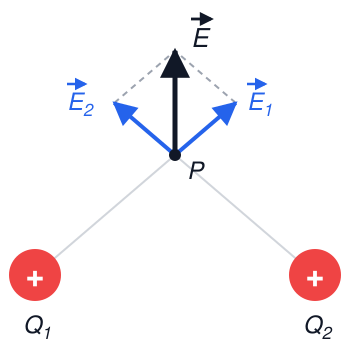
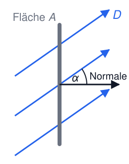
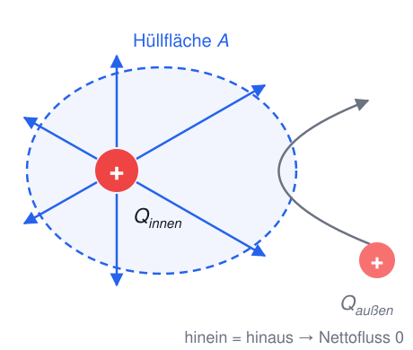
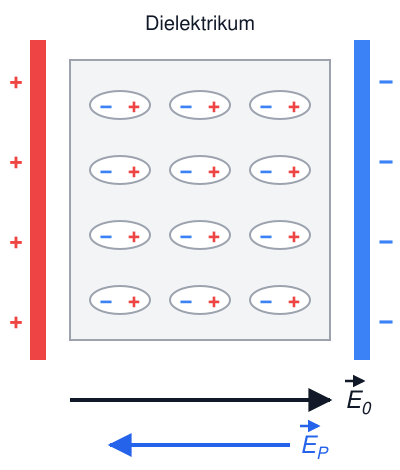
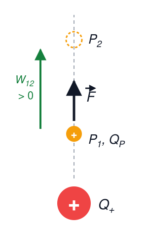
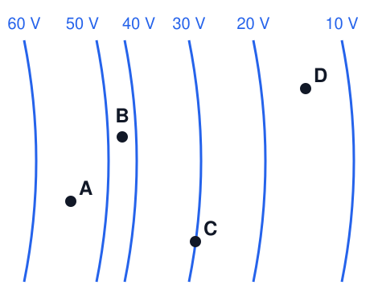

# Elektrotechnik – 2. Das elektrische Feld II

**Luft- und Raumfahrttechnik Bachelor, 1. Semester**

David Straub

## 2. Das elektrische Feld

1. Elektrische Ladung
2. Coulomb’sches Gesetz
3. Elektrische Feldstärke
4. Feldlinien und Satz von Gauß
5. Elektrisches Feld in Materie
6. Potential, Spannung, Arbeit
7. Homogenes Feld und Kondensatoren

### 🗳️ Elektron und Proton im selben Feld

Ein Elektron und ein Proton befinden sich nacheinander am selben Ort in einem elektrischen Feld $\vec{E}$.

Was gilt für die Kräfte auf die beiden Teilchen?

A) Gleicher Betrag, gleiche Richtung

B) Gleicher Betrag, entgegengesetzte Richtung

C) Auf das Elektron wirkt die größere Kraft, weil es leichter ist

D) Auf das Proton wirkt die größere Kraft, weil es schwerer ist

### Feldlinien

- Feldlinien stellen Richtung und Stärke des elektrischen Feldes bildlich dar
- Sie verlaufen von positiven zu negativen Ladungen und zeigen die Richtung der Kraft an, die auf eine **positive** Probeladung wirken würde
- Je dichter die Linien, desto stärker das Feld

**Interaktiv:** [E-Feld-Editor](https://davidstraub.de/teaching-apps/efield-editor/) – Ladungen setzen, ziehen, Vorzeichen und Betrag ändern und die Feldlinien mitwandern sehen

### Feldlinien: Beispiele

 

### Feldlinien: Plattenkondensator

Zwischen zwei entgegengesetzt geladenen Platten: **homogenes Feld** (dazu gleich mehr)

### Superpositionsprinzip

Das elektrische Feld mehrerer Ladungen ist die **Vektorsumme** der Felder der einzelnen Ladungen:

$$\vec{E}(\vec{r}) = \sum_{i} \vec{E}_i(\vec{r})$$

- Jede Ladung erzeugt ihr Feld unabhängig von den anderen – die Felder addieren sich
- Für kontinuierliche Ladungsverteilungen wird aus der Summe ein Integral (hier nicht vertieft)

### 📝 Aufgabe 3a: Feldlinien

**Zuerst auf Papier:** Skizzieren Sie das Feldlinienbild zweier gleichnamiger Punktladungen, von denen eine die **doppelte** Ladung trägt. Wo ist das Feld null – genau in der Mitte, näher an der großen oder näher an der kleinen Ladung?
**Erst danach** mit dem [E-Feld-Editor](https://davidstraub.de/teaching-apps/efield-editor/) überprüfen.

### Elektrische Flussdichte (*electric flux density*)

$$\vec{D} = \varepsilon_0 \cdot \vec{E}$$

$$[\vec{D}] = [\varepsilon_0] \cdot [\vec{E}] = \frac{\text{C}^2}{\text{N} \cdot \text{m}^2} \cdot \frac{\text{N}}{\text{C}} = \frac{\text{C}}{\text{m}^2}$$

Anschaulich: $D$ misst, wie dicht die Feldlinien liegen.

### Elektrischer Fluss (*electric flux*)

Wie viel Feld tritt durch eine Fläche $A$?

- $\vec{D}$ homogen und senkrecht zur Fläche: $\Psi = D \cdot A$
- $\vec{D}$ unter dem Winkel $\alpha$ zur Normale – nur der senkrechte Anteil zählt: $\Psi = D \cdot A \cdot \cos\alpha$
- $\vec{D}$ nicht homogen: Fläche in kleine Stücke $\Delta A_i$ zerlegen und aufsummieren

$$\Psi = \sum_i D_i \, \Delta A_i \cos\alpha_i \quad \xrightarrow{\Delta A \to 0} \quad \Psi = \int_A \vec{D} \cdot d\vec{A}$$

$d\vec{A}$: Flächenstück als Vektor in Richtung der Normale – das Skalarprodukt liefert den Faktor $\cos\alpha$.

### Satz von Gauß (*Gauss’s law*)

Der elektrische Fluss durch eine **geschlossene** Oberfläche ist gleich der eingeschlossenen Ladung:

$$\oint_{A} \vec{D} \cdot d\vec{A} = Q_{\text{innen}}$$

Anschaulich: Feldlinien beginnen und enden nur auf Ladungen – was an Fluss „herauskommt“, muss von Ladung im Inneren stammen.

Der Kreis am Integral heißt: über die **ganze** Hülle summieren.

### Beispiel: Punktladung mit dem Satz von Gauß

Bei **hoher Symmetrie** (Kugel, Zylinder, Ebene) ist $D$ auf der Hülle überall gleich groß und senkrecht – dann wird das Integral zum Produkt $D \cdot A_\text{Hülle}$.

Kugeloberfläche mit Radius $r$ um eine Punktladung $Q$ – $D$ ist überall auf der Kugel gleich groß und radial:

$$\oint_{A} \vec{D} \cdot d\vec{A} = D(r) \cdot 4\pi r^2 = Q$$

$$\Rightarrow \quad D(r) = \frac{Q}{4\pi r^2} \quad \Rightarrow \quad E(r) = \frac{Q}{4\pi \varepsilon_0 r^2}$$

Das Coulomb-Feld aus Woche 1 – jetzt ohne Coulomb’sches Gesetz hergeleitet!

### Elektrisches Feld in Materie

- In nicht oder schwach leitenden Materialien führen elektrische Felder zu **Polarisation**: die positiven und negativen Ladungen im Material verschieben sich gegeneinander
- Das erzeugt ein internes Gegenfeld, das das äußere Feld abschwächt
- Solche polarisierbaren Materialien nennt man **Dielektrika**

### Abschwächung des Feldes in Dielektrika

$$\vec{E}_\text{Materie} = \frac{1}{\varepsilon_r} \cdot \vec{E}_\text{Vakuum}$$

mit der Permittivitätszahl $\varepsilon_r \geq 1$ (auch relative Permittivität):

| Material     | $\varepsilon_r$ |
|--------------|------------------|
| Luft         | 1,00059          |
| Gummi        | 2,5–3,5          |
| Glas         | 5–7              |
| Destilliertes Wasser | 81       |

### Elektrische Flussdichte in Dielektrika

**Konvention:** $\vec{D}$ bezieht sich immer auf das Feld der *freien* Ladungen:

$$\vec{D} = \varepsilon_0 \varepsilon_r \vec{E}_\text{Materie} = \varepsilon \vec{E}_\text{Materie}, \qquad \varepsilon = \varepsilon_0 \varepsilon_r$$

Vorteil: der Satz von Gauß gilt unverändert, wenn man nur die freien Ladungen zählt:

$$\oint_{A} \vec{D} \cdot d\vec{A} = Q_{\text{innen, frei}}$$

### 📝 Aufgabe 3b: Dielektrikum

Die Punktladung $Q = 10 \, \text{nC}$ aus Aufgabe 2 befindet sich jetzt in destilliertem Wasser ($\varepsilon_r = 81$) statt im Vakuum. Wie groß sind $E$ und $D$ im Abstand $r_1 = 24 \, \text{cm}$? Was ändert sich gegenüber dem Vakuum, was bleibt gleich? Begründen Sie mit dem Satz von Gauß.

### Elektrische Arbeit im Feld

Bewegung einer positiven Probeladung $Q_P$ im Feld einer positiven Punktladung $Q^+$:

- $P_1 \rightarrow P_2$ (nach außen): $W > 0$ – Arbeit wird freigesetzt
- $P_2 \rightarrow P_1$ (nach innen): $W < 0$ – Arbeit muss aufgebracht werden

Vgl. Mechanik: $W = \vec{F} \cdot \vec{s}$ – aber hier ist $\vec{F}$ abhängig von $r$!

$$W_{12} = \sum_{i} F_i \cdot \Delta r \quad \xrightarrow{\Delta r \to 0} \quad W_{12} = \int_{r_1}^{r_2} F(r) \, dr$$

### Von der Arbeit zum Potential

$$W_{12} = Q_P \int_{r_1}^{r_2} E(r) \, dr = Q_P \cdot \left[ \frac{Q^+}{4 \pi \varepsilon} \cdot \frac{1}{r_1} - \frac{Q^+}{4 \pi \varepsilon} \cdot \frac{1}{r_2} \right] = Q_P \cdot (\varphi_1 - \varphi_2)$$

Die Arbeit hängt nur von **Anfangs- und Endpunkt** ab, und die Probeladung $Q_P$ steht als Faktor davor.

→ Der Rest ist eine Eigenschaft **des Feldes allein**: jedem Ort lässt sich eine Zahl $\varphi$ zuordnen.

### Elektrisches Potential und Äquipotentialflächen

Das **elektrische Potential** $\varphi$ im Abstand $r$ von einer Punktladung $Q$:

$$\varphi(r) = \frac{Q}{4 \pi \varepsilon_0 \varepsilon_r \cdot r}$$

Einheit: $[\varphi] = \frac{\text{J}}{\text{C}} = \text{V}$ (Volt)

Punkte gleichen Potentials bilden **Äquipotentialflächen**. Sie stehen immer **senkrecht** auf den Feldlinien – entlang einer solchen Fläche wird keine Arbeit verrichtet.

### Analogie: Gravitationspotential

$$E_\text{pot} = m \cdot g \cdot h = m \cdot \varphi_g(h)$$

- Höhenlinien auf der Landkarte = Äquipotentiallinien
- Die Kraft wirkt in Richtung des stärksten Gefälles (senkrecht zu den Höhenlinien)

### 🗳️ Wo ist das Feld am stärksten?

Die blauen Linien sind Äquipotentiallinien.

An welchem der Punkte A, B, C, D ist der Betrag der elektrischen Feldstärke am größten?

### Spannung & Arbeit

**Elektrische Spannung** (*voltage*) = Potentialdifferenz:

$$U_{12} = \varphi_1 - \varphi_2, \qquad [U] = \text{V}$$

**Elektrische Arbeit**:

$$W_{12} = Q \cdot (\varphi_1 - \varphi_2) = Q \cdot U_{12}, \qquad [W] = \text{J}$$

Die elektrische Arbeit ist **unabhängig vom Weg**!

Elektrostatische Felder sind **Potentialfelder**: Feldlinien beginnen/enden auf Ladungen („Quellen/Senken“) und sind nie in sich geschlossen.

### Feld und Spannung

Allgemeiner Zusammenhang zwischen Feldstärke und Spannung:

$$U_{12} = \int_{P_1}^{P_2} \vec{E} \cdot d\vec{s} = \varphi_1 - \varphi_2$$

### 📝 Aufgabe 4: Spannung

Noch einmal die Punktladung $Q = 10 \, \text{nC}$ (im Vakuum):

a) Welche Spannung $U$ besteht zwischen zwei Punkten, die $r_1 = 24 \, \text{cm}$ bzw. $r_2 = 50 \, \text{cm}$ von der Punktladung entfernt sind?

b) Ein Elektron wird von $r_1$ nach $r_2$ gebracht. Wie groß ist die Arbeit $W_{12}$? Wird Arbeit freigesetzt oder muss sie aufgebracht werden?

### Zwischenstand & Ausblick

- Feldlinien: von + nach −, Dichte = Feldstärke; Äquipotentialflächen ⊥ Feldlinien
- Satz von Gauß: $\oint \vec{D} \cdot d\vec{A} = Q_\text{innen}$ – mächtig bei Symmetrie
- Dielektrika schwächen das Feld: $E \to E/\varepsilon_r$, $D$ bleibt gleich
- Potential $\varphi$, Spannung $U = \varphi_1 - \varphi_2$, Arbeit $W = Q \cdot U$ (wegunabhängig!)

**Nächste Woche:** Kondensatoren – Ladung speichern im homogenen Feld.
