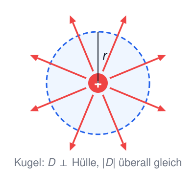
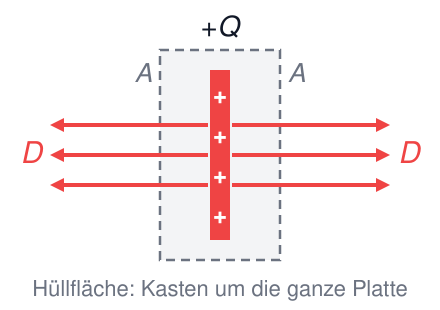
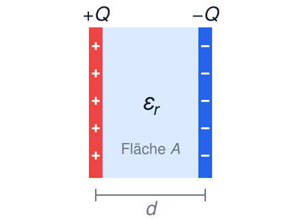
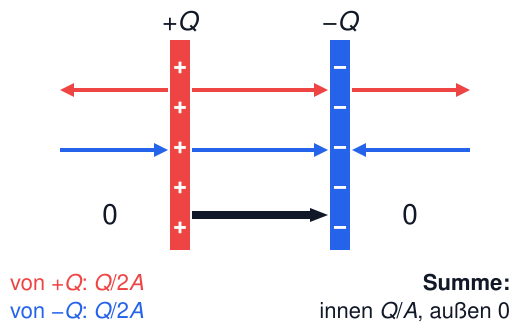
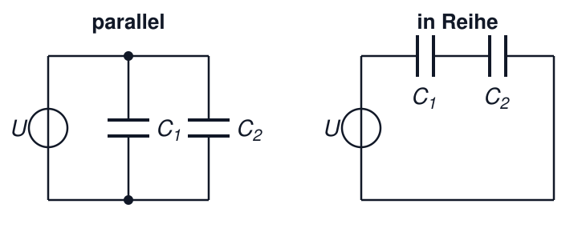
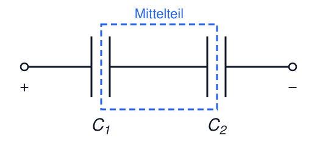
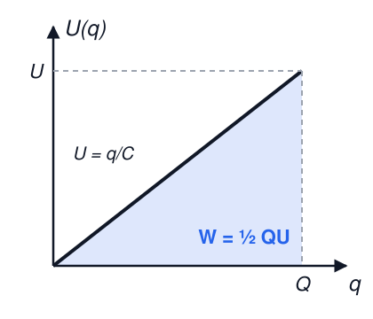
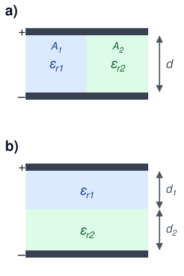

# Elektrotechnik – 2. Das elektrische Feld III

**Luft- und Raumfahrttechnik Bachelor, 1. Semester**

David Straub

## 2. Das elektrische Feld

1. Elektrische Ladung
2. Coulomb’sches Gesetz
3. Elektrische Feldstärke
4. Feldlinien und Satz von Gauß
5. Elektrisches Feld in Materie
6. Potential, Spannung, Arbeit
7. Homogenes Feld und Kondensatoren

### Homogenes elektrisches Feld

- Konstante Feldstärke $E$ in Betrag und Richtung, parallele Feldlinien
- Äquipotentialflächen senkrecht zu den Feldlinien

Die Kraft $F = Q \cdot E$ ist überall gleich. Arbeit auf der Strecke $d$ in Feldrichtung:

$$W = F \cdot d = Q \cdot E \cdot d \qquad\text{und}\qquad W = Q \cdot U \qquad\Rightarrow\qquad U = E \cdot d$$

### Kondensatoren (*capacitors*)

Ein Kondensator besteht aus zwei Leitern (z.B. Platten), die die Ladungen $+Q$ und $-Q$ tragen. $U$ ist die Spannung zwischen ihnen.

Doppelte Ladung → doppeltes Feld → doppelte Spannung: $U \sim Q$. Das Verhältnis $Q/U$ hängt also nur vom Bauteil ab.

**Kapazität** (*capacitance*) = Ladung pro Volt:

$$C := \frac{Q}{U}$$

Einheit: $[C] = \frac{\text{C}}{\text{V}} = \text{F}$ (Farad)

### ⚠️ Kapazität ≠ Kapazität

Die Kapazität (*capacity*) einer Batterie ist eine Ladungsmenge!

z.B.: $\text{mAh} = 10^{-3} \, \text{A} \cdot 3600 \, \text{s} = 3{,}6 \, \text{C}$

Nicht zu verwechseln mit der Kapazität (*capacitance*) eines Kondensators in Farad!

### Satz von Gauß: die Hülle geschickt wählen

$$\oint \vec{D} \cdot d\vec{A} = Q_\text{innen}$$

Die Hülle so wählen, dass jedes Stück davon

- **senkrecht zu den Feldlinien** liegt und $|D|$ dort konstant ist → Beitrag $D \cdot A$
- oder **parallel zu den Feldlinien** liegt → Beitrag 0

Dann wird das Integral zum Produkt: $D \cdot A_\perp = Q_\text{innen}$

**Bekannt aus 2.2:** Punktladung → Kugel um die Ladung: $D \cdot 4\pi r^2 = Q$

### Feld einer geladenen Platte

Eine große Platte trägt die Ladung $+Q$ auf der Fläche $A$. Aus Symmetrie steht $D$ senkrecht auf der Platte und ist auf beiden Seiten gleich groß. Hüllfläche: ein Kasten um die ganze Platte.

Der Fluss tritt durch **beide** Deckflächen aus:

$$D \cdot A + D \cdot A = Q \qquad\Rightarrow\qquad D = \frac{Q}{2A}$$

Das Feld zeigt nach beiden Seiten von der Platte weg. Solange der Abstand klein gegen die Plattengröße ist, hängt es nicht vom Abstand ab.

### 📝 Aufgabe 5a: Plattenkondensator

Eine zweite Platte mit $-Q$ wird im Abstand $d$ parallel dazugestellt. Dazwischen liegt ein Dielektrikum mit $\varepsilon_r$.

a) Zeigen Sie per Superposition: Zwischen den Platten gilt $D = Q/A$, außerhalb $D = 0$.

b) Leiten Sie daraus $E$, $U$ und $C = \dfrac{\varepsilon_0 \varepsilon_r A}{d}$ her.

c) Wovon hängt die Kapazität ab, wovon nicht?

### Plattenkondensator

Superposition: Innen addieren sich die Felder beider Platten, außen heben sie sich auf: $D = \frac{Q}{A}$

$$E = \frac{D}{\varepsilon_0 \varepsilon_r} = \frac{Q}{\varepsilon_0 \varepsilon_r A}, \qquad U = E \cdot d = \frac{Q \cdot d}{\varepsilon_0 \varepsilon_r A}$$

$$C = \frac{Q}{U} = \frac{\varepsilon_0 \varepsilon_r A}{d} = \frac{\varepsilon A}{d}$$

Kapazität steigt mit Fläche $A$, Permittivität $\varepsilon_r$ und kleinerem Abstand $d$.

### 🗳️ Platten auseinanderziehen

Ein Plattenkondensator wird an einer Spannungsquelle aufgeladen und dann von ihr **getrennt**.

Anschließend werden die Platten auf den **doppelten Abstand** auseinandergezogen. Was passiert mit der Spannung $U$?

A) $U$ halbiert sich

B) $U$ bleibt gleich

C) $U$ verdoppelt sich

D) $U$ vervierfacht sich

### Kondensatoren zusammenschalten

Eine **Spannungsquelle** (z.B. eine Batterie) hält zwischen ihren beiden Anschlüssen die Spannung $U$ fest.

- **Parallel:** Beide Kondensatoren hängen an denselben zwei Leitungen
- **In Reihe:** Die Kondensatoren liegen hintereinander, ohne Abzweig dazwischen

Schaltzeichen: zwei Striche = Kondensator (zwei Platten), Kreis = Spannungsquelle

### Parallelschaltung von Kondensatoren

$$C_{\text{ges}} = C_1 + C_2 + \dots + C_n = \sum_{i=1}^n C_i$$

- Gleiche Spannung an allen Kondensatoren
- Gesamtladung = Summe der Einzelladungen

Herleitung (gleiches $U$):

$$Q = C_1 U + C_2 U = (C_1 + C_2) \cdot U$$

### 🗳️ Der Mittelteil

Zwei ungeladene Kondensatoren werden **in Reihe** an eine Spannungsquelle angeschlossen und aufgeladen.

Welche Gesamtladung trägt danach der blau umrahmte Mittelteil?

A) $+Q$

B) $-Q$

C) null

D) hängt von $C_1$ und $C_2$ ab

### Reihenschaltung von Kondensatoren

$$\frac{1}{C_{\text{ges}}} = \frac{1}{C_1} + \frac{1}{C_2} + \dots + \frac{1}{C_n} = \sum_{i=1}^n \frac{1}{C_i}$$

- Gleiche Ladung auf allen Kondensatoren: $Q_1 = Q_2 = \dots = Q_\text{ges}$
- Gesamtspannung = Summe der Einzelspannungen

Herleitung: $C_{\text{ges}} = \frac{Q}{U_1 + U_2 + \dots} = \frac{Q}{Q \cdot \left(\frac{1}{C_1} + \frac{1}{C_2} + \dots\right)}$

### Energie im Kondensator

Jede weitere Ladung muss gegen die schon anliegende Spannung auf den Kondensator gebracht werden ($W = Q \cdot U$). Beim Aufladen steigt die Spannung aber von 0 auf $U$, im Mittel liegt also $U/2$ an – das ist die Fläche des Dreiecks:

$$W = \frac{1}{2} Q U = \frac{1}{2} C U^2 = \frac{Q^2}{2C}$$

$$[W] = \text{V} \cdot \text{C} = \text{W} \cdot \text{s} = \text{J}$$

### 📝 Aufgabe 5b: Kondensatoren

Zwei Kondensatoren $C_1 = 1 \, \mu\text{F}$ und $C_2 = 4 \, \mu\text{F}$ werden **in Reihe** geschaltet und an eine Spannung $U = 5000 \, \text{V}$ gelegt.

a) Schätzen Sie zuerst ohne Rechnung: An welchem Kondensator liegt die größere Spannung?

b) Wie groß ist die Gesamtkapazität $C_g$?

c) Wie groß sind die Teilspannungen $U_1$ und $U_2$?

d) Wie viel Energie ist insgesamt gespeichert?

### Unsere Basiseinheiten-Tabelle wächst

| Elektrische Größe | Formelzeichen | Einheit | Basiseinheiten |
|---|---|---|---|
| Ladung | $Q$ | C | $\text{A} \cdot \text{s}$ |
| Spannung | $U$ | V | ❓ |
| **Kapazität** | $C$ | F | ❓ |

Leiten Sie die Basiseinheiten von Spannung und Kapazität her – Ansatz: $[U] = \frac{[W]}{[Q]}$, $[C] = \frac{[Q]}{[U]}$

### 🗳️ Basiseinheiten des Farad

Welche Basiseinheiten hat die Kapazität $[C] = \text{F}$?

A) $\dfrac{\text{A}^2 \cdot \text{s}^4}{\text{kg} \cdot \text{m}^2}$

B) $\dfrac{\text{kg} \cdot \text{m}^2}{\text{A} \cdot \text{s}^3}$

C) $\dfrac{\text{A} \cdot \text{s}^2}{\text{kg} \cdot \text{m}^2}$

D) $\dfrac{\text{A}^2 \cdot \text{s}^3}{\text{kg} \cdot \text{m}}$

### Zusammenfassung: Das elektrische Feld

- Feldlinien: von + nach −, Dichte = Feldstärke; Äquipotentialflächen ⊥ Feldlinien
- Satz von Gauß: $\oint \vec{D} \cdot d\vec{A} = Q_\text{innen}$ – mächtig bei Symmetrie
- Dielektrika schwächen das Feld: $E \to E/\varepsilon_r$
- Potential $\varphi$, Spannung $U = \varphi_1 - \varphi_2$, Arbeit $W = Q \cdot U$ (wegunabhängig!)
- Homogenes Feld: $U = E \cdot d$
- Kondensator: $C = Q/U$; Platte: $C = \varepsilon A/d$; parallel: $C$ addieren, in Reihe: $1/C$ addieren
- Energie: $W = \frac{1}{2} C U^2$

**Nächstes Kapitel:** Gleichstrom – jetzt bewegen sich die Ladungen! 🔌

### Übersicht: Größen im elektrischen Feld

Größe | Definition | Einheit
--- | --- | ---
Elektrische Ladung (*electric charge*) | $Q$ | $[Q] = \text{C}$
Spannung (*voltage*) | $U = \Delta \varphi$ | $[U] = \text{V}$
Kapazität (*capacitance*) | $C = \frac{Q}{U}$ | $[C] = \text{F} = \frac{\text{C}}{\text{V}}$
Elektrische Feldstärke (*electric field [strength]*) | $\vec{E} = \frac{\vec{F}}{Q}$ | $[\vec{E}] = \frac{\text{V}}{\text{m}}=\frac{\text{N}}{\text{C}}$
Elektrische Flussdichte (*electric flux density*) | $\vec{D} = \varepsilon_0 \varepsilon_r \vec{E}$ | $[\vec{D}] = \frac{\text{C}}{\text{m}^2}$
Elektrische Feldkonstante (*electric constant*) | $\varepsilon_0$ | $[\varepsilon_0] = \frac{\text{C}^2}{\text{N} \cdot \text{m}^2}$
Relative Permittivität (*relative permittivity*) | $\varepsilon_r = \frac{\varepsilon}{\varepsilon_0}$ | dimensionslos

## Vertiefung

### Vertiefung: Kondensatoren mit geschichteten Dielektrika

Der Raum zwischen den Platten ist mit zwei verschiedenen Dielektrika gefüllt:

a) **nebeneinander** (Flächen $A_1$, $A_2$)

b) **hintereinander** (Dicken $d_1$, $d_2$)

Welcher Kondensatorschaltung entspricht jeweils die Anordnung?

### Vertiefung: Kondensatoren mit geschichteten Dielektrika

**Nebeneinander** (= Parallelschaltung):

$$C = \frac{\varepsilon_0}{d} \left(\varepsilon_{r1} A_1 + \varepsilon_{r2} A_2\right)$$

**Hintereinander** (= Reihenschaltung):

$$C = \frac{\varepsilon_0 \, \varepsilon_{r1} \varepsilon_{r2} \, A}{\varepsilon_{r2} d_1 + \varepsilon_{r1} d_2}$$

Anwendung: kapazitiver Ölstandsensor

### Vertiefung: Kugel- und Zylinderkondensator

| | Kugel | Zylinder |
|---|---|---|
| | $C = 4\pi \varepsilon \dfrac{R_1 R_2}{R_2 - R_1}$ | $C = 2 \pi \varepsilon \dfrac{l}{\ln(R_2/R_1)}$ |

Herleitung: Satz von Gauß + $U = \int E \, dr$ (gleiche Methode wie beim Punktladungs-Beispiel)

