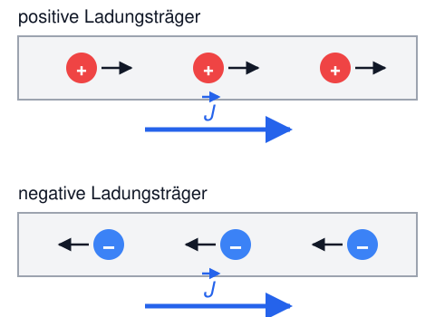
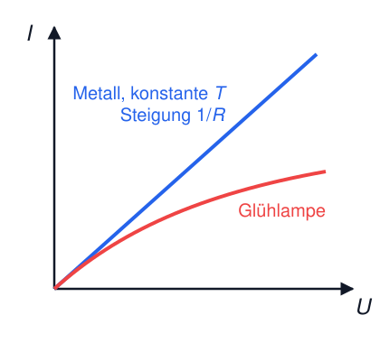
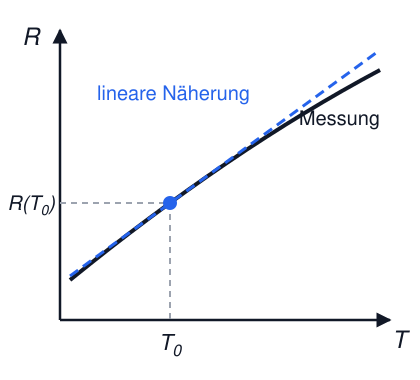

# Elektrotechnik – 3. Gleichstrom I

**Luft- und Raumfahrttechnik Bachelor, 1. Semester**

David Straub

## 3. Gleichstrom

1. Stromstärke und Stromdichte
2. Stromleitung in Metallen
3. Ohm’sches Gesetz und Widerstand
4. Temperaturabhängigkeit des Widerstands
5. Die Kirchhoff’schen Gesetze
6. Reihen- und Parallelschaltung, Teilerregeln
7. Zweipoltheorie
8. Arbeit und Leistung
9. Reale Messungen im Gleichstromkreis

### Elektrischer Strom (*electric current*)

Strom ist der gerichtete Fluss von elektrischer Ladung.

**Stromstärke $I$:** Wie viel Ladung passiert einen Drahtquerschnitt pro Zeit?

$$I = \frac{\Delta Q}{\Delta t} \quad \text{(bei konstantem Strom)}, \qquad [I] = \text{A} = \frac{\text{C}}{\text{s}}$$

**Beispiel:** Passieren in $2 \, \text{s}$ insgesamt $6 \, \text{C}$ den Querschnitt, fließt ein Strom von $3 \, \text{A}$.

Allgemein, auch bei zeitlich veränderlichem Strom: $I = dQ/dt$.

### Stromdichte (*current density*)

**Stromdichte $J$:** Strom pro Querschnittsfläche

$$J = \frac{I}{A}, \qquad [J] = \frac{\text{A}}{\text{m}^2}$$

Bei gleichmäßiger Verteilung und senkrechtem Durchtritt.

Allgemein: Beiträge über die Fläche summieren

$$I = \int_A \vec{J} \cdot d\vec{A}$$

### Stromrichtung & Ladungsträger

- **Technische Stromrichtung:** Bewegungsrichtung positiver Ladung.
- **Elektronen** bewegen sich entgegengesetzt.
- **Zählpfeil:** frei wählbar; $I < 0$ bedeutet Strom entgegen dem Pfeil.

### Stromleitung in Metallen

- Bewegliche **Leitungselektronen** im Gitter positiver Atomrümpfe („Elektronengas“).
- **Im Inneren näherungsweise neutral:** Positive und negative Ladungen gleichen sich aus.
- Die **Elektronen** transportieren die Ladung.

### Metalle im elektrischen Feld

- Elektrisches Feld → Beschleunigung; Stöße am Gitter begrenzen die Drift.
- Mittlere **Driftgeschwindigkeit** $\vec{v}_d$ entgegen der Feldrichtung.

$$\vec{J} = \rho_\mathrm{e} \cdot \vec{v}_d, \qquad \rho_\mathrm{e} = -ne$$

$\rho_\mathrm{e}$: Elektronenladungsdichte; $n$: Elektronen pro Volumen; $e$: Elementarladung.

### 🗳️ Wie schnell sind die Elektronen?

Durch einen Kupferdraht mit $1 \, \text{mm}^2$ Querschnitt fließt ein Strom von $1 \, \text{A}$.

Wie schnell bewegen sich die Elektronen im Mittel entlang des Drahts?

A) fast mit Lichtgeschwindigkeit

B) einige km/s

C) einige m/s

D) einige mm pro Minute

### Zahlenbeispiel: Driftgeschwindigkeit im Kupferdraht

Kupfer, $A=1 \, \text{mm}^2$, $I=1 \, \text{A}$:

- Dichte freier Elektronen: $n \approx 8{,}5 \cdot 10^{28} \, \frac{1}{\text{m}^3}$
- Ladungsdichte der Elektronen: $\rho_\mathrm{e} = -n \cdot e \approx -1{,}36 \cdot 10^{10} \, \frac{\text{C}}{\text{m}^3}$
- Stromdichte: $|\vec{J}| = \frac{I}{A} = 1 \cdot 10^{6} \, \frac{\text{A}}{\text{m}^2}$
- Driftgeschwindigkeit: $|\vec{v}_d| = \frac{|\vec{J}|}{|\rho_\mathrm{e}|} \approx 7{,}35 \cdot 10^{-5} \, \frac{\text{m}}{\text{s}} \approx 4{,}4 \, \frac{\text{mm}}{\text{min}}$ 🐌

**Licht sofort an?** Die Feldänderung breitet sich schnell aus – die Elektronen müssen nicht erst vom Schalter zur Lampe wandern.

### Ohm’scher Leiter und Widerstand

**Ohm’scher Leiter bei konstanter Temperatur:** Doppelte Spannung → doppelter Strom.

$$R = \frac{U}{I}, \qquad [R] = \frac{\text{V}}{\text{A}} = \Omega \ \text{(Ohm)}$$

$R$: **elektrischer Widerstand** (*electric resistance*)

- **Ohm’sch:** $R$ bleibt bei veränderter Spannung konstant.
- **Nichtlinear:** $U/I$ hängt vom Betriebspunkt ab.

### Ohm’sches Gesetz (*Ohm’s law*)

- Für ein gegebenes Material ist die Stromdichte umso höher, je höher das elektrische Feld ist
- Der Proportionalitätsfaktor ist die elektrische **Leitfähigkeit** $\sigma$:

$$\vec{J} = \sigma \cdot \vec{E}$$

Achtung: die proportionale Beziehung gilt nur für *Ohm’sche Leiter* (z.B. Metalle bei konstanter Temperatur)

### Ohm’sches Gesetz im Ohm’schen Leiter

$$\vec{J} = \sigma \cdot \vec{E}$$

Leiter der Länge $l$, Querschnitt $A$, homogenes Feld wie im Kondensator ($U = E \cdot l$):

$$I = J \cdot A = \sigma \cdot E \cdot A = \sigma \cdot \frac{U}{l} \cdot A = \frac{U}{R}$$

Damit hängt der **Widerstand** von Material und Geometrie ab:

$$R = \frac{l}{\sigma \cdot A} = \rho \cdot \frac{l}{A}$$

mit dem **spezifischen Widerstand** $\rho = 1/\sigma$ (Materialgröße; nicht mit der Ladungsdichte $\rho_\mathrm{e}$ verwechseln).

### Leitwert (*conductance*)

Der elektrische Leitwert $G$ ist der Kehrwert des Widerstands:

$$G = \frac{1}{R} = \frac{I}{U}, \qquad [G] = \frac{\text{A}}{\text{V}} = \text{S} \ \text{(Siemens)}$$

Je größer $G$, desto mehr Strom fließt bei gleicher Spannung: $I = G \cdot U$.

In der $I$-$U$-Kennlinie eines Ohm’schen Leiters ist $G = 1/R$ die Steigung.

### Materialeigenschaften vs. Bauteilgrößen

**Materialeigenschaften** (unabhängig von der Geometrie):
- **Spezifischer Widerstand** $\rho$
- **Leitfähigkeit** $\sigma = \frac{1}{\rho}$

**Bauteilgrößen** (abhängig von der Geometrie):
- **Widerstand** $R = \rho \frac{l}{A}$
- **Leitwert** $G = \frac{1}{R} = \sigma \frac{A}{l}$

**Kupfer bei 20 °C:** $\sigma \approx 58 \, \text{MS/m}$, unabhängig von der Drahtform.

Gleiches Material, gleiche Temperatur und Länge: **dickerer Draht → kleineres $R$**.

Wie beim Kondensator $C = \varepsilon A/d$: Material mal Geometrie.

### 🗳️ Länger und dünner

Ein Draht hat den Widerstand $R$. Ein zweiter Draht aus demselben Material ist **doppelt so lang** und hat den **halben Durchmesser**.

Welchen Widerstand hat der zweite Draht?

A) $R$

B) $2R$

C) $4R$

D) $8R$

### Übersicht der Größen im Ohm’schen Leiter

Größe | Definition | Einheit | Name
--- | --- | --- | ---
Spannung (*voltage*) | $U = \Delta \varphi$ | $[U] = \text{V}$ | Volt
Stromstärke (*current*) | $I = \frac{\Delta Q}{\Delta t}$ | $[I] = \text{A}$ | Ampere
Widerstand (*resistance*) | $R = \frac{U}{I}$ | $[R] = \Omega$ | Ohm
Leitwert (*conductance*) | $G = \frac{1}{R}$ | $[G] = \text{S} = \frac{1}{\Omega}$ | Siemens
spezifischer Widerstand (*resistivity*) | $\rho = R \frac{A}{l}$ | $[\rho] = \Omega \cdot \text{m}$ | Ohm-Meter
Leitfähigkeit (*conductivity*) | $\sigma = \frac{1}{\rho}$ | $[\sigma] = \text{S/m}$ | Siemens pro Meter

Hinweis: In manchen Büchern heißt die Stromdichte $S$ statt $J$ – gemeint ist dasselbe.

### 📝 Aufgabe 6: Stromdichte & Widerstand

In einer Glühlampe (12 V, Kfz-Blinker) fließt ein Strom $I = 0{,}5 \, \text{A}$.

**Vorab:** Gleicher Strom durch Zuleitung und Glühfaden – wo ist $J$ größer? Ohne Rechnung begründen.

a) Wie groß ist die Stromdichte $J_1$ im Glühfaden ($d_1 = 100 \, \mu\text{m}$)?

b) Wie groß ist die Stromdichte $J_2$ in der Zuleitung ($d_2 = 1{,}5 \, \text{mm}$)?

c) Ein Kupferdraht hat die Länge $l = 5 \, \text{m}$ und den Querschnitt $A = 3 \, \text{mm}^2$ ($\rho_\text{Cu} = 1{,}79 \cdot 10^{-8} \, \Omega\text{m}$). Wie groß ist sein Widerstand $R$?

d) Welchen Widerstand hat ein Draht gleicher Abmessungen aus Aluminium ($\rho_\text{Al} = 2{,}6 \cdot 10^{-8} \, \Omega\text{m}$)?

### Temperaturabhängigkeit des Widerstands

**Bisher:** konstante Temperatur. **Glühlampe:** Erwärmung → $R$ steigt → Kennlinie flacht ab.

Lineare Näherung in einem begrenzten Temperaturbereich:

$$R(T) = R(T_0) \cdot [1 + \alpha \cdot (T - T_0)]$$

- $\alpha$: Temperaturkoeffizient, $[\alpha] = \frac{1}{\text{K}}$
- $T_0$: Bezugstemperatur (üblicherweise 20 °C oder 0 °C)

### Leitfähigkeit verschiedener Materialien

Bei den hier betrachteten Metallen nimmt der Widerstand mit steigender Temperatur zu ($\alpha > 0$).

Typische Werte bei 20 °C:

| Leitermaterial | $\rho$ (µΩ·m) | $\sigma$ (MS/m) | $\alpha$ (1/K) |
|----------------|---------------|-----------------|----------------|
| Silber         | 0,016         | 63              | 3,8 · 10⁻³     |
| Kupfer         | 0,017         | 58              | 3,9 · 10⁻³     |
| Aluminium      | 0,027         | 38              | 4,3 · 10⁻³     |
| Messing        | 0,062         | 16              | 2,0 · 10⁻³     |

### 🗳️ Warme Leitung

Eine Kupferleitung hat bei 20 °C den Widerstand $R$. Im Betrieb erwärmt sie sich auf 70 °C.

Um wie viel steigt ihr Widerstand?

A) etwa 0,2 %

B) etwa 2 %

C) etwa 20 %

D) etwa 200 %

### Metalle als Temperatursensoren

**Temperatur aus Widerstand bestimmen**

**Platin-Widerstandsthermometer (Pt100):**
- $R(0 \, °\text{C}) = 100 \, \Omega$
- $\alpha_{\text{Pt}} = 3{,}85 \cdot 10^{-3} \, \text{K}^{-1}$

- Langzeitstabil; Messbereich −200 °C bis +850 °C.
- Lineare Näherung nur in einem begrenzten Temperaturbereich.

Bei bekanntem Messstrom: $R = U/I$ → Temperatur.

### Zwischenstand & Ausblick

- **Strom:** $I = dQ/dt$; gleichmäßig im senkrechten Querschnitt: $J = I/A$
- **Langsame Elektronendrift**, schnelle Ausbreitung der Feldänderung
- **Ohm’scher Leiter:** konstantes $R = U/I$; Material und Geometrie: $R = \rho \, l/A$
- **Temperatur:** $R(T)$ näherungsweise linear → Pt100-Sensor

**Nächste Woche:** Kirchhoff’sche Gesetze, Netzwerke und reale Quellen.
