# Elektrotechnik – 3. Gleichstrom II

**Luft- und Raumfahrttechnik Bachelor, 1. Semester**

David Straub

## 3. Gleichstrom

1. Stromstärke und Stromdichte
2. Stromleitung in Metallen
3. Ohm’sches Gesetz und Widerstand
4. Temperaturabhängigkeit des Widerstands
5. Die Kirchhoff’schen Gesetze
6. Reihen- und Parallelschaltung, Teilerregeln
7. Zweipoltheorie
8. Arbeit und Leistung
9. Reale Messungen im Gleichstromkreis

### Zählpfeile: Vorzeichen festlegen

Vor dem Rechnen bekommt **jede** Spannung und **jeder** Strom eine Zählrichtung – frei wählbar, ab dann verbindlich. Ein negatives Ergebnis heißt einfach: es fließt andersherum.

- **Verbraucherzählpfeilsystem:** $U$ und $I$ am Bauteil gleichsinnig (Widerstände)
- **Erzeugerzählpfeilsystem:** $U$ und $I$ gegensinnig (Quellen)
- **Beim Maschenumlauf:** Pfeil in Umlaufrichtung → positiv zählen, sonst negativ

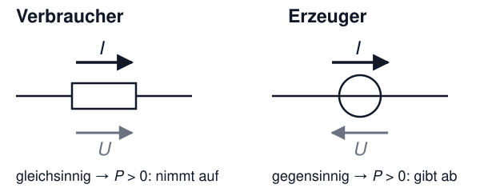

### Knotenpunktregel (1. Kirchhoff’sches Gesetz)

**Knoten:** Punkt, an dem sich die Leitung verzweigt.

Im Knoten kann weder Ladung gespeichert noch erzeugt werden. Was hineinfließt, fließt auch wieder heraus:

$$\sum I_\text{zu} = \sum I_\text{ab}$$

Gleichwertig: Alle Ströme mit Vorzeichen addieren, zufließend $+$, abfließend $-$. Das Ergebnis ist Null.

Ob ein Strom zu- oder abfließt, legt sein **Zählpfeil** fest.

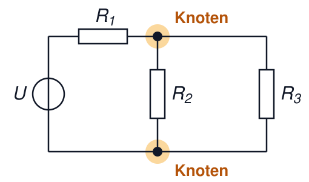

### Knotenpunktregel: Beispiel

$I_1$ und $I_4$ fließen zu, $I_2$ und $I_3$ fließen ab:

$$I_1 + I_4 = I_2 + I_3$$

Mit Vorzeichen auf eine Seite gebracht:

$$I_1 - I_2 - I_3 + I_4 = 0$$

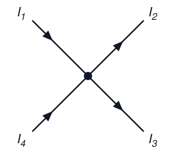

### Maschenregel (2. Kirchhoff’sches Gesetz)

**Masche:** geschlossener Umlauf durch die Schaltung.

Spannung ist eine Potentialdifferenz (2.2). Wer einmal die Masche entlang läuft, kommt beim selben Potential wieder an. Deshalb gilt:

Alle Spannungen der Masche mit Vorzeichen addieren ergibt Null.

1. Umlaufrichtung wählen (frei)
2. Spannungspfeil **in** Umlaufrichtung → $+U$
3. Spannungspfeil **gegen** Umlaufrichtung → $-U$

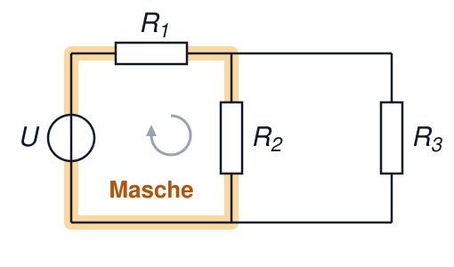

### Maschenregel: Beispiel

Umlauf im Uhrzeigersinn: $U_1$ und $U_2$ zeigen in Umlaufrichtung, $U_\text{q}$ zeigt dagegen:

$$-U_\text{q} + U_1 + U_2 = 0$$

Umgestellt: $U_\text{q} = U_1 + U_2$. Die Quellenspannung teilt sich auf die Widerstände auf.

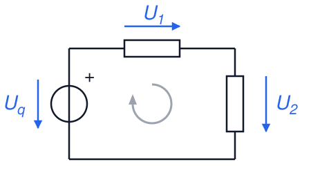

### 🗳️ Vorzeichen in der Masche

In der Masche gilt $U_1 = 2 \, \text{V}$, $U_2 = 5 \, \text{V}$, $U_3 = 4 \, \text{V}$.

Wie groß ist $U_4$?

A) $11 \, \text{V}$

B) $-11 \, \text{V}$

C) $7 \, \text{V}$

D) $-1 \, \text{V}$

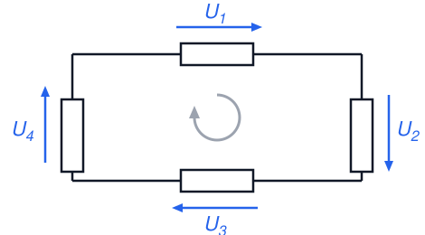

### Knoten und Zweige

- **Knoten:** Verzweigungspunkt, an dem mindestens drei Zweige zusammentreffen
- **Zweig:** Verbindung zwischen zwei Knoten (ein oder mehrere Bauteile in Reihe); durch einen Zweig fließt überall derselbe Strom

Im Bild: 2 Knoten und 3 Zweige (Quelle $U$, $R_1$, $R_2$)

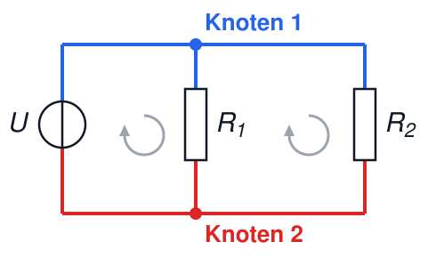

### Wie viele unabhängige Gleichungen gibt es?

Netzwerk mit $k$ Knoten und $z$ Zweigen:

- **Unabhängige Knotengleichungen:** $k - 1$
  (die letzte Knotengleichung folgt aus den anderen)
- **Unabhängige Maschengleichungen:** $z - (k - 1)$

Zusammen: $z$ Gleichungen für $z$ unbekannte Zweigströme ✓

Beispiel: 2 Knoten, 3 Zweige → 1 Knotengleichung + 2 Maschengleichungen

### 📝 Aufgabe 7a: Kirchhoff

Gegeben: $U = 12 \, \text{V}$, $I = 3 \, \text{mA}$, $I_2 = 1 \, \text{mA}$, $U_1 = 6 \, \text{V}$

a) Markieren Sie die Knoten. Wie viele Knoten, Zweige und unabhängige Gleichungen hat die Schaltung?

b) Bestimmen Sie $I_3$, $U_2$ und $U_3$ mit den Kirchhoff’schen Gesetzen.

c) Wie groß sind $R_1$, $R_2$ und $R_3$?

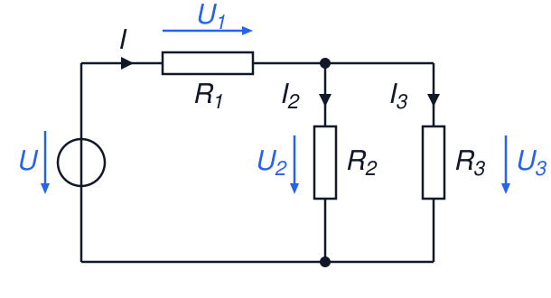

### Reihenschaltung von Widerständen

$$R_\text{ges} = R_1 + R_2 + \dots + R_n = \sum_{i=1}^{n} R_i$$

- Kein Abzweig dazwischen → **gleicher Strom** durch alle (Knotenregel): $I = I_1 = \dots = I_n$
- **Maschenregel:** $U = U_1 + \dots + U_n$
- Mit $U_i = I R_i$: $\;U = I \cdot (R_1 + \dots + R_n)$
- Folge: $R_\text{ges}$ ist **größer** als der größte Einzelwiderstand

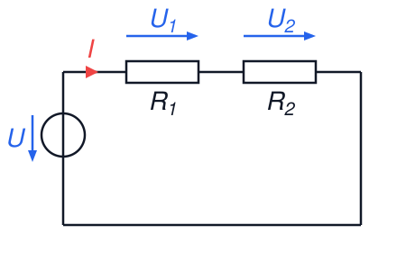

### Spannungsteiler

Bei einer Reihenschaltung teilt sich die Gesamtspannung im Verhältnis der Widerstände auf:

$$I = \frac{U}{R_\text{ges}} = \frac{U_1}{R_1} = \frac{U_2}{R_2}$$

$$\Rightarrow \quad \frac{U_1}{U_2} = \frac{R_1}{R_2}, \qquad U_2 = U \cdot \frac{R_2}{R_1 + R_2}$$

### Parallelschaltung von Widerständen

$$\frac{1}{R_\text{ges}} = \frac{1}{R_1} + \frac{1}{R_2} + \dots + \frac{1}{R_n} \qquad\Leftrightarrow\qquad G_\text{ges} = \sum_{i=1}^{n} G_i$$

- Dieselben zwei Knoten → **gleiche Spannung** an allen (Maschenregel)
- **Knotenregel:** $I = I_1 + \dots + I_n$
- Mit $I_i = U/R_i$: $\;I = U \cdot \left(\frac{1}{R_1} + \dots + \frac{1}{R_n}\right)$
- Folge: $R_\text{ges}$ ist **kleiner** als der kleinste Einzelwiderstand

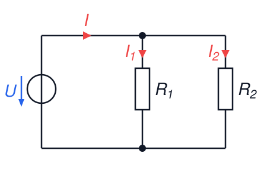

### Stromteilerregel

Bei einer Parallelschaltung teilt sich der Gesamtstrom im umgekehrten Verhältnis der Widerstände bzw. im direkten Verhältnis der Leitwerte auf:

$$\frac{I}{G_\text{ges}} = \frac{I_1}{G_1} = \frac{I_2}{G_2} = \dots = \frac{I_n}{G_n}$$

Zwei Widerstände: $\quad I_1 = I \cdot \dfrac{R_2}{R_1 + R_2}$

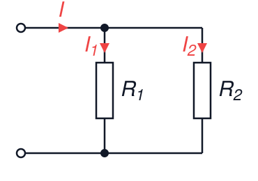

### Reihe oder parallel? So erkennt man es *wirklich*

- **In Reihe** ⇔ zwischen ihnen **kein Knoten** ⇔ zwingend **derselbe Strom**
- **Parallel** ⇔ beide an **denselben zwei Knoten** ⇔ zwingend **dieselbe Spannung**

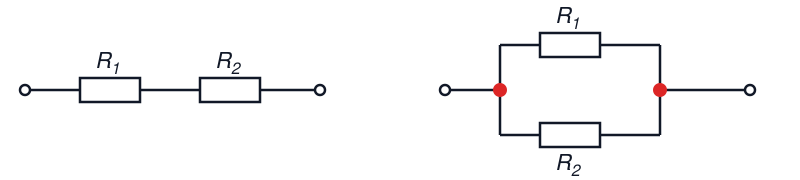

⚠️ Wie die Schaltung *gezeichnet* ist, bedeutet **gar nichts** – entscheidend sind die Knoten.

### Methode: Knoten markieren

1. Alles, was nur durch Draht mit einem Knoten verbunden ist, gehört zu **diesem** Knoten (gleiches Potential) → gleich einfärben
2. Schaltung mit diesen Knoten **neu zeichnen**
3. Kriterium von der vorigen Folie anwenden

### 🗳️ Wie liegen $R_1$ und $R_2$ zueinander?

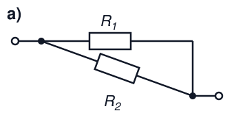

A) in Reihe &nbsp;&nbsp;&nbsp; B) parallel &nbsp;&nbsp;&nbsp; C) keins von beidem

### 🗳️ Wie liegen $R_1$ und $R_2$ zueinander?

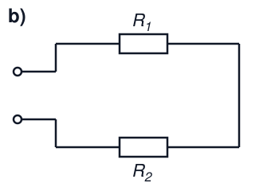

A) in Reihe &nbsp;&nbsp;&nbsp; B) parallel &nbsp;&nbsp;&nbsp; C) keins von beidem

### 🗳️ Wie liegen $R_1$ und $R_2$ zueinander?

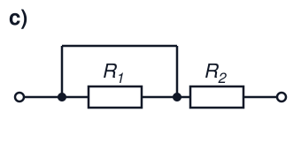

A) in Reihe &nbsp;&nbsp;&nbsp; B) parallel &nbsp;&nbsp;&nbsp; C) keins von beidem

### 🗳️ Wie liegen $R_1$ und $R_2$ zueinander?

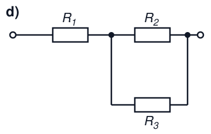

A) in Reihe &nbsp;&nbsp;&nbsp; B) parallel &nbsp;&nbsp;&nbsp; C) keins von beidem

### 🗳️ Wie liegen $R_1$ und $R_2$ zueinander?

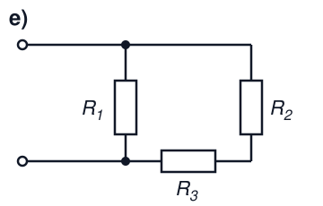

A) in Reihe &nbsp;&nbsp;&nbsp; B) parallel &nbsp;&nbsp;&nbsp; C) keins von beidem

### 📝 Aufgabe 7b: Belasteter Spannungsteiler

Ein Spannungsteiler besteht aus $R_1 = R_2 = 1 \, \text{k}\Omega$ an einer Quelle $U = 12 \, \text{V}$. Am Abgriff (über $R_2$) wird die Spannung $U_a$ abgenommen. **Zeichnen Sie die Schaltung selbst!**

a) Wie groß ist $U_a$ im Leerlauf (kein Verbraucher angeschlossen)?

b) Nun wird ein Verbraucher $R_L = 1 \, \text{k}\Omega$ an den Abgriff angeschlossen (parallel zu $R_2$). Schätzen Sie zuerst: steigt oder sinkt $U_a$? Wie groß ist $U_a$ jetzt?

### Zweipoltheorie

Ein Zweipol (*two-pole*) oder Eintor (*one-port*) ist ein elektrisches Bauteil mit zwei zugänglichen Anschlüssen.

**Das große Versprechen dieses Abschnitts:** Jedes noch so komplizierte lineare Netzwerk verhält sich an zwei Klemmen wie eine Quelle mit **zwei Kenngrößen** ($U_0$ und $R_i$).

### Passive lineare Zweipole

- Passiv: Zweipol gibt keine Energie ab
- Linear (Ohm’sch): Strom-Spannungs-Kennlinie ist eine Gerade

Passive lineare Zweipole können zu einem Ersatzwiderstand zusammengefasst werden – wie gerade bei Reihe und Parallel:

$$U = R \cdot I$$

### Ideale Spannungsquelle

Eine ideale Spannungsquelle liefert eine konstante Spannung $U_0$, unabhängig von der Belastung.

- Konstante Klemmenspannung $U = U_0$
- Innenwiderstand $R_i = 0$
- Beliebiger Strom $I$ möglich

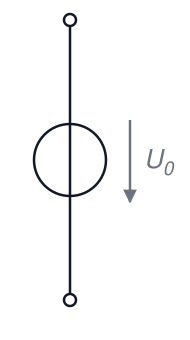

### Ideale Stromquelle

Eine ideale Stromquelle liefert einen konstanten Strom $I_0$, unabhängig von der Belastung.

- Konstanter Strom $I = I_0$
- Innenwiderstand $R_i = \infty$
- Beliebige Spannung $U$ möglich

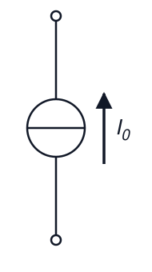

### 🗳️ Warum sinkt die Batteriespannung?

Beim Starten eines Autos sinkt die Spannung der Batterie – direkt an ihren Polen gemessen – von $12{,}6 \, \text{V}$ auf etwa $10 \, \text{V}$.

Woran liegt das?

A) Die Batterie ist in diesem Moment fast leer.

B) Ein Teil der Spannung fällt in der Batterie selbst ab.

C) Der Anlasser erzeugt eine Gegenspannung.

D) Die Kabel zum Anlasser haben einen Widerstand.

### Reale Spannungsquelle

Eine reale Spannungsquelle = ideale Spannungsquelle $U_0$ **in Reihe** mit einem Innenwiderstand $R_i$:

$$U = U_0 - R_i \cdot I$$

- Leerlauf ($I = 0$): $U = U_0$ (maximale Spannung)
- Kurzschluss ($U = 0$): $I_k = \frac{U_0}{R_i}$ (maximaler Strom)

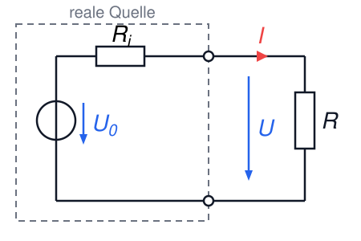

### Reale Stromquelle

Eine reale Stromquelle = ideale Stromquelle $I_0$ **parallel** zu einem Innenwiderstand $R_i$:

$$I = I_0 - \frac{U}{R_i}$$

- Leerlauf: $U = I_0 \cdot R_i$
- Kurzschluss: $I = I_0$

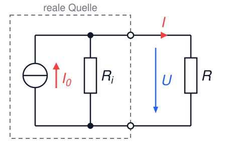

### Die U-I-Kennlinie

Die Kennlinien im Vergleich – die reale Quelle ist eine fallende Gerade zwischen zwei Punkten, die man messen (oder berechnen) kann:

- $U_0$: Schnittpunkt mit der U-Achse (Leerlauf)
- $I_k$: Schnittpunkt mit der I-Achse (Kurzschluss)
- Steigung: $-R_i = -U_0/I_k$

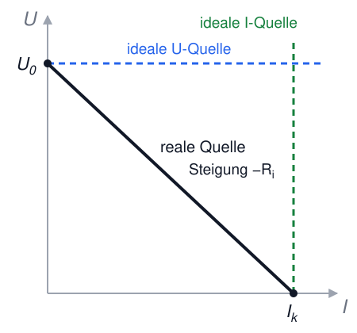

### 🗳️ Kurzschlussstrom aus zwei Messungen

An einer Quelle misst man im Leerlauf $9 \, \text{V}$. Bei einem Laststrom von $1 \, \text{A}$ sind es noch $8 \, \text{V}$.

Welcher Strom fließt im Kurzschluss?

A) $1 \, \text{A}$

B) $8 \, \text{A}$

C) $9 \, \text{A}$

D) unbegrenzt viel

### Äquivalenz von realer Spannungs- und Stromquelle

Reale Spannungsquelle und reale Stromquelle sind **äquivalent** (gleiche Kennlinie!), wenn:

$$U_0 = I_0 \cdot R_i \qquad\Leftrightarrow\qquad I_0 = \frac{U_0}{R_i}$$

**Umrechnung** (gleiche $R_i$!):
- Spannungsquelle → Stromquelle: $I_0 = \frac{U_0}{R_i}$
- Stromquelle → Spannungsquelle: $U_0 = I_0 \cdot R_i$

$I_0$ ist also gerade der Kurzschlussstrom $I_k$ aus der Kennlinie.

Von außen sind beide nicht unterscheidbar – wählen Sie die Darstellung, die die Rechnung einfacher macht!

### 📝 Aufgabe 7c: Reale Quelle

Eine Flugzeugbatterie hat die Leerlaufspannung $U_0 = 24 \, \text{V}$ und den Innenwiderstand $R_i = 0{,}2 \, \Omega$.

a) Ein Verbraucher mit $R = 2{,}2 \, \Omega$ wird angeschlossen. Wie groß sind Strom $I$ und Klemmenspannung $U$?

b) Geben Sie die äquivalente Ersatzstromquelle an ($I_0$, $R_i$).

c) Skizzieren Sie die $U$-$I$-Kennlinie und tragen Sie Leerlauf, Kurzschluss und den Arbeitspunkt aus a) ein.

### Zwischenstand & Ausblick

- Zählpfeile zuerst festlegen; ein negatives Ergebnis heißt: es fließt andersherum
- Kirchhoff: zufließend = abfließend (Knoten), Spannungen im Umlauf mit Vorzeichen ergeben Null (Masche); $k-1$ unabhängige Knotengleichungen
- Teilerregeln: Spannung ∝ R (Reihe), Strom ∝ G (parallel) – entscheidend sind die Knoten, nicht die Zeichnung
- Ein belasteter Spannungsteiler bricht ein!
- Reale Quelle = zwei Kenngrößen: $U_0$ und $R_i$ (oder äquivalent $I_0 = U_0/R_i$)

**Nächste Woche:** Ersatzquellen für beliebige Netzwerke, Leistung und Messen im Gleichstromkreis.
