# Elektrotechnik – 3. Gleichstrom III

**Luft- und Raumfahrttechnik Bachelor, 1. Semester**

David Straub

## 3. Gleichstrom

1. Stromstärke und Stromdichte
2. Stromleitung in Metallen
3. Ohm’sches Gesetz und Widerstand
4. Temperaturabhängigkeit des Widerstands
5. Die Kirchhoff’schen Gesetze
6. Reihen- und Parallelschaltung, Teilerregeln
7. Zweipoltheorie: **Ersatzquelle eines Netzwerks, Quellen in Reihe und parallel**
8. **Arbeit und Leistung: Leistungsanpassung, Wirkungsgrad, Arbeitspunkt**
9. **Reale Messungen im Gleichstromkreis: Spannung, Strom (Shunt), Vierleitermessung**

### Ersatzquelle eines beliebigen Netzwerks bestimmen

Jedes lineare Netzwerk mit Quellen lässt sich an zwei Klemmen a–b als **Ersatzspannungsquelle** ($U_0$, $R_i$) oder **Ersatzstromquelle** ($I_0$, $R_i$) darstellen. Rezept:

1. **Leerlaufspannung** $U_0$: Spannung an den offenen Klemmen berechnen
2. **Innenwiderstand** $R_i$: Quellen deaktivieren (U-Quelle → **Kurzschluss**, I-Quelle → **Unterbrechung**), dann Widerstand von den Klemmen aus berechnen
3. Kontrolle oder Alternative zu 2.: **Kurzschlussstrom** $I_k$ berechnen, dann $R_i = U_0 / I_k$

**Das ist die zentrale Technik für Netzwerkaufgaben.**

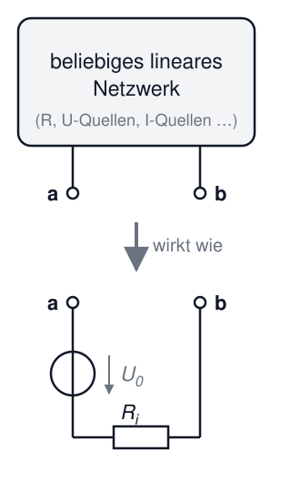

### 🗳️ Innenwiderstand mit Stromquelle

Kurzschreibweise für zwei parallele Widerstände: $R_1 \parallel R_2 = \dfrac{R_1 R_2}{R_1 + R_2}$

Wie groß ist der Innenwiderstand $R_i$ der Schaltung an den Klemmen a–b?

A) $R_2$

B) $R_1 + R_2$

C) $R_1 \parallel R_2$

D) $R_1$

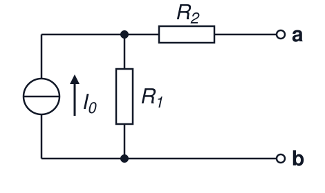

### Beispiel: Ersatzquelle des belasteten Spannungsteilers

Unser Spannungsteiler aus Aufgabe 7b ($U = 12 \, \text{V}$, $R_1 = R_2 = 1 \, \text{k}\Omega$), Klemmen über $R_2$:

1. Leerlauf: $U_0 = U \cdot \dfrac{R_2}{R_1 + R_2} = 6 \, \text{V}$
2. Quelle kurzschließen: $R_i = R_1 \parallel R_2 = \dfrac{R_1 R_2}{R_1 + R_2} = 500 \, \Omega$
3. Last $R_L = 1 \, \text{k}\Omega$ anschließen: $U_a = U_0 \cdot \dfrac{R_L}{R_i + R_L} = 4 \, \text{V}$

Gleiche Antwort wie in Aufgabe 7b – jetzt in zwei Zeilen statt Netzwerk-Umformung.

### 📝 Aufgabe 8: Ersatzquelle

Eine Spannungsquelle $U_e = 150 \, \text{V}$ speist einen Spannungsteiler aus $R_1$ und $R_2$; an den Klemmen über $R_2$ wird $U_a$ abgenommen. Im Leerlauf ist $U_a = 50 \, \text{V}$, bei $I = 0{,}5 \, \text{A}$ ist $U_a = 45 \, \text{V}$. **Schaltung zeichnen!**

a) Bestimmen Sie $U_0$, $R_i$ und den Kurzschlussstrom $I_k$ der Ersatzquelle.

b) Wie groß müssen $R_1$ und $R_2$ sein?

c) Wie groß muss ein Lastwiderstand $R_a$ sein, damit er die größtmögliche Leistung aufnimmt, und wie groß ist diese? *(Vorgriff auf später heute – Vermutung reicht!)*

### Reihenschaltung von aktiven, linearen Zweipolen

Bei der Reihenschaltung von realen Spannungsquellen addieren sich Leerlaufspannungen und Innenwiderstände:

$$U_{0,\text{ges}} = \sum_j U_{0,j}, \qquad R_{i,\text{ges}} = \sum_j R_{i,j}$$

Begründung: Maschenregel – durch alle fließt derselbe Strom, die Spannungen addieren sich.

**Anwendung:** Batteriepacks (Taschenlampe, E-Auto)
**Vorteil:** höhere Gesamtspannung • **Nachteil:** höherer Innenwiderstand

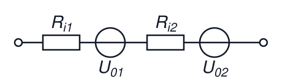

### Parallelschaltung von aktiven, linearen Zweipolen

Bei der Parallelschaltung von realen Spannungsquellen mit gleicher Leerlaufspannung $U_0$ addieren sich die Leitwerte der Innenwiderstände:

$$\frac{1}{R_{i,\text{ges}}} = \sum_j \frac{1}{R_{i,j}}$$

Begründung: Beide in Stromquellen $I_{0,j} = U_0 / R_{i,j}$ umwandeln. Parallel addieren sich die Ströme und die Leitwerte.

**Anwendung:** höhere Ströme, Redundanz
**Nachteil:** nur bei gleichen Spannungen sinnvoll (sonst Ausgleichsströme!)

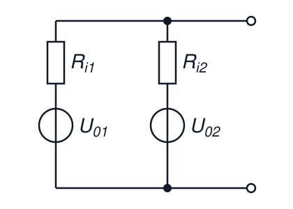

### Elektrische Arbeit (Energie)

Aus $W = Q \cdot U$ (2.2) und $Q = I \cdot t$ (bei konstantem Strom) folgt:

$$W = U \cdot I \cdot t = I^2 \cdot R \cdot t = \frac{U^2}{R} \cdot t$$

Einheit: $[W] = \text{V} \cdot \text{A} \cdot \text{s} = \text{W} \cdot \text{s} = \text{J}$ (Joule)

### Elektrische Leistung

Die elektrische Leistung ist Arbeit pro Zeiteinheit:

$$P = \frac{dW}{dt} = U \cdot I = I^2 \cdot R = \frac{U^2}{R}$$

Einheit: $[P] = \text{W}$ (Watt)

Die drei Schreibweisen sind über das Ohm’sche Gesetz äquivalent – nehmen Sie die, deren Größen Sie kennen.

### 🗳️ Zwei Glühlampen in Reihe

Eine 60-W- und eine 100-W-Glühlampe (beide für 230 V) werden **in Reihe** an 230 V angeschlossen.

Welche leuchtet heller?

A) die 100-W-Lampe

B) die 60-W-Lampe

C) beide gleich hell

D) keine – die Spannung reicht für beide nicht

### Leistungsanpassung

Bei welchem Verbraucherwiderstand $R$ liefert eine reale Quelle ($U_0$, $R_i$) die maximale Leistung an den Verbraucher?

$$P = R \cdot I^2 = U_0^2 \cdot \frac{R}{(R_i + R)^2}$$

- Leerlauf ($R \to \infty$): $P = 0$; Kurzschluss ($R = 0$): $P = 0$
- Maximum dazwischen: **$R = R_i$** (Herleitung → Tafel)

$$P_\text{max} = \frac{U_0^2}{4 R_i}$$

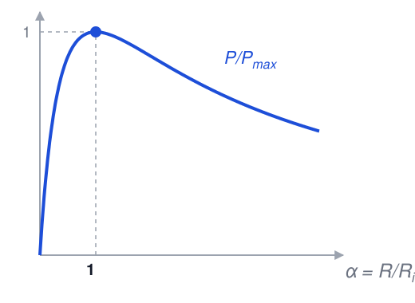

### Anpassungsverhältnis und Wirkungsgrad

Anpassungsverhältnis: $\alpha = \frac{R}{R_i}$

Wirkungsgrad = Verbraucherleistung / Gesamtleistung der Quelle, mit $P_0 = U_0 \cdot I$ (Leistung der idealen Quelle $U_0$):

$$\eta = \frac{P}{P_0} = \frac{R}{R_i + R} = \frac{\alpha}{1 + \alpha}$$

⚠️ Bei Leistungsanpassung ($\alpha = 1$) ist $\eta = 0{,}5$ – die Hälfte der Energie heizt die Quelle!

- Nachrichtentechnik: Anpassung (maximales Signal zählt)
- Energietechnik: Überanpassung $R \gg R_i$ (Wirkungsgrad zählt)

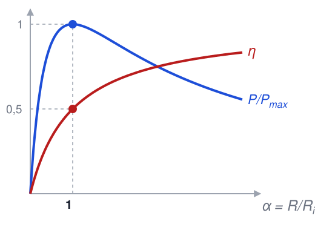

### Betriebszustände einer aktiven Quelle

|             | Last            | Leistung Quelle $P_0$                                | Leistung Last $P$               | Wirkungsgrad $\eta$ |
|-----------------|----------------------|------------------------------------------------------|---------------------------------|---------------------|
| Kurzschluss     | $R = 0$              | $P_0 = \frac{U_0^2}{R_i}$                            | $P = 0$                         | $\eta = 0$          |
| Unteranpassung  | $R < R_i$            | $P_0 = \frac{U_0^2}{R + R_i}$      | $0 < P < P_\text{max}$          | $0 < \eta < 0{,}5$    |
| Anpassung       | $R = R_i$            | $P_0 = \frac{U_0^2}{2R_i}$                           | $P = \frac{U_0^2}{4R_i}$        | $\eta = 0{,}5$        |
| Überanpassung   | $R > R_i$            | $P_0 = \frac{U_0^2}{R + R_i}$      | $0 < P < P_\text{max}$          | $0{,}5 < \eta < 1$    |
| Leerlauf        | $R \to \infty$       | $P_0 = 0$                                            | $P = 0$                         | $\eta = 1$          |

### U-I-Kennlinie und Arbeitspunkt

Quelle und Verbraucher in einem Diagramm:

- **Quelle:** fallende Gerade $U = U_0 - R_i \cdot I$
- **Verbraucher:** steigende Gerade $U = R \cdot I$
- Schnittpunkt = **Arbeitspunkt**: dort stellen sich $U$ und $I$ tatsächlich ein

Grafische Lösung: beide Kennlinien zeichnen, Schnittpunkt ablesen. Aus Aufgabe 7c kennen Sie den Arbeitspunkt schon.

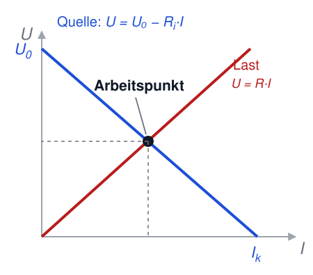

### 📝 Aufgabe 9: Autobatterie

An den Klemmen einer Autobatterie wird bei wechselnder Last gemessen:

| $U_a$/V | 11,8 | 11,6 | 11 | 10 | 8 |
|---------|------|------|-----|-----|-----|
| $I$/A   | 10   | 20   | 50  | 100 | 200 |

a) Bestimmen Sie die Leerlaufspannung $U_0$ und den Innenwiderstand $R_i$.

b) Die Batterie wird mit $R = 0{,}2 \, \Omega$ belastet. Wie hoch ist der Wirkungsgrad $\eta$?

### 📝 Klausuraufgabe: Gleichstromnetzwerk

Die Schaltung liefert an den Klemmen 1–2 die Spannung $U_a$:

a) Wie viele *unabhängige* Knotenpunktgleichungen gibt es? Stellen Sie sie auf.
b) **Leerlauf** ($R_a \to \infty$): Geben Sie $I_1$ und $I_2$ in Abhängigkeit der Stromquellen an.
c) Bestimmen Sie das **Spannungsquellen-Ersatzschaltbild** links der Klemmen 1–2 ($U_0$, $R_i$ allgemein).
d) Die Schaltung soll $U_0 = 10 \, \text{V}$ und $P_\text{max} = 5 \, \text{W}$ liefern. Wie groß muss $R_i$ sein?

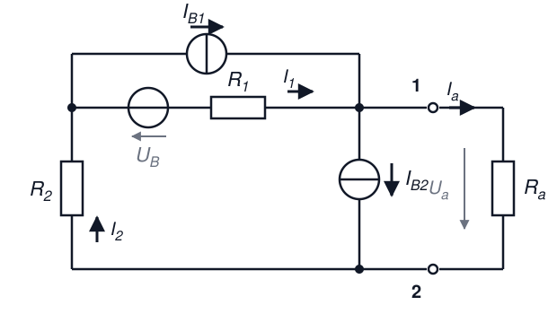

### Reale Messungen: Spannung

Jedes reale Voltmeter hat einen **endlichen Innenwiderstand** und belastet die Schaltung:

- Digitalmultimeter (DMM): typisch $R_V \approx 10 \, \text{M}\Omega$
- Das Voltmeter liegt **parallel** zum Messobjekt → wirkt wie ein Lastwiderstand → **Lastfehler**, wenn $R_V$ nicht $\gg$ Quellwiderstand
- In Klausuraufgaben: „ideales Voltmeter“ = $R_V \to \infty$, zieht keinen Strom

Faustregel: Spannungsmessung ist unkritisch, solange $R_\text{Quelle} \ll R_V$

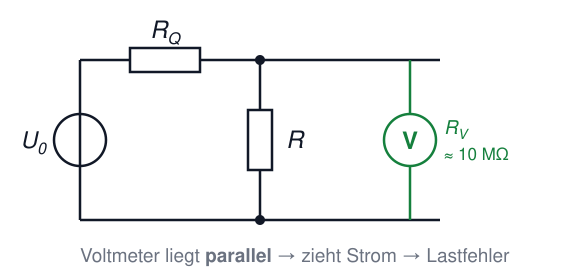

### 🗳️ Was zeigt das Multimeter?

Ein Spannungsteiler aus zwei Widerständen von je $1 \, \text{M}\Omega$ liegt an $10 \, \text{V}$. Ein Multimeter ($R_V = 10 \, \text{M}\Omega$) misst die Spannung über dem unteren Widerstand.

Was zeigt es an?

A) $5{,}0 \, \text{V}$

B) $4{,}8 \, \text{V}$

C) $4{,}5 \, \text{V}$

D) $3{,}3 \, \text{V}$

### Reale Messungen: Strom mit dem Shunt

Wie misst man große Ströme (z.B. 100 A im Bordnetz)? **Über einen Shunt:**

- Kleiner, präziser Widerstand (z.B. $R_S = 1 \, \text{m}\Omega$) im Strompfad
- Gemessen wird die **Spannung** über dem Shunt: $I = U_S / R_S$
- Bei 100 A: $U_S = 100 \, \text{mV}$ – gut messbar, Verlustleistung nur 10 W

Heute überall: Batteriemanagement, Motorsteuerungen, jedes DMM im Amperebereich hat intern einen Shunt.

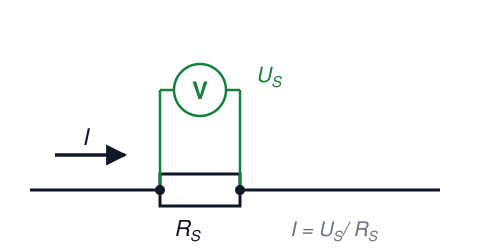

### Reale Messungen: Vierleitermessung

Problem: Bei kleinen Widerständen (z.B. Pt100 mit $100 \, \Omega$) verfälscht der **Leitungswiderstand** der Zuleitungen die Messung.

**Lösung – Vierleitermessung:**

- Zwei Leitungen führen den (bekannten) Messstrom $I$
- Zwei separate Leitungen messen die Spannung **direkt am Sensor** – durch sie fließt (ideales Voltmeter!) kein Strom → kein Spannungsabfall → Leitungswiderstand fällt heraus

Alltagstechnik: jedes Labornetzteil mit „Sense“-Klemmen arbeitet so.

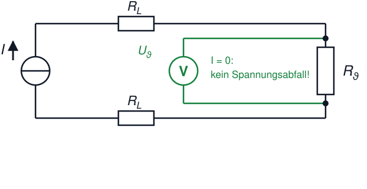

### 📝 Aufgabe 10: Temperaturmessung

Ein Pt100 ($R_0 = 100 \, \Omega$ bei $\vartheta_0 = 0 \, °\text{C}$, $\alpha = 4 \cdot 10^{-3} \, \text{K}^{-1}$ – hier vereinfacht gerundet) wird von einer idealen Stromquelle mit $I = 1 \, \text{mA}$ gespeist. Über eine Vierleitermessung wird direkt am Sensor $U_\vartheta = 120 \, \text{mV}$ gemessen.

a) Wie groß ist der Sensorwiderstand $R_\vartheta$?

b) Welche Temperatur $\vartheta$ hat der Sensor?

c) Welche Leistung $P_\vartheta$ nimmt der Sensor auf? Warum sollte sie klein bleiben?

### Unsere Basiseinheiten-Tabelle wächst

| Elektrische Größe | Formelzeichen | Einheit | Basiseinheiten |
|---|---|---|---|
| Ladung | $Q$ | C | $\text{A} \cdot \text{s}$ |
| Spannung | $U$ | V | $\frac{\text{kg} \cdot \text{m}^2}{\text{A} \cdot \text{s}^3}$ |
| Kapazität | $C$ | F | $\frac{\text{A}^2 \cdot \text{s}^4}{\text{kg} \cdot \text{m}^2}$ |
| **Widerstand** | $R$ | Ω | ❓ |
| **Leistung** | $P$ | W | ❓ |

Leiten Sie die Basiseinheiten von Widerstand und Leistung her.

### Zusammenfassung: Gleichstrom

- $I = dQ/dt$; Ohm: $U = R \cdot I$; $R = \rho \, l / A$; $R(T)$ linear mit $\alpha$
- Kirchhoff: Knoten- und Maschenregel; $k-1$ unabhängige Knotengleichungen
- Reihe: R addieren, Spannungsteiler; parallel: G addieren, Stromteiler – **Topologie zählt, nicht die Zeichnung!**
- **Zweipoltheorie:** jedes lineare Netzwerk = $U_0$ + $R_i$; Quellen deaktivieren für $R_i$
- Leistungsanpassung: $P_\text{max} = U_0^2/4R_i$ bei $R = R_i$, dann $\eta = 0{,}5$
- Arbeitspunkt = Schnittpunkt von Quellen- und Lastkennlinie
- Messen: Lastfehler, Shunt, Vierleitermessung

**Nächstes Kapitel:** Magnetismus – das zweite große Feld der Elektrotechnik 🧲
