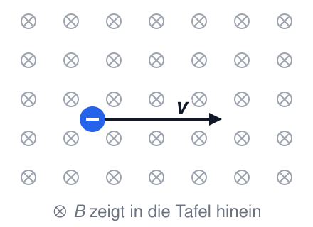
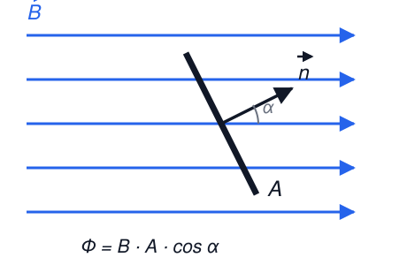
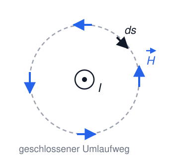
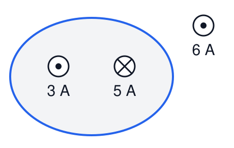
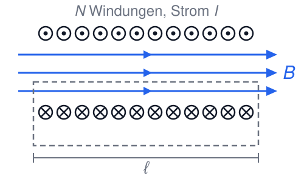
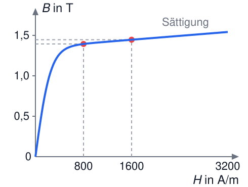
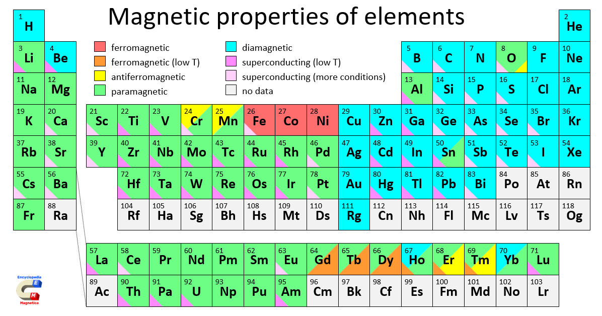

# Elektrotechnik – 4. Magnetismus I

**Luft- und Raumfahrttechnik Bachelor, 1. Semester**

David Straub

## 4. Magnetismus

1. Magnetisches Feld
2. Kräfte im magnetischen Feld
3. Magnetische Feldgrößen und Durchflutungsgesetz
4. Materie im Magnetfeld
5. Der magnetische Kreis
6. Kraft am Luftspalt

### Elektrizität & Magnetismus

... sind untrennbar verbunden. Eine konsistente Naturbeschreibung erfordert beide.

Grenzfälle:

- Ruhende Ladungen → **Elektrostatik**
- Konstante Stromverteilungen → **Magnetostatik**
- Langsam bewegte Ladungen & langsam veränderliche Ströme → **Quasistatik**
- Allgemeiner Fall → **Elektrodynamik**

### Magnetpole

- Magnete besitzen immer zwei Pole: Nordpol (N) und Südpol (S)
    - Nordpol = Pol, der auf der Erde nach Norden zeigt
- Gleichnamige Pole stoßen sich ab, ungleichnamige Pole ziehen sich an

### 🗳️ Zwei parallele Leiter

Zwei lange, parallele Drähte führen Ströme in **dieselbe** Richtung.

Was passiert?

A) Sie ziehen sich an.

B) Sie stoßen sich ab.

C) Nichts – die Drähte sind elektrisch neutral.

D) Sie verdrehen sich gegeneinander.

### Kräfte zwischen elektrischen Leitern

Zwei parallele, stromdurchflossene Leiter üben eine Kraft aufeinander aus:

$$\frac{|\vec{F}_{12}|}{l} = 2k_A \cdot \frac{I_1 I_2}{d}$$

Magnetfelder entstehen durch bewegte elektrische Ladungen (Ströme).

Im SI-System gilt $k_A = \frac{\mu_0}{4\pi}$ mit $\mu_0 \approx 4\pi \cdot 10^{-7} \, \frac{\text{N}}{\text{A}^2}$

### Wichtiger Unterschied zur Elektrostatik

- In der Elektrostatik haben wir die Feldstärke über die Kraft definiert: $\vec{E} = \frac{\vec{F}}{Q}$
- In der Magnetostatik geht das nicht so einfach, da die Kraft senkrecht zur Bewegungsrichtung der Ladung wirkt
- Experimentell lassen sich Feldlinien durch die Ausrichtung kleiner Permanentmagnete (Kompassnadeln) sichtbar machen

### Magnetische Feldlinien

- Magnetische Feldlinien zeigen in die Richtung, in die sich der Nordpol eines kleinen Testmagneten ausrichten würde: N → S außerhalb des Magneten
- Magnetische Feldlinien sind **immer geschlossen** (keine magnetischen Monopole!)
- Die Dichte der Feldlinien ist ein Maß für die Stärke des Magnetfeldes

### Magnetische Flussdichte $\vec{B}$

Die magnetische Flussdichte $\vec{B}$ zeigt entlang der magnetischen Feldlinien. Ihr Betrag ist proportional zur Dichte der Feldlinien.

### Rechte-Faust-Regel

- Ein gerader, stromdurchflossener Leiter erzeugt ein ringförmiges Magnetfeld. Wenn der Daumen der Faust in Stromrichtung zeigt, zeigen die gekrümmten Finger in Feldrichtung
- Alternativ: Eindrehen einer Schraube in Stromrichtung → Drehrichtung der Schraube entspricht der Feldlinienrichtung

### Magnetische Flussdichte eines stromdurchflossenen Leiters

Im Abstand $r$ von einem geraden, unendlich langen Leiter:

$$|\vec{B}| = \frac{\mu_0}{2\pi} \cdot \frac{I}{r}$$

Einheit: das **Tesla**

$$[\vec{B}] = [\mu_0] \cdot \frac{[I]}{[r]} = \frac{\text{N}}{\text{A}^2} \cdot \frac{\text{A}}{\text{m}} = \frac{\text{N}}{\text{A}\cdot\text{m}} = \text{T}$$

### 🗳️ 1 Tesla im Abstand 1 m

Welcher Strom in einem langen, geraden Draht erzeugt im Abstand $r = 1 \, \text{m}$ die Flussdichte $B = 1 \, \text{T}$?

A) $5 \, \text{A}$

B) $5 \, \text{kA}$

C) $5 \, \text{MA}$

D) $5 \, \text{GA}$

### Größenordnung der magnetischen Flussdichte

| Quelle                | Magnetische Flussdichte *B* |
|-----------------------------------|------------------------------------------|
| Erdmagnetfeld                     | 30 µT – 60 µT                            |
| Kühlschrankmagnet                 | 1 mT – 10 mT                             |
| Magnetstreifen (Kreditkarte)      | 10 mT – 100 mT                           |
| Lautsprechermagnet                | 100 mT – 1 T                             |
| MRT-Gerät            | 1 T – 3 T                             |
| Large Hadron Collider (LHC)  | 8 T                                      |
| Fusionskraftwerk  | 5–15 T |

### 📝 Aufgabe 11a: Doppelleitung

Bei einer langen Doppelleitung (Hin- und Rückleiter) beträgt der Achsabstand $a = 25 \, \text{cm}$; der Strom ist $I = 100 \, \text{A}$.

a) Addieren oder subtrahieren sich die Beiträge beider Leiter auf der Verbindungslinie zwischen ihnen? Begründen Sie mit der Rechte-Faust-Regel.

b) Berechnen Sie allgemein den Betrag der Flussdichte $B$ auf der Verbindungslinie und werten Sie ihn in der Mitte aus.

c) Vergleichen Sie mit dem Erdmagnetfeld!

### Kräfte im magnetischen Feld

**Lorentzkraft auf bewegte Ladung:**

$$\vec{F} = Q \cdot (\vec{v} \times \vec{B})$$

**Kraft auf stromdurchflossenen Leiter:**

$$\vec{F} = I \cdot (\vec{\ell} \times \vec{B})$$

- Skalar (wenn $\vec{\ell} \perp \vec{B}$): $F = I \cdot \ell \cdot B$
- **Rechte-Hand-Regel:** Daumen = Stromrichtung, Zeigefinger = Feldrichtung, Mittelfinger = Kraftrichtung

### 🗳️ Kraft auf ein Elektron

Ein Elektron fliegt mit der Geschwindigkeit $\vec{v}$ durch ein Magnetfeld, das in die Tafel hinein zeigt.

In welche Richtung wirkt die Lorentzkraft?

A) nach oben

B) nach unten

C) in die Tafel hinein

D) es wirkt keine Kraft

### Bewegte Ladung im Magnetfeld

**Kreisbewegung:**

- Lorentzkraft wirkt als Zentripetalkraft: $Q \cdot v \cdot B = \frac{m \cdot v^2}{r}$
- Bahnradius: $r = \frac{m \cdot v}{Q \cdot B}$
- Umlauffrequenz: $f = \frac{Q \cdot B}{2\pi m}$ (unabhängig von $v$!)

**Anwendungen:** Teilchenbeschleuniger (Zyklotron), Massenspektrometer

### Vergleich: Elektrisches und magnetisches Feld

| Eigenschaft | Elektrisches Feld | Magnetisches Feld |
|-------------|-------------------|-------------------|
| **Feldlinien** | Beginnen/enden auf Ladungen | Geschlossen |
| **Quellen** | Ladungen | Keine (keine Monopole) |
| **Wirbel** | Keine (wirbelfrei) | Ströme erzeugen Wirbel |
| **Potential** | $\vec{E} = -\operatorname{grad} \varphi$ | Im Allgemeinen kein skalares Potential |
| **Arbeit an Ladung** | Wegunabhängig | Null, da $\vec{F} \perp \vec{v}$ |

**Elektrostatisches Feld** = Quellenfeld, wirbelfrei
**Magnetostatisches Feld** = quellenfrei, Wirbelfeld

### Magnetischer Fluss $\Phi$

Der magnetische Fluss $\Phi$ durch eine Fläche $A$:

$$\Phi = \int_A \vec{B} \cdot d\vec{A}$$

Einheit: $[\Phi] = \text{Vs} = \text{Wb}$ (Weber)

Da das magnetische Feld *quellenfrei* ist, gilt für jede geschlossene Fläche:

$$\oint_A \vec{B} \cdot d\vec{A} = 0$$

(Vergleiche: Satz von Gauß, $\oint_A \vec{D} \cdot d\vec{A} = Q_{\text{innen}}$)

### Magnetische Feldstärke $\vec{H}$

Die magnetische Feldstärke $\vec{H}$ beschreibt die Fähigkeit eines elektrischen Stroms, ein Magnetfeld zu erzeugen.

**Zusammenhang mit der magnetischen Flussdichte** (im Vakuum):

$$\vec{B} = \mu_0 \vec{H}$$

Einheit: $[H] = \frac{\text{A}}{\text{m}}$

**Beispiel:** gerader stromdurchflossener Leiter (Abstand $r$): $H = \frac{I}{2\pi r}$

### Durchflutungsgesetz (Ampèresches Gesetz)

Die Summe der magnetischen Feldstärke längs eines geschlossenen Weges ist gleich der Gesamtstromdurchflutung:

$$\Theta = N \cdot I = \oint \vec{H}(s) \cdot d\vec{s}$$

Erinnerung: in der Elektrostatik gilt aufgrund der Wegunabhängigkeit des Potentials:

$$\oint \vec{E}(s) \cdot d\vec{s} = 0$$

### 🗳️ Durchflutung

Wie groß ist der Betrag von $\oint \vec{H} \cdot d\vec{s}$ entlang der blauen Kurve?

(⊙ aus der Tafel heraus, ⊗ in die Tafel hinein)

A) $2 \, \text{A}$

B) $4 \, \text{A}$

C) $8 \, \text{A}$

D) $14 \, \text{A}$

### Vergleich: Gaußsches Gesetz und Ampèresches Gesetz

| Elektrostatik | Magnetostatik |
|---------------|---------------|
| **Gaußsches Gesetz** | **Ampèresches Gesetz** |
| $\oint_A \vec{D} \cdot d\vec{A} = Q_{\text{innen}}$ | $\oint_s \vec{H} \cdot d\vec{s} = I_{\text{umschlossen}}$ |
| Quellenfeld | Wirbelfeld |
| **Wirbelfreiheit:** $\oint_s \vec{E} \cdot d\vec{s} = 0$ | **Quellenfreiheit:** $\oint_A \vec{B} \cdot d\vec{A} = 0$ |

**Anwendung bei Symmetrie:**
- Gauß → Kugel-, Zylinder-, Plattensymmetrie für Ladungen
- Ampère → Zylinder-, Ebenen-, Toroidsymmetrie für Ströme

### Magnetfeld einer langen Spule

Lange Spule mit $N$ Windungen, Länge $\ell$, Strom $I$. Durchflutungsgesetz:

$$\oint \vec{H} \cdot d\vec{s} = N \cdot I$$

**Im Inneren der Spule** (Luft):

$$H = \frac{N \cdot I}{\ell}, \qquad B = \mu_0 H$$

**Außerhalb:** $B \approx 0$

Mit einem Eisenkern wird $B$ um ein Vielfaches größer – dazu gleich beim Magnetfeld in Materie.

### 📝 Aufgabe 11b: Lange Spule

Eine lange Spule hat $N = 500$ Windungen auf $\ell = 25 \, \text{cm}$ und führt $I = 1 \, \text{A}$.

a) Wie groß sind $H$ und $B$ im Inneren (Luft)? Vergleichen Sie mit dem Erdmagnetfeld!

b) Wie viele Windungen bräuchte die Spule bei gleichem Strom und gleicher Länge für $B = 1 \, \text{T}$?

### Materie im Magnetfeld

Bei gleicher Feldstärke $H$ hängt die Flussdichte vom Material ab:

$$\vec{B} = \mu_0 \mu_r \vec{H}$$

| Klasse | $\mu_r$ | Beispiele |
|---|---|---|
| diamagnetisch | knapp unter 1 (z.B. $1 - 10^{-5}$) | Kupfer, Wasser, Silber |
| paramagnetisch | knapp über 1 (z.B. $1 + 2 \cdot 10^{-5}$) | Aluminium, Luft, Platin |
| ferromagnetisch | $10^2$ bis $10^5$, **nicht konstant** | Eisen, Nickel, Kobalt und ihre Legierungen |

Für die Technik verhalten sich Dia- und Paramagnete wie Luft. Ferromagnete bündeln den Fluss – daraus baut man Kerne.

### Ferromagnete: Hysterese

Die Flussdichte hängt von der *Vorgeschichte* ab:

- **Sättigung** (1): mehr Strom bringt kaum noch mehr $B$
- **Remanenz** (2): Flussdichte, die ohne äußeres Feld bleibt
- **Koerzitivfeldstärke** (3): Feldstärke, die die Magnetisierung beseitigt

**Weichmagnetisch** (schmale Schleife): Trafo- und Motorkerne, Elektromagnete
**Hartmagnetisch** (breite Schleife): Permanentmagnete

### Weiches Eisen: Magnetisierungskurve

Bei weichmagnetischen Werkstoffen ist die Schleife so schmal, dass man mit **einer** Kurve $B(H)$ rechnet.

- Steiler Anstieg: $\mu_r$ sehr groß
- Ab etwa 1,4 T Sättigung: $\mu_r$ sinkt stark
- $\mu_r = \dfrac{B}{\mu_0 H}$ gilt nur im jeweiligen Arbeitspunkt

### 🗳️ Doppelter Strom im Eisenkern

Eine Spule mit Eisenkern arbeitet bei $H = 800 \, \text{A/m}$, also $B \approx 1{,}4 \, \text{T}$. Der Spulenstrom wird **verdoppelt**.

Was passiert mit $B$?

A) $B$ verdoppelt sich

B) $B$ steigt, aber deutlich weniger als doppelt

C) $B$ bleibt exakt gleich

D) $B$ steigt auf mehr als das Doppelte

### Übersicht: Größen in der Magnetostatik

Größe | Definition | Einheit
--- | --- | ---
Magnetische Flussdichte (*magnetic flux density*) | $\vec{B}$ | $[\vec{B}] = \text{T} = \frac{\text{N}}{\text{A} \cdot \text{m}}$
Magnetische Feldstärke (*magnetic field [strength]*) | $\vec{H} = \frac{\vec{B}}{\mu_0 \mu_r}$ | $[\vec{H}] = \frac{\text{A}}{\text{m}}$
Magnetischer Fluss (*magnetic flux*) | $\Phi = \int_A \vec{B} \cdot d\vec{A}$ | $[\Phi] = \text{Vs} = \text{Wb}$
Durchflutung (*magnetomotive force*) | $\Theta = N \cdot I = \oint \vec{H} \cdot d\vec{s}$ | $[\Theta] = \text{A}$
Magnetische Feldkonstante | $\mu_0$ | $[\mu_0] = \frac{\text{N}}{\text{A}^2}$
Relative Permeabilität | $\mu_r = \frac{\mu}{\mu_0}$ | dimensionslos

### 📝 Aufgabe 12: Materie im Magnetfeld

a) Ein Elektromagnet soll in einer Recyclinganlage Metallteile sortieren. Kann er Aluminiumplatten anheben? Stahlplatten? (Mit Begründung!)

b) Lesen Sie aus den Hysteresekurven rechts ab: Welche Größe muss ein Material für einen guten *Permanentmagneten* besitzen – und welche für einen guten *Transformatorkern*?

c) Ein Ringkern aus Elektroblech ($\ell = 20 \, \text{cm}$) trägt $N = 200$ Windungen. Bestimmen Sie $H$, $B$ und $\mu_r$ für $I = 0{,}8 \, \text{A}$ und $I = 1{,}6 \, \text{A}$.

| $H$ in A/m | 400 | 800 | 1600 |
|---|---|---|---|
| $B$ in T | 1,25 | 1,40 | 1,45 |

### Zwischenstand – und nächste Woche: Probeklausur!

Heute: Magnetfeld ($B$, $H$, $\Phi$, $\Theta$), Kräfte ($F = Q v B$, $F = I \ell B$), Durchflutungsgesetz, Materie (dia/para/ferro, Hysterese)

**Nächste Woche: Probeklausur unter Klausurbedingungen**

- Stoff: Kapitel 1–3 (Einheiten, E-Feld, Gleichstrom)
- 60 Minuten, keine Hilfsmittel – wie in der echten Prüfung
- Mit „Ersatzwerten“ wie im Original: wenn Sie eine Teilaufgabe nicht lösen, rechnen Sie mit dem Ersatzwert weiter!
- Danach: ausführliche Besprechung

**In zwei Wochen:** der magnetische Kreis – Magnetfelder berechnen wie Stromkreise.

## Vertiefung

Für alle, die es genauer wissen wollen

### Vertiefung: Magnetisches Verhalten von Materie

Ähnlich wie bei Dielektrika im elektrischen Feld reagiert Materie im Magnetfeld durch **Magnetisierung**.

**Magnetische Dipole in Atomen:**

- Elektronen haben einen intrinsischen **Spin** (magnetischer Dipol)
- Bahnbewegung der Elektronen erzeugt **Bahnmagnetismus**
- Jedes Elektron ist ein winziger Permanentmagnet – makroskopische Magnete entstehen durch **Ausrichtung** vieler Spins

### Vertiefung: Magnetische Suszeptibilität und Permeabilität

Die Magnetisierung $\vec{M}$ ist proportional zur magnetischen Feldstärke $\vec{H}$:

$$\vec{M} = \chi_m \vec{H}, \qquad \mu_r = 1 + \chi_m$$

**Reaktion auf äußeres Feld:**

- **Diamagnetismus:** gegen das äußere Feld ($\mu_r < 1$, $\chi_m < 0$)
- **Paramagnetismus:** mit dem äußeren Feld ($\mu_r > 1$, $\chi_m > 0$)
- **Ferromagnetismus:** starke Ausrichtung ($\mu_r \gg 1$)

### Vertiefung: Magnetische Eigenschaften der Elemente

(S. Zurek, Encyclopedia Magnetica, CC-BY-SA 4.0)

### Vertiefung: Diamagnetismus

- Tritt in **allen** Materialien auf; $\chi_m < 0$ (sehr klein), $\mu_r$ knapp unter 1
- Mechanismus: externes Feld induziert Änderung der Elektronenbahnen → magnetisches Moment **entgegen** dem äußeren Feld
- Effekt verschwindet mit dem Feld

**Beispiele:** Kupfer, Silber, Gold, Wasser, organische Materialien

Kuriosum: Diamagnete können in starken Feldern schweben →

### Vertiefung: Paramagnetismus

- Atome besitzen **permanente magnetische Dipole**; $\chi_m > 0$ (klein), $\mu_r$ knapp über 1
- Ohne Feld: zufällige Ausrichtung (thermische Bewegung); mit Feld: partielle Ausrichtung **parallel**
- Paramagnete werden schwach von Magneten angezogen; stärker bei tiefen Temperaturen

**Beispiele:** **Aluminium**, Platin, Sauerstoff

### Vertiefung: Ferromagnetismus

- Sehr starke Magnetisierung: $\mu_r \gg 1$ (bis zu $10^5$!)
- **Spontane Magnetisierung** auch ohne externes Feld möglich
- Mechanismus: starke Wechselwirkung benachbarter Atome (**Austauschwechselwirkung**) → Bildung von **Weiss’schen Bezirken** (Domänen), die ein externes Feld ausrichtet

**Beispiele:** Eisen, Kobalt, Nickel

### Vertiefung: Weiss’sche Bezirke

- Bereiche mit **gleich orientierten magnetischen Dipolen**
- Spontane Magnetisierung innerhalb der Bezirke

**Ohne äußeres Feld:** Bezirke zufällig orientiert → keine Gesamtmagnetisierung
**Mit äußerem Feld:** Bezirke richten sich aus; bei Sättigung einheitlich

### Vertiefung: Magnetisches Feld und Magnetisierung

**Magnetisierung** $\vec{M}$: magnetisches Dipolmoment pro Volumeneinheit

$$\vec{B} = \mu_0(\vec{H} + \vec{M}) = \mu_0 \mu_r \vec{H}$$

**Konvention:** $\vec{H}$ beschreibt das durch **freie Ströme** erzeugte Feld – ohne Beiträge der Magnetisierung (vgl. $\vec{D}$ und freie Ladungen in der Elektrostatik!).

**Vorteil:** Das Durchflutungsgesetz gilt unverändert:

$$\oint \vec{H} \cdot d\vec{s} = I_{\text{frei}}$$

### Vertiefung: Magnetfeld in einem Tokamak

### Vertiefung: Magnetfeld in einem Tokamak

Ringförmiges Fusionsreaktor-Design mit toroidalem Magnetfeld zum Plasmaeinschluss.

**Toroidale Feldspulen (TF):** $N$ Spulen, $M$ Windungen, Strom $I$; Ampèresches Gesetz auf kreisförmigem Weg (Radius $r$):

$$H \cdot 2\pi r = N M I \quad\Rightarrow\quad H(r) = \frac{N M I}{2\pi r}$$

Feld nimmt mit $1/r$ ab (inhomogen); typisch $B \approx 5{-}15 \, \text{T}$

**Beispiel ITER:** 18 TF-Spulen, 134 Windungen, 68 kA → B = 5,3 T bei 6,2 m Radius
