# Elektrotechnik – 4. Magnetismus I

**Luft- und Raumfahrttechnik Bachelor, 1. Semester**

David Straub

## 4. Magnetismus

1. **Magnetisches Feld**
2. **Kräfte im magnetischen Feld**
3. **Magnetische Feldgrößen und Durchflutungsgesetz**
4. **Materie im Magnetfeld**
5. Der magnetische Kreis
6. Kraft am Luftspalt

### Elektrizität & Magnetismus

... sind untrennbar verbunden. Eine konsistente Naturbeschreibung erfordert beide.

Grenzfälle:

- Ruhende Ladungen → **Elektrostatik**
- Konstante Stromverteilungen → **Magnetostatik**
- Langsam bewegte Ladungen & langsam veränderliche Ströme → **Quasistatik**
- Allgemeiner Fall → **Elektrodynamik**

### Magnetpole

- Magnete besitzen immer zwei Pole: Nordpol (N) und Südpol (S)
    - Nordpol = Pol, der auf der Erde nach Norden zeigt
- Gleichnamige Pole stoßen sich ab, ungleichnamige Pole ziehen sich an
- Am geographischen Nordpol der Erde liegt deshalb ein magnetischer **Südpol**

### Magnete und Ströme

- **Ørsted (1820):** Ein stromdurchflossener Draht lenkt eine Kompassnadel ab.
- **Ampère (1820):** Zwei Ströme üben Kräfte aufeinander aus, ganz ohne Magnet.
- **Ampères Hypothese:** Auch Permanentmagnete beruhen auf Strömen, auf winzigen Kreisströmen in den Atomen. Heute weiß man: Ursache sind die Elektronen der Atome (Bahnbewegung und Spin).

**Alle Magnetfelder stammen von bewegten Ladungen.** Im Permanentmagneten sind es die Elektronen der Atome.

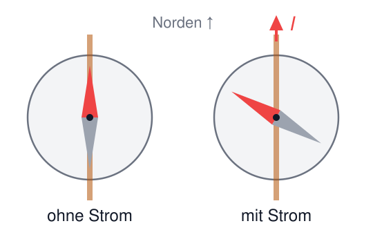

### Kräfte zwischen elektrischen Leitern

Zwei parallele, stromdurchflossene Leiter üben eine Kraft aufeinander aus (Kraft pro Leiterlänge $\ell$):

$$\frac{|\vec{F}_{12}|}{\ell} = 2k_A \cdot \frac{I_1 I_2}{d}$$

Magnetfelder entstehen durch bewegte elektrische Ladungen (Ströme).

**Anwendung:** Bei einem Kurzschluss fließen Ströme von vielen kA. Stromschienen in Schaltanlagen und Batteriesystemen werden mechanisch auf diese Kräfte ausgelegt.

### Die Konstante $k_A$

| Elektrostatik | Magnetostatik |
|---|---|
| $\lvert\vec{F}_{12}\rvert = k \cdot \dfrac{\lvert Q_1 Q_2\rvert}{r^2}$ | $\dfrac{\lvert\vec{F}_{12}\rvert}{\ell} = 2k_A \cdot \dfrac{I_1 I_2}{d}$ |
| $k = \dfrac{1}{4\pi\varepsilon_0}$ | $k_A = \dfrac{\mu_0}{4\pi}$ |

Wie $k$ ist $k_A$ eine **Einheiten-Konvention**: Ihr Wert hängt davon ab, in welchen Einheiten man Kraft, Strom und Länge misst.

Im SI-System: magnetische Feldkonstante $\mu_0 \approx 4\pi \cdot 10^{-7} \, \frac{\text{N}}{\text{A}^2}$

### Magnetische Feldlinien und Flussdichte $\vec{B}$

- Kompassnadeln machen Feldlinien sichtbar: Feldlinien zeigen in die Richtung, in die sich der Nordpol einer kleinen Kompassnadel ausrichtet, außerhalb des Magneten von N nach S
- Magnetische Feldlinien sind **immer geschlossen** (keine magnetischen Monopole!)
- Die **magnetische Flussdichte** $\vec{B}$ zeigt entlang der Feldlinien. Ihr Betrag ist proportional zur Dichte der Feldlinien.

### Rechte-Faust-Regel

- Ein gerader, stromdurchflossener Leiter erzeugt ein ringförmiges Magnetfeld. Wenn der Daumen der Faust in Stromrichtung zeigt, zeigen die gekrümmten Finger in Feldrichtung
- Alternativ: Eindrehen einer Schraube in Stromrichtung → Drehrichtung der Schraube entspricht der Feldlinienrichtung

### Magnetische Flussdichte eines stromdurchflossenen Leiters

Im Abstand $r$ von einem geraden, unendlich langen Leiter:

$$|\vec{B}| = \frac{\mu_0}{2\pi} \cdot \frac{I}{r}$$

Einheit: das **Tesla**

$$[\vec{B}] = [\mu_0] \cdot \frac{[I]}{[r]} = \frac{\text{N}}{\text{A}^2} \cdot \frac{\text{A}}{\text{m}} = \frac{\text{N}}{\text{A}\cdot\text{m}} = \text{T}$$

**Anwendung:** Die Stromzange misst den Strom über das Magnetfeld $B \sim I$, ohne den Leiter aufzutrennen.

### 🗳️ 1 Tesla im Abstand 1 m

Welcher Strom in einem langen, geraden Draht erzeugt im Abstand $r = 1 \, \text{m}$ die Flussdichte $B = 1 \, \text{T}$?

A) $5 \, \text{A}$

B) $5 \, \text{kA}$

C) $5 \, \text{MA}$

D) $5 \, \text{GA}$

### Größenordnung der magnetischen Flussdichte

| Quelle                | Magnetische Flussdichte *B* |
|-----------------------------------|------------------------------------------|
| Erdmagnetfeld                     | 30 µT – 60 µT                            |
| Kühlschrankmagnet                 | 1 mT – 10 mT                             |
| Magnetstreifen (Kreditkarte)      | 10 mT – 100 mT                           |
| Lautsprechermagnet                | 100 mT – 1 T                             |
| MRT-Gerät            | 1 T – 3 T                             |
| Large Hadron Collider (LHC)  | 8 T                                      |
| Fusionskraftwerk  | 5–15 T |

### 📝 Aufgabe 11a: Doppelleitung

Bei einer langen Doppelleitung (Hin- und Rückleiter) beträgt der Achsabstand $a = 25 \, \text{cm}$; der Strom ist $I = 100 \, \text{A}$.

a) Addieren oder subtrahieren sich die Beiträge beider Leiter auf der Verbindungslinie zwischen ihnen? Begründen Sie mit der Rechte-Faust-Regel.

b) Berechnen Sie allgemein den Betrag der Flussdichte $B$ auf der Verbindungslinie und werten Sie ihn in der Mitte aus.

c) Vergleichen Sie mit dem Erdmagnetfeld!

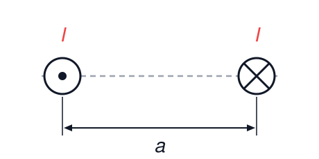

### Lorentzkraft auf bewegte Ladung

$$\vec{F} = Q \cdot (\vec{v} \times \vec{B})$$

- Die Kraft steht **senkrecht** auf $\vec{v}$ und $\vec{B}$. Im elektrischen Feld wirkt $\vec{F} = Q \vec{E}$ auf eine positive Ladung dagegen in Feldrichtung.
- Betrag (wenn $\vec{v} \perp \vec{B}$): $F = |Q| \cdot v \cdot B$
- **Rechte-Hand-Regel:** Daumen = Bewegungsrichtung der positiven Ladung (Stromrichtung), Zeigefinger = Feldrichtung, Mittelfinger = Kraftrichtung

**Anwendung:** Hall-Sensor. Die Lorentzkraft lenkt die Ladungsträger in einem Halbleiterplättchen seitlich ab, es entsteht eine messbare Spannung $\sim B$. So messen Antriebe Drehzahl und Rotorlage.

### 🗳️ Kraft auf ein Elektron

Ein Elektron fliegt mit der Geschwindigkeit $\vec{v}$ durch ein Magnetfeld, das in die Tafel hinein zeigt.

In welche Richtung wirkt die Lorentzkraft?

A) nach oben

B) nach unten

C) in die Tafel hinein

D) es wirkt keine Kraft

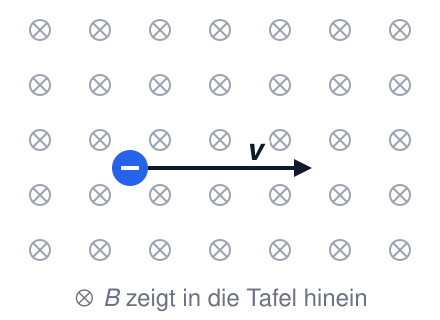

### Bewegte Ladung im Magnetfeld

**Kreisbewegung:**

- Lorentzkraft wirkt als Zentripetalkraft: $|Q| \cdot v \cdot B = \frac{m \cdot v^2}{r}$
- Bahnradius: $r = \frac{m \cdot v}{|Q| \cdot B}$
- Umlauffrequenz: $f = \frac{|Q| \cdot B}{2\pi m}$ (unabhängig von $v$!)

**Anwendungen:** Teilchenbeschleuniger (Zyklotron), Massenspektrometer

### Kraft auf stromdurchflossenen Leiter

Im Leiter bewegen sich viele Ladungen. Die Lorentzkräfte addieren sich zu:

$$\vec{F} = I \cdot (\vec{\ell} \times \vec{B})$$

Skalar (wenn $\vec{\ell} \perp \vec{B}$): $F = I \cdot \ell \cdot B$

**Anwendung auf zwei parallele Leiter:** Leiter 1 erzeugt am Ort von Leiter 2 die Flussdichte $B_1 = \frac{\mu_0}{2\pi} \cdot \frac{I_1}{d}$. Damit:

$$\frac{F_{12}}{\ell} = I_2 \cdot B_1 = \frac{\mu_0}{2\pi} \cdot \frac{I_1 I_2}{d} = 2k_A \cdot \frac{I_1 I_2}{d}$$

### Anwendung: Gleichstrommotor

Drehbar gelagerte Leiterschleife (Länge $\ell$, Radius $r$) im Magnetfeld:

- Auf beide Seiten wirkt $F = I \ell B$, entgegengesetzt gerichtet.
- Drehmoment des Kräftepaars bei $N$ Windungen: $M = 2 N r I \ell B$, also $M \sim I$
- Nach einer halben Umdrehung muss der Strom umgepolt werden: Kommutator mit Bürsten. Beim bürstenlosen Motor sitzen die Magnete auf dem Rotor, und eine Leistungselektronik schaltet die Ströme in den feststehenden Spulen um.

Gleiches Prinzip: Linearmotor, Lautsprecher, Tauchspulaktor

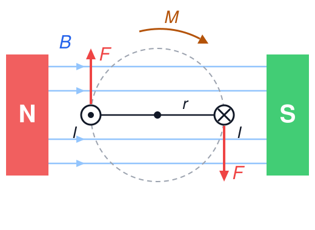

### Vergleich: Elektrostatisches und magnetostatisches Feld

| Eigenschaft | Elektrisches Feld | Magnetisches Feld |
|-------------|-------------------|-------------------|
| **Feldlinien** | Beginnen/enden auf Ladungen | Geschlossen |
| **Quellen** | Ladungen | Keine (keine Monopole) |
| **Wirbel** | Keine (wirbelfrei) | Ströme erzeugen Wirbel |
| **Potential** | $\vec{E} = -\operatorname{grad} \varphi$ | Im Allgemeinen kein skalares Potential |
| **Arbeit an Ladung** | Wegunabhängig | Null, da $\vec{F} \perp \vec{v}$ |

**Elektrostatisches Feld** = Quellenfeld, wirbelfrei
**Magnetostatisches Feld** = quellenfrei, Wirbelfeld

### Magnetischer Fluss $\Phi$

Der magnetische Fluss $\Phi$ durch eine Fläche $A$:

$$\Phi = \int_A \vec{B} \cdot d\vec{A}$$

Homogenes Feld, ebene Fläche: $\Phi = B \cdot A \cdot \cos \alpha$

Einheit: $[\Phi] = \text{Vs} = \text{Wb}$ (Weber)

Da das magnetische Feld *quellenfrei* ist, gilt für jede geschlossene Fläche:

$$\oint_A \vec{B} \cdot d\vec{A} = 0$$

(Vergleiche: Satz von Gauß, $\oint_A \vec{D} \cdot d\vec{A} = Q_{\text{innen}}$)

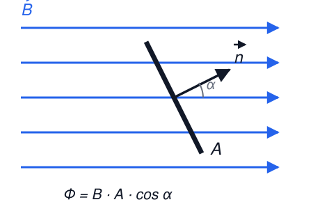

### Magnetische Feldstärke $\vec{H}$

Im Vakuum gilt, analog zu $\vec{D} = \varepsilon_0 \vec{E}$ in der Elektrostatik:

$$\vec{B} = \mu_0 \vec{H}$$

$$[\vec{H}] = \frac{[\vec{B}]}{[\mu_0]} = \frac{\text{N}}{\text{A} \cdot \text{m}} \cdot \frac{\text{A}^2}{\text{N}} = \frac{\text{A}}{\text{m}}$$

**Namen und Rollen:**

- $\vec{B}$ und $\vec{D}$ sind **Flussdichten** (Fluss durch eine Fläche), $\vec{H}$ und $\vec{E}$ **Feldstärken** (Integral längs eines Weges).
- Mit den Quellen verknüpft sind $\vec{D}$ (Satz von Gauß) und $\vec{H}$ (Durchflutungsgesetz). Die Kraft auf Ladungen bestimmen $\vec{E}$ und $\vec{B}$.

**Beispiel:** gerader stromdurchflossener Leiter (Abstand $r$): $H = \frac{I}{2\pi r}$

### Durchflutungsgesetz (Ampèresches Gesetz)

Das Umlaufintegral der magnetischen Feldstärke längs eines geschlossenen Weges ist gleich der Summe der umschlossenen Ströme, der **Durchflutung** $\Theta$:

$$\oint \vec{H}(s) \cdot d\vec{s} = \Theta = \sum I_\text{umschlossen}$$

- Die Ströme zählen mit Richtung (Rechte-Faust-Regel bezogen auf den Umlaufsinn).
- Umschließt der Weg eine Spule mit $N$ Windungen: $\Theta = N \cdot I$

Erinnerung: in der Elektrostatik gilt aufgrund der Wegunabhängigkeit des Potentials:

$$\oint \vec{E}(s) \cdot d\vec{s} = 0$$

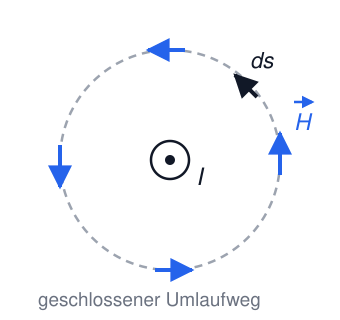

### 🗳️ Durchflutung

Wie groß ist der Betrag von $\oint \vec{H} \cdot d\vec{s}$ entlang der blauen Kurve?

(⊙ aus der Tafel heraus, ⊗ in die Tafel hinein)

A) $2 \, \text{A}$

B) $4 \, \text{A}$

C) $8 \, \text{A}$

D) $14 \, \text{A}$

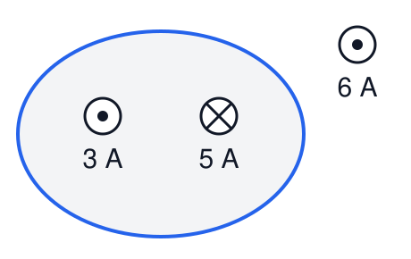

### Vergleich: Gaußsches Gesetz und Ampèresches Gesetz

| Elektrostatik | Magnetostatik |
|---------------|---------------|
| **Gaußsches Gesetz** | **Ampèresches Gesetz** |
| $\oint_A \vec{D} \cdot d\vec{A} = Q_{\text{innen}}$ | $\oint_s \vec{H} \cdot d\vec{s} = I_{\text{umschlossen}}$ |
| Quellenfeld | Wirbelfeld |
| **Wirbelfreiheit:** $\oint_s \vec{E} \cdot d\vec{s} = 0$ | **Quellenfreiheit:** $\oint_A \vec{B} \cdot d\vec{A} = 0$ |

**Anwendung bei Symmetrie:**
- Gauß → Kugel-, Zylinder-, Plattensymmetrie für Ladungen
- Ampère → Zylinder-, Ebenen-, Toroidsymmetrie für Ströme

### Magnetfeld einer langen Spule

$N$ Windungen, Länge $\ell$, Strom $I$. Innen ist das Feld homogen, außen gilt $H \approx 0$.

Durchflutungsgesetz auf dem gestrichelten Weg, abschnittsweise:

- innen ($\vec{H} \parallel d\vec{s}$, Länge $\ell$): $H \cdot \ell$
- außen ($H \approx 0$): $0$
- Querstücke ($\vec{H} \perp d\vec{s}$): $0$

$$H \cdot \ell = N \cdot I \quad\Rightarrow\quad H = \frac{N \cdot I}{\ell}, \qquad B = \mu_0 H$$

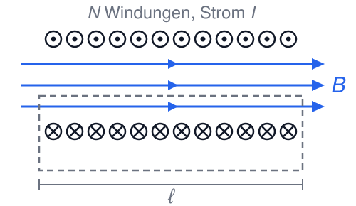

### 📝 Aufgabe 11b: Lange Spule

Eine lange Spule hat $N = 500$ Windungen auf $\ell = 25 \, \text{cm}$ und führt $I = 1 \, \text{A}$.

a) Wie groß sind $H$ und $B$ im Inneren (Luft)? Vergleichen Sie mit dem Erdmagnetfeld!

b) Wie viele Windungen bräuchte die Spule bei gleichem Strom und gleicher Länge für $B = 1 \, \text{T}$?

### Magnetfeld in Materie

Die Elektronen der Atome sind winzige Magnete. Ein äußeres Feld ordnet sie, und ihr gemeinsames Feld (**Magnetisierung**) überlagert sich dem Feld der Ströme. Füllt ein Material eine lange Spule oder einen Ringkern vollständig aus, gilt mit der Permeabilitätszahl $\mu_r$:

$$B_\text{Materie} = \mu_r \cdot B_\text{Vakuum}$$

| Klasse | $\mu_r$ | Ursache | Beispiele |
|---|---|---|---|
| dia&shy;magnetisch | knapp unter 1 | schwaches Gegenfeld der Elektronen | Kupfer, Wasser |
| para&shy;magnetisch | knapp über 1 | atomare Magnete richten sich teilweise aus | Aluminium, Luft |
| ferro&shy;magnetisch | $10^2$ bis $10^5$, **nicht konstant** | ganze Bereiche (Weiss’sche Bezirke) richten sich aus | Eisen, Nickel, Kobalt |

Für die Technik verhalten sich Dia- und Paramagnete wie Luft. Ferromagnete bündeln den Fluss: Daraus baut man Kerne (Elektroblech in Motor und Trafo) und Permanentmagnete (NdFeB in Synchronmotoren von E-Autos und Drohnen).

### Magnetische Feldstärke in Materie

**Konvention:** $\vec{H}$ bezieht sich immer auf das Feld der *freien* Ströme, also der Ströme in den Leitern. Die Magnetisierung des Materials steckt nur in $\vec{B}$:

$$\vec{B} = \mu_0 \mu_r \vec{H} = \mu \vec{H}, \qquad \mu = \mu_0 \mu_r$$

Vorteil: Das Durchflutungsgesetz gilt unverändert, wenn man nur die freien Ströme zählt:

$$\oint \vec{H} \cdot d\vec{s} = \Theta = \sum I_\text{frei}$$

In Spule und Ringkern bestimmen deshalb die Ströme $H$, und das Material bestimmt, welches $B$ daraus wird. Mit Eisenkern wird $B$ um ein Vielfaches größer: Elektromagnet, Relais, Magnetventil (z.B. Einspritzventil).

### Ferromagnete: Hysterese

Die Flussdichte hängt von der *Vorgeschichte* ab:

- **Sättigung** (1): mehr Strom bringt kaum noch mehr $B$
- **Remanenz** $B_r$ (2): Flussdichte, die nach Abschalten des Stroms bleibt
- **Koerzitivfeldstärke** $H_c$ (3): Gegenfeldstärke, bei der die Flussdichte verschwindet

**Weichmagnetisch** (schmale Schleife): Trafo- und Motorkerne, Elektromagnete. Jeder Umlauf kostet Energie (Ummagnetisierungsverluste), die Motor und Trafo erwärmt.
**Hartmagnetisch** (breite Schleife): Permanentmagnete

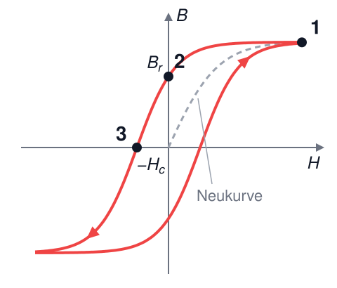

### Weiches Eisen: Magnetisierungskurve

Bei weichmagnetischen Werkstoffen ist die Schleife so schmal, dass man mit **einer** Kurve $B(H)$ rechnet.

- Steiler Anstieg: $\mu_r$ sehr groß
- Ab etwa 1,4 T Sättigung: $\mu_r$ sinkt stark
- $\mu_r = \dfrac{B}{\mu_0 H}$ gilt nur im jeweiligen Arbeitspunkt

**Anwendung:** Elektromotoren werden auf etwa 1,5 T ausgelegt. Mehr Strom bringt dann kaum mehr Kraft, nur mehr Wärme.

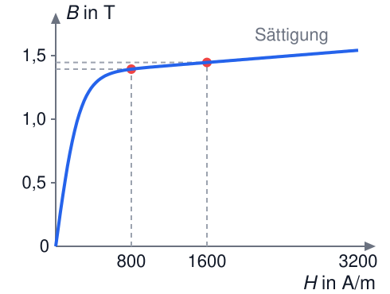

### 🗳️ Doppelter Strom im Eisenkern

Eine Spule mit Eisenkern arbeitet bei $H = 800 \, \text{A/m}$, also $B \approx 1{,}4 \, \text{T}$. Der Spulenstrom wird **verdoppelt**.

Was passiert mit $B$?

A) $B$ verdoppelt sich

B) $B$ steigt, aber deutlich weniger als doppelt

C) $B$ bleibt exakt gleich

D) $B$ steigt auf mehr als das Doppelte

### Übersicht: Größen in der Magnetostatik

Größe | Definition | Einheit
--- | --- | ---
Magnetische Flussdichte (*magnetic flux density*) | $\vec{B}$ | $[\vec{B}] = \text{T} = \frac{\text{N}}{\text{A} \cdot \text{m}}$
Magnetische Feldstärke (*magnetic field [strength]*) | $\vec{H} = \frac{\vec{B}}{\mu_0 \mu_r}$ | $[\vec{H}] = \frac{\text{A}}{\text{m}}$
Magnetischer Fluss (*magnetic flux*) | $\Phi = \int_A \vec{B} \cdot d\vec{A}$ | $[\Phi] = \text{Vs} = \text{Wb}$
Durchflutung (*magnetomotive force*) | $\Theta = N \cdot I = \oint \vec{H} \cdot d\vec{s}$ | $[\Theta] = \text{A}$
Magnetische Feldkonstante | $\mu_0$ | $[\mu_0] = \frac{\text{N}}{\text{A}^2}$
Relative Permeabilität | $\mu_r = \frac{\mu}{\mu_0}$ | dimensionslos

### 📝 Aufgabe 12a/b: Materie im Magnetfeld

a) Ein Elektromagnet soll in einer Recyclinganlage Metallteile sortieren. Kann er Aluminiumplatten anheben? Stahlplatten? (Mit Begründung!)

b) Lesen Sie aus den Hysteresekurven rechts ab: Welche Größe muss ein Material für einen guten *Permanentmagneten* besitzen – und welche für einen guten *Transformatorkern*? Welches Material eignet sich jeweils?

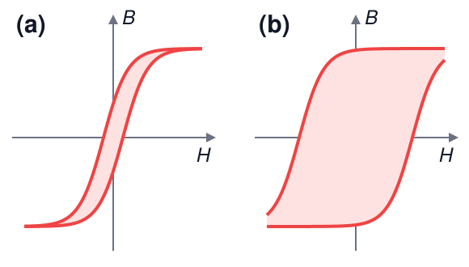

### 📝 Aufgabe 12c: Ringkern

Ein Ringkern aus Elektroblech (mittlere Feldlinienlänge $\ell = 20 \, \text{cm}$) trägt $N = 200$ Windungen. Bestimmen Sie $H$, $B$ und $\mu_r$ für $I = 0{,}8 \, \text{A}$ und $I = 1{,}6 \, \text{A}$.

Magnetisierungskurve des Elektroblechs:

| $H$ in A/m | 400 | 800 | 1600 |
|---|---|---|---|
| $B$ in T | 1,25 | 1,40 | 1,45 |

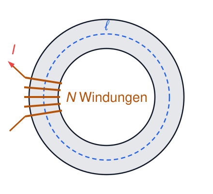

### Zusammenfassung

- Ströme erzeugen Magnetfelder mit geschlossenen Feldlinien; gerader Leiter: $B = \frac{\mu_0}{2\pi} \cdot \frac{I}{r}$
- Kräfte: $\vec{F} = Q \cdot (\vec{v} \times \vec{B})$ auf bewegte Ladungen, $\vec{F} = I \cdot (\vec{\ell} \times \vec{B})$ auf Leiter (Motorprinzip)
- Fluss $\Phi = \int_A \vec{B} \cdot d\vec{A}$, durch jede geschlossene Fläche null
- Durchflutungsgesetz $\oint \vec{H} \cdot d\vec{s} = \Theta$; lange Spule: $H = \frac{N I}{\ell}$
- Materie: $B = \mu_0 \mu_r H$; Ferromagnete bündeln den Fluss, sättigen ab etwa 1,4 T und zeigen Hysterese
