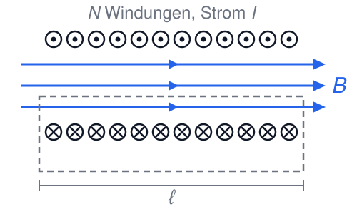
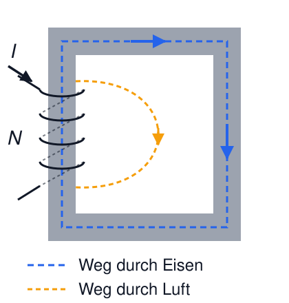
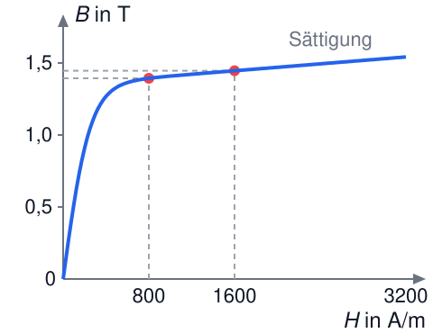
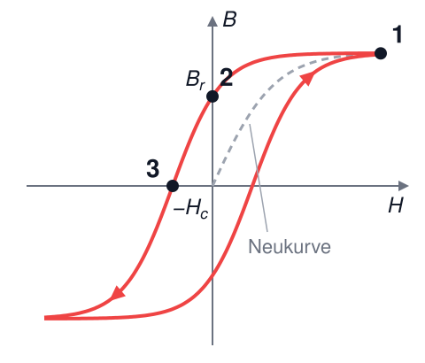
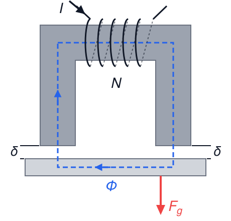
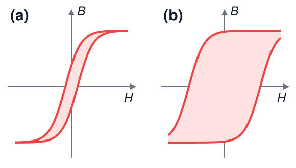
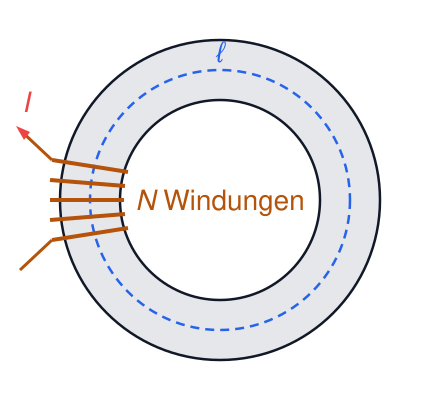
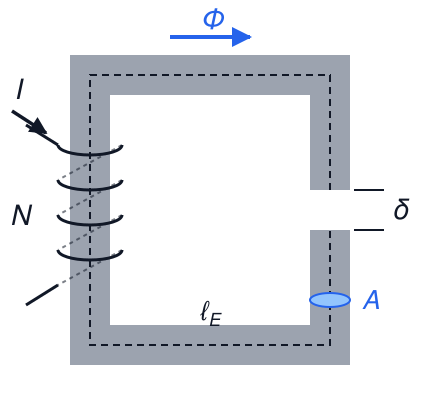
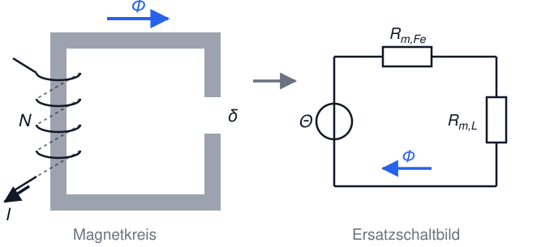
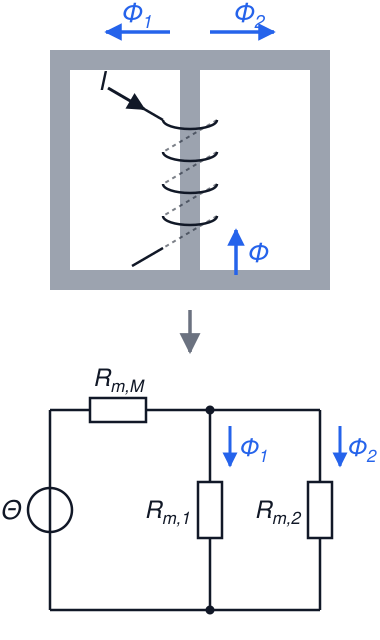

# Elektrotechnik – 4. Magnetismus II

**Luft- und Raumfahrttechnik Bachelor, 1. Semester**

David Straub

## 4. Magnetismus

1. Magnetisches Feld
2. Kräfte im magnetischen Feld
3. Magnetische Feldgrößen und Durchflutungsgesetz
4. **Materie im Magnetfeld**
5. **Der magnetische Kreis**
6. **Kraft am Luftspalt**

### Wiederholung: Durchflutungsgesetz

$$\oint \vec{H} \cdot d\vec{s} = \Theta = \sum I_\text{umschlossen}$$

Die Ströme zählen mit Richtung, eine Spule mit $N$ Windungen zählt $N$-mal.

**Lange Spule:** Nur das Wegstück im Inneren trägt bei:

$$H \cdot \ell = N \cdot I \quad\Rightarrow\quad H = \frac{N \cdot I}{\ell}, \qquad B = \mu_0 H$$

**Aufgabe 11b:** Für $B = 1 \, \text{T}$ in Luft bräuchte man rund $2 \cdot 10^5$ Windungen.

### Wiederholung: Größen der Magnetostatik

Größe | Definition | Einheit
--- | --- | ---
Magnetische Flussdichte (*magnetic flux density*) | $\vec{B}$ | $[\vec{B}] = \text{T} = \frac{\text{N}}{\text{A} \cdot \text{m}}$
Magnetische Feldstärke (*magnetic field [strength]*) | Vakuum: $\vec{H} = \frac{\vec{B}}{\mu_0}$ | $[\vec{H}] = \frac{\text{A}}{\text{m}}$
Magnetischer Fluss (*magnetic flux*) | $\Phi = \int_A \vec{B} \cdot d\vec{A}$ | $[\Phi] = \text{Vs} = \text{Wb}$
Durchflutung (*magnetomotive force*) | $\Theta = N \cdot I = \oint \vec{H} \cdot d\vec{s}$ | $[\Theta] = \text{A}$
Magnetische Feldkonstante | $\mu_0$ | $[\mu_0] = \frac{\text{N}}{\text{A}^2}$

### 🗳️ Gestreckte Spule

Eine lange Spule wird auf die **doppelte Länge** auseinandergezogen. Windungszahl und Strom bleiben gleich.

Was passiert mit $H$ im Inneren?

A) verdoppelt sich

B) bleibt gleich

C) halbiert sich

D) sinkt auf ein Viertel

### Magnetfeld in Materie

Die Elektronen der Atome sind winzige Magnete. Ein äußeres Feld ordnet sie, und ihr gemeinsames Feld (**Magnetisierung**) überlagert sich dem Feld der Ströme. Füllt ein Material eine lange Spule oder einen Ringkern vollständig aus, gilt mit der Permeabilitätszahl $\mu_r$:

$$B_\text{Materie} = \mu_r \cdot B_\text{Vakuum}$$

| Klasse | $\mu_r$ | Ursache | Beispiele |
|---|---|---|---|
| dia&shy;magnetisch | knapp unter 1 | schwaches Gegenfeld der Elektronen | Kupfer, Wasser |
| para&shy;magnetisch | knapp über 1 | atomare Magnete richten sich teilweise aus | Aluminium, Luft |
| ferro&shy;magnetisch | $10^2$ bis $10^5$, **nicht konstant** | ganze Bereiche (Weiss’sche Bezirke) richten sich aus | Eisen, Nickel, Kobalt |

Für die Technik verhalten sich Dia- und Paramagnete wie Luft. Ferromagnete bündeln den Fluss: Daraus baut man Kerne (Elektroblech in Motor und Trafo) und Permanentmagnete (NdFeB in Synchronmotoren von E-Autos und Drohnen).

### Magnetische Feldstärke in Materie

**Konvention:** $\vec{H}$ bezieht sich immer auf das Feld der *freien* Ströme, also der Ströme in den Leitern. Die Magnetisierung des Materials steckt nur in $\vec{B}$:

$$\vec{B} = \mu_0 \mu_r \vec{H} = \mu \vec{H}, \qquad \mu = \mu_0 \mu_r$$

Vorteil: Das Durchflutungsgesetz gilt unverändert, wenn man nur die freien Ströme zählt:

$$\oint \vec{H} \cdot d\vec{s} = \Theta = \sum I_\text{frei}$$

In Spule und Ringkern bestimmen deshalb die Ströme $H$, und das Material bestimmt, welches $B$ daraus wird. Mit Eisenkern wird $B$ um ein Vielfaches größer: Elektromagnet, Relais, Magnetventil (z.B. Einspritzventil).

### Eisen führt den Fluss

Jeder geschlossene Weg um die Wicklung umfasst dieselbe Durchflutung $\Theta = N I$. Bei ähnlicher Weglänge ist $H$ also ähnlich groß, im Eisen wie in der Luft.

Wegen $B = \mu_0 \mu_r H$ ist $B$ im Eisen $\mu_r$-mal so groß wie in der Luft, also auch der Fluss $\Phi = \int_A \vec{B} \cdot d\vec{A}$ durch den Querschnitt.

- $\mu_r = 1000$: Fast der ganze Fluss läuft im Eisen.
- Luft sperrt den Fluss nicht: Ein kleiner Rest geht als **Streufluss** durch die Luft.

### Weiches Eisen: Magnetisierungskurve

Im Eisen hängt $B$ nicht linear von $H$ ab. Man liest $B$ aus der **Magnetisierungskurve** $B(H)$ des Werkstoffs ab.

- Steiler Anstieg: $\mu_r$ sehr groß
- Ab etwa 1,4 T Sättigung: $\mu_r$ sinkt stark
- $\mu_r = \dfrac{B}{\mu_0 H}$ gilt nur im jeweiligen Arbeitspunkt

**Anwendung:** Elektromotoren werden auf etwa 1,5 T ausgelegt. Mehr Strom bringt dann kaum mehr Kraft, nur mehr Wärme.

### 🗳️ Doppelter Strom im Eisenkern

Eine Spule mit Eisenkern arbeitet bei $H = 800 \, \text{A/m}$, also $B \approx 1{,}4 \, \text{T}$. Der Spulenstrom wird **verdoppelt**.

Was passiert mit $B$?

A) $B$ verdoppelt sich

B) $B$ steigt, aber deutlich weniger als doppelt

C) $B$ bleibt exakt gleich

D) $B$ steigt auf mehr als das Doppelte

### Ferromagnete: Hysterese

Genauer betrachtet hängt $B$ auch von der *Vorgeschichte* ab:

- **Sättigung** (1): mehr Strom bringt kaum noch mehr $B$
- **Remanenz** $B_r$ (2): Flussdichte, die nach Abschalten des Stroms bleibt
- **Koerzitivfeldstärke** $H_c$ (3): Gegenfeldstärke, bei der die Flussdichte verschwindet

**Weichmagnetisch** (schmale Schleife, praktisch eine Kurve): Trafo- und Motorkerne, Elektromagnete. Jeder Umlauf kostet Energie (Ummagnetisierungsverluste), die Motor und Trafo erwärmt.
**Hartmagnetisch** (breite Schleife): Permanentmagnete

### 🗳️ Aluminium oder Stahl?

Ein Elektromagnet soll in einer Recyclinganlage Metallteile sortieren.

Welche Platten kann er anheben?

A) Aluminium und Stahl

B) nur Stahl

C) nur Aluminium

D) keine von beiden

### 📝 Aufgabe 12a: Hysterese

Lesen Sie aus den Hysteresekurven rechts ab: Welche Größe muss ein Material für einen guten *Permanentmagneten* besitzen – und welche für einen guten *Transformatorkern*? Welches Material eignet sich jeweils?

### 📝 Aufgabe 12b: Ringkern

Ein Ringkern aus Elektroblech (mittlere Feldlinienlänge $\ell = 20 \, \text{cm}$) trägt $N = 200$ Windungen. Bestimmen Sie $H$, $B$ und $\mu_r$ für $I = 0{,}8 \, \text{A}$ und $I = 1{,}6 \, \text{A}$.

Magnetisierungskurve des Elektroblechs:

| $H$ in A/m | 400 | 800 | 1600 |
|---|---|---|---|
| $B$ in T | 1,25 | 1,40 | 1,45 |

## 4. Magnetismus

1. Magnetisches Feld
2. Kräfte im magnetischen Feld
3. Magnetische Feldgrößen und Durchflutungsgesetz
4. Materie im Magnetfeld
5. **Der magnetische Kreis**
6. **Kraft am Luftspalt**

### Der magnetische Kreis

**Magnetischer Kreis:** geschlossener Pfad aus ferromagnetischem Material, der den magnetischen Fluss führt

**Anwendungen:** Elektromotoren, Generatoren, Transformatoren, induktives Laden, Relais, Hubmagnete, Sensoren

Das genaue Feld liefert nur eine 3D-Simulation (FEM). Weil das Eisen den Fluss führt, genügt ein **eindimensionales Modell**, das man rechnet wie ein Widerstandsnetzwerk.

### Grundidee

**Elektrischer Kreis:** Spannung treibt Strom durch Widerstand: $U = R \cdot I$

**Magnetischer Kreis:** Durchflutung treibt magnetischen Fluss durch magnetischen Widerstand:

$$\Theta = R_m \cdot \Phi$$

Die Analogie ist **mathematisch**: $\Theta$, $\Phi$ und $R_m$ gehorchen denselben Gleichungen wie $U$, $I$ und $R$. Alle Rechenregeln für Widerstandsnetzwerke lassen sich übertragen.

### Herleitung des magnetischen Widerstands

Homogener Kreis (konstantes $A$, ein Material, Feld folgt dem Materialweg):

$$\Theta = \oint \vec{H} \cdot d\vec{s} = H \cdot \ell$$

Mit $\Phi = B \cdot A$ und $B = \mu_0 \mu_r H$ folgt $H = \frac{\Phi}{\mu_0 \mu_r A}$, also:

$$\Theta = \frac{\ell}{\mu_0 \mu_r A} \cdot \Phi \qquad\Rightarrow\qquad \boxed{\Theta = R_m \cdot \Phi, \quad R_m = \frac{\ell}{\mu_0 \mu_r A}}$$

Das ist das **„Ohmsche Gesetz“ des magnetischen Kreises**, mit $[R_m] = \frac{\text{A}}{\text{Wb}}$, analog zu $R = \frac{\ell}{\sigma A}$.

### Die Analogie im Überblick

| Elektrischer Kreis | Magnetischer Kreis |
|---|---|
| Spannung $U=\int \vec{E} \cdot d\vec{s}$ | Durchflutung $\Theta = \oint \vec{H} \cdot d\vec{s}$ |
| Stromstärke $I=\int \vec{J} \cdot d\vec{A}$ | Magnetischer Fluss $\Phi = \int \vec{B} \cdot d\vec{A}$ |
| Widerstand $R = \frac{\ell}{\sigma A}$ | Mag. Widerstand $R_m = \frac{\ell}{\mu_0 \mu_r A}$ |
| Leitwert $G = \frac{1}{R}$ | Mag. Leitwert $\Lambda = \frac{1}{R_m}$ |
| $U = R \cdot I$ | $\Theta = R_m \cdot \Phi$ |

**Grenzen der Analogie:**

- Im Eisen hängt $\mu_r$ von der Aussteuerung ab (Magnetisierungskurve). $R_m$ ist nur unterhalb der Sättigung näherungsweise konstant.
- Streufluss neben dem Eisen und das Aufweiten des Feldes am Luftspalt (Randfeld) vernachlässigt das Modell.

### Reihenschaltung: das Ersatzschaltbild

Die Durchflutung $\Theta = N I$ wirkt wie eine Quelle, jeder Abschnitt wie ein Widerstand. Eisen und Luftspalt liegen im selben Flusspfad, derselbe Fluss $\Phi$ durchsetzt beide:

$$R_{m,\text{ges}} = R_{m,\text{Fe}} + R_{m,L}, \qquad \Phi = \frac{\Theta}{R_{m,\text{ges}}}$$

### Parallelschaltung: der Fluss verzweigt sich

Beim Mantelkern teilt sich der Fluss des Mittelschenkels auf die beiden Außenschenkel auf.

- „Knotenregel“: $\Phi = \Phi_1 + \Phi_2$
- Außenschenkel parallel: $\frac{1}{R_{m,12}} = \frac{1}{R_{m,1}} + \frac{1}{R_{m,2}}$
- Mittelschenkel in Reihe dazu: $R_{m,\text{ges}} = R_{m,M} + R_{m,12}$

**Anwendung:** Transformatoren und Drosseln mit Mantelkern

### Praxisbeispiel: Elektromagnet mit Luftspalt

**Typische Anwendung:** Schaltschütz, Relais, Hubmagnet

**Aufbau:**

- Eisenkern mit Spule ($N$ Windungen, Strom $I$)
- Luftspalt der Länge $\delta$, Eisenweg $\ell_E$, Querschnitt $A$

$$R_{m,\text{ges}} = \underbrace{\frac{\ell_E}{\mu_0 \mu_r A}}_{\text{Eisen}} + \underbrace{\frac{\delta}{\mu_0 A}}_{\text{Luftspalt}}, \qquad \Phi = \frac{N \cdot I}{R_{m,\text{ges}}}$$

### 🗳️ Eisen oder Luftspalt?

Ein Elektromagnet hat einen Eisenweg $\ell_E = 30 \, \text{cm}$ mit $\mu_r = 2000$ und einen Luftspalt $\delta = 1 \, \text{mm}$. Der Querschnitt ist überall gleich.

Welcher Abschnitt hat den größeren magnetischen Widerstand?

A) das Eisen, etwa 300-mal größer

B) das Eisen, etwa 7-mal größer

C) beide etwa gleich

D) der Luftspalt, etwa 7-mal größer

### Der Luftspalt dominiert

**Zahlenwerte:** Eisenweg $\ell_E = 30$ cm, $\mu_r = 2000$; Luftspalt $\delta = 1$ mm

$$\frac{R_{m,L}}{R_{m,E}} = \frac{\delta \cdot \mu_r}{\ell_E} = \frac{0{,}001 \cdot 2000}{0{,}3} \approx 6{,}7$$

Der Luftspalt ist 300-mal kürzer als der Eisenweg und hat trotzdem den fast 7-fachen magnetischen Widerstand.

**Praktische Näherung** für $\mu_r \gg 1$ und $\delta \mu_r \gg \ell_E$: Eisenwiderstand vernachlässigen, $R_{m,\text{ges}} \approx R_{m,L}$. In Aufgabenstellungen steht dafür oft kurz „$\mu_r \to \infty$“.

**Anwendung:** Elektromotoren haben deshalb zwischen Rotor und Stator nur Luftspalte von etwa 0,3 bis 1 mm.

### Kraft am Luftspalt

Ein Elektromagnet zieht ferromagnetisches Material an. Die Kraft pro Polfläche:

$$\boxed{F = \frac{B^2 \cdot A}{2 \mu_0}}$$

- $B$: Flussdichte im Luftspalt, $A$: Polfläche
- Herleitung über die Energie des Magnetfelds → Kapitel 5
- ⚠️ Ein U-Kern hat **zwei** Polflächen, also zwei Luftspalte. An jedem wirkt diese Kraft.

**Typische Aufgabe:** Hubmagnet dimensionieren, von der geforderten Kraft rückwärts zu $B$, $\Phi$ und $I$.

### 🗳️ Doppelter Luftspalt

Bei einem Hubmagneten ($\mu_r \to \infty$) verdoppelt sich der Luftspalt $\delta$. Der Strom bleibt gleich.

Wie ändert sich die Kraft?

A) bleibt gleich

B) sinkt auf die Hälfte

C) sinkt auf ein Viertel

D) sinkt auf ein Achtel

### 📝 Aufgabe 13: Elektromagnet dimensionieren

Ein Elektromagnet am Roboterarm soll Eisenblechtafeln ($F_g = 160 \, \text{N}$) anheben. U-förmiger Kern, Querschnitt $A = 8 \, \text{cm}^2$ pro Pol, Luftspalt $\delta = 0{,}5 \, \text{mm}$ pro Pol (Verschmutzung), $\mu_r \to \infty$, $N = 1000$ Windungen. Hinweis: normierter Luftspalt (1 mm, 1 cm²) hat $R_{m} = 8 \cdot 10^6 \, \frac{\text{A}}{\text{Wb}}$; $\mu_0 = 1{,}25 \cdot 10^{-6} \, \frac{\text{Vs}}{\text{Am}}$.

a) Skizzieren Sie das magnetische Ersatzschaltbild. Wie groß ist $R_{m,\text{ges}}$?
b) Welche Kraft muss **pro Luftspalt** wirken? Welche Flussdichte $B_\text{min}$ ist dafür nötig?
c) Welcher Strom $I$ stellt die notwendige Kraft sicher?
d) Kann der Magnet auch Aluminiumplatten anheben? (Begründung!)

### Zusammenfassung

- **Materie:** $B = \mu_0 \mu_r H$; Ferromagnete sättigen ab etwa 1,4 T und zeigen Hysterese
- **Magnetischer Kreis:** $\Theta = R_m \Phi$ mit $R_m = \frac{\ell}{\mu_0 \mu_r A}$, gerechnet wie ein Stromkreis
- Reihen- und Parallelschaltung, Knotenregel und Ersatzschaltbild wie im elektrischen Netzwerk
- Gültig, solange das Eisen nicht sättigt
- Der **Luftspalt** dominiert den magnetischen Widerstand
- Kraft am Luftspalt: $F = \frac{B^2 A}{2\mu_0}$ pro Polfläche
