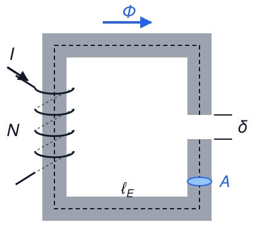
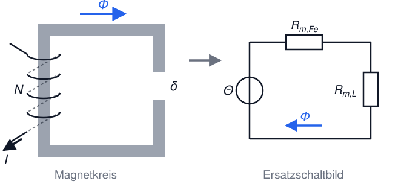
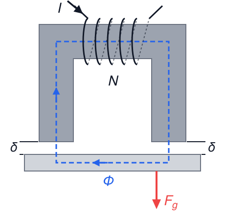

# Elektrotechnik – 4. Magnetismus II

**Luft- und Raumfahrttechnik Bachelor, 1. Semester**

David Straub

## 4. Magnetismus

1. Magnetisches Feld
2. Kräfte im magnetischen Feld
3. Magnetische Feldgrößen und Durchflutungsgesetz
4. Materie im Magnetfeld
5. **Der magnetische Kreis**
6. **Kraft am Luftspalt**

### Der magnetische Kreis

**Magnetischer Kreis:** geschlossener Pfad aus ferromagnetischem Material, der den magnetischen Fluss führt

**Anwendungen:** Elektromotoren, Generatoren, Transformatoren, induktives Laden, Relais, Hubmagnete, Sensoren

Das genaue Feld liefert nur eine 3D-Simulation (FEM). Führt das Eisen den Fluss, genügt ein **eindimensionales Modell**, das man rechnet wie ein Widerstandsnetzwerk.

### Grundidee

**Elektrischer Kreis:** Spannung treibt Strom durch Widerstand: $U = R \cdot I$

**Magnetischer Kreis:** Durchflutung treibt magnetischen Fluss durch magnetischen Widerstand:

$$\Theta = R_m \cdot \Phi$$

Die Analogie ist **mathematisch**: $\Theta$, $\Phi$ und $R_m$ gehorchen denselben Gleichungen wie $U$, $I$ und $R$. Alle Rechenregeln für Widerstandsnetzwerke lassen sich übertragen.

### Herleitung des magnetischen Widerstands

Homogener Kreis (konstantes $A$, ein Material, Feld folgt dem Materialweg):

$$\Theta = \oint \vec{H} \cdot d\vec{s} = H \cdot \ell$$

Mit $\Phi = B \cdot A$ und $B = \mu_0 \mu_r H$ folgt $H = \frac{\Phi}{\mu_0 \mu_r A}$, also:

$$\Theta = \frac{\ell}{\mu_0 \mu_r A} \cdot \Phi \qquad\Rightarrow\qquad \boxed{\Theta = R_m \cdot \Phi, \quad R_m = \frac{\ell}{\mu_0 \mu_r A}}$$

Das ist das **„Ohmsche Gesetz“ des magnetischen Kreises**, mit $[R_m] = \frac{\text{A}}{\text{Wb}}$, analog zu $R = \frac{\ell}{\sigma A}$.

### Die Analogie im Überblick

| Elektrischer Kreis | Magnetischer Kreis |
|---|---|
| Spannung $U=\int \vec{E} \cdot d\vec{s}$ | Durchflutung $\Theta = \oint \vec{H} \cdot d\vec{s}$ |
| Stromstärke $I=\int \vec{J} \cdot d\vec{A}$ | Magnetischer Fluss $\Phi = \int \vec{B} \cdot d\vec{A}$ |
| Widerstand $R = \frac{\ell}{\sigma A}$ | Mag. Widerstand $R_m = \frac{\ell}{\mu_0 \mu_r A}$ |
| Leitwert $G = \frac{1}{R}$ | Mag. Leitwert $\Lambda = \frac{1}{R_m}$ |
| $U = R \cdot I$ | $\Theta = R_m \cdot \Phi$ |

**Grenzen der Analogie:**

- Im Eisen hängt $\mu_r$ von der Aussteuerung ab (Magnetisierungskurve). $R_m$ ist nur unterhalb der Sättigung näherungsweise konstant.
- Streufluss neben dem Eisen und das Randfeld am Luftspalt (Bild) vernachlässigt das Modell.

### Reihen- und Parallelschaltung magnetischer Widerstände

**Reihenschaltung** (verschiedene Abschnitte im selben Flusspfad: Eisen, Luftspalt, …):

$$R_{m,\text{ges}} = R_{m,1} + R_{m,2} + \ldots$$

Der gleiche Fluss $\Phi$ durchsetzt alle Abschnitte (wie der Strom in der Reihenschaltung).

**Parallelschaltung** (der Fluss verzweigt sich auf mehrere Schenkel):

$$\frac{1}{R_{m,\text{ges}}} = \frac{1}{R_{m,1}} + \frac{1}{R_{m,2}} + \ldots$$

Am Verzweigungspunkt gilt die „Knotenregel“: $\sum_k \Phi_k = 0$.

### Vom Magnetkreis zum Ersatzschaltbild

Durchflutung $\Theta = N I$ wirkt wie eine Quelle, jeder Abschnitt wie ein Widerstand – **magnetische Ersatzschaltbilder zeichnet man wie Stromkreise**.

### Praxisbeispiel: Elektromagnet mit Luftspalt

**Typische Anwendung:** Schaltschütz, Relais, Hubmagnet

**Aufbau:**

- Eisenkern mit Spule ($N$ Windungen, Strom $I$)
- Luftspalt der Länge $\delta$, Eisenweg $\ell_E$, Querschnitt $A$

$$R_{m,\text{ges}} = \underbrace{\frac{\ell_E}{\mu_0 \mu_r A}}_{\text{Eisen}} + \underbrace{\frac{\delta}{\mu_0 A}}_{\text{Luftspalt}}, \qquad \Phi = \frac{N \cdot I}{R_{m,\text{ges}}}$$

### 🗳️ Eisen oder Luftspalt?

Ein Elektromagnet hat einen Eisenweg $\ell_E = 30 \, \text{cm}$ mit $\mu_r = 2000$ und einen Luftspalt $\delta = 1 \, \text{mm}$. Der Querschnitt ist überall gleich.

Welcher Abschnitt hat den größeren magnetischen Widerstand?

A) das Eisen, etwa 300-mal größer

B) das Eisen, etwa 7-mal größer

C) beide etwa gleich

D) der Luftspalt, etwa 7-mal größer

### Der Luftspalt dominiert

**Zahlenwerte:** Eisenweg $\ell_E = 30$ cm, $\mu_r = 2000$; Luftspalt $\delta = 1$ mm

$$\frac{R_{m,L}}{R_{m,E}} = \frac{\delta \cdot \mu_r}{\ell_E} = \frac{0{,}001 \cdot 2000}{0{,}3} \approx 6{,}7$$

Der Luftspalt ist 300-mal kürzer als der Eisenweg und hat trotzdem den fast 7-fachen magnetischen Widerstand.

**Praktische Näherung** für $\mu_r \gg 1$ und $\delta \mu_r \gg \ell_E$: Eisenwiderstand vernachlässigen, $R_{m,\text{ges}} \approx R_{m,L}$. In Aufgabenstellungen steht dafür oft kurz „$\mu_r \to \infty$“.

**Anwendung:** Elektromotoren haben deshalb zwischen Rotor und Stator nur Luftspalte von etwa 0,3 bis 1 mm.

### Kraft am Luftspalt

Ein Elektromagnet zieht ferromagnetisches Material an. Die Kraft pro Polfläche:

$$\boxed{F = \frac{B^2 \cdot A}{2 \mu_0}}$$

- $B$: Flussdichte im Luftspalt, $A$: Polfläche
- Herleitung über die Energie des Magnetfelds → Kapitel 5
- ⚠️ Ein U-Kern hat **zwei** Polflächen, also zwei Luftspalte. An jedem wirkt diese Kraft.

**Typische Aufgabe:** Hubmagnet dimensionieren, von der geforderten Kraft rückwärts zu $B$, $\Phi$ und $I$.

### 🗳️ Doppelter Luftspalt

Bei einem Hubmagneten ($\mu_r \to \infty$) verdoppelt sich der Luftspalt $\delta$. Der Strom bleibt gleich.

Wie ändert sich die Kraft?

A) bleibt gleich

B) sinkt auf die Hälfte

C) sinkt auf ein Viertel

D) sinkt auf ein Achtel

### 📝 Aufgabe 13: Elektromagnet dimensionieren

Ein Elektromagnet am Roboterarm soll Eisenblechtafeln ($F_g = 160 \, \text{N}$) anheben. U-förmiger Kern, Querschnitt $A = 8 \, \text{cm}^2$ pro Pol, Luftspalt $\delta = 0{,}5 \, \text{mm}$ pro Pol (Verschmutzung), $\mu_r \to \infty$, $N = 1000$ Windungen. Hinweis: normierter Luftspalt (1 mm, 1 cm²) hat $R_{m} = 8 \cdot 10^6 \, \frac{\text{A}}{\text{Wb}}$; $\mu_0 = 1{,}25 \cdot 10^{-6} \, \frac{\text{Vs}}{\text{Am}}$.

a) Skizzieren Sie das magnetische Ersatzschaltbild. Wie groß ist $R_{m,\text{ges}}$?
b) Welche Kraft muss **pro Luftspalt** wirken? Welche Flussdichte $B_\text{min}$ ist dafür nötig?
c) Welcher Strom $I$ stellt die notwendige Kraft sicher?
d) Kann der Magnet auch Aluminiumplatten anheben? (Begründung!)

### Magnetische Größen in Basiseinheiten

| Größe | Formelzeichen | Einheit | Basiseinheiten |
|---|---|---|---|
| Ladung | $Q$ | C | $\text{A} \cdot \text{s}$ |
| Spannung | $U$ | V | $\frac{\text{kg} \cdot \text{m}^2}{\text{A} \cdot \text{s}^3}$ |
| Kapazität | $C$ | F | $\frac{\text{A}^2 \cdot \text{s}^4}{\text{kg} \cdot \text{m}^2}$ |
| Widerstand | $R$ | Ω | $\frac{\text{kg} \cdot \text{m}^2}{\text{A}^2 \cdot \text{s}^3}$ |
| **Magn. Flussdichte** | $B$ | T | $\frac{\text{kg}}{\text{A} \cdot \text{s}^2}$ |
| **Magn. Fluss** | $\Phi$ | Wb | $\frac{\text{kg} \cdot \text{m}^2}{\text{A} \cdot \text{s}^2}$ |
| **Magn. Widerstand** | $R_m$ | A/Wb | $\frac{\text{A}^2 \cdot \text{s}^2}{\text{kg} \cdot \text{m}^2}$ |

Aus $F = I \ell B$: $[B] = \frac{[F]}{[I] \cdot [\ell]}$, außerdem $[\Phi] = [B] \cdot [A]$ und $[R_m] = \frac{[\Theta]}{[\Phi]}$

### Zusammenfassung

- **Magnetischer Kreis:** $\Theta = R_m \Phi$ mit $R_m = \frac{\ell}{\mu_0 \mu_r A}$, gerechnet wie ein Stromkreis
- Reihen- und Parallelschaltung, Knotenregel und Ersatzschaltbild wie im elektrischen Netzwerk
- Gültig, solange das Eisen nicht sättigt
- Der **Luftspalt** dominiert den magnetischen Widerstand
- Kraft am Luftspalt: $F = \frac{B^2 A}{2\mu_0}$ pro Polfläche
