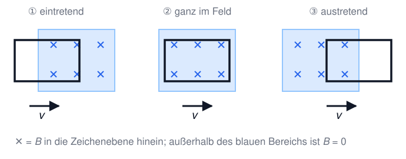
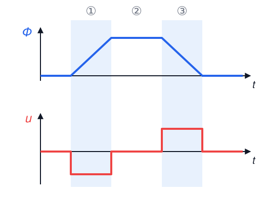
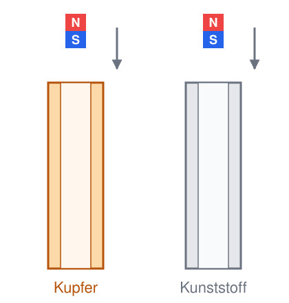
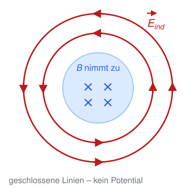
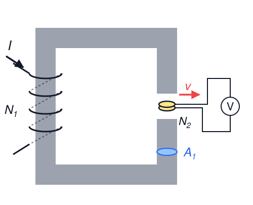

# Elektrotechnik – 5. Elektromagnetische Induktion I

**Luft- und Raumfahrttechnik Bachelor, 1. Semester**

David Straub

## 5. Elektromagnetische Induktion

1. **Induktionsgesetz**
2. Selbstinduktion
3. Energie des magnetischen Feldes
4. Kräfte an Grenzflächen

### Induktion

**Induktion:** Ändert sich der magnetische Fluss durch eine Leiterschleife, wird in ihr eine Spannung induziert.

Der Fluss ändert sich durch **Bewegung** des Leiters oder durch ein **zeitlich veränderliches Feld**.

**Anwendungen:** Generator, Transformator, Elektromotor und Rekuperation, induktives Laden, Näherungsschalter, Induktionsherd

### Bewegter Leiter im Magnetfeld

Lorentzkraft auf die Elektronen im Stab: $\vec{F}_m = q \cdot (\vec{v} \times \vec{B})$

Die Ladungen trennen sich, bis das elektrische Feld die Lorentzkraft ausgleicht:

$$q \vec{E} + q (\vec{v} \times \vec{B}) = 0 \quad\Rightarrow\quad \vec{E} = -\,\vec{v} \times \vec{B}$$

Spannung zwischen den Stabenden ($\vec{v}$, $\vec{B}$, $\vec{\ell}$ senkrecht zueinander):

$$U_\text{ind} = B \cdot \ell \cdot v$$

### Das Induktionsgesetz

Gleitet der Stab auf Schienen, wächst die umfasste Fläche um $\frac{dA}{dt} = \ell \cdot v$:

$$U_\text{ind} = B \cdot \ell \cdot v = B \cdot \frac{dA}{dt}$$

**Allgemein** (Faraday), für $N$ Windungen:

$$\boxed{U_\text{ind} = -N \cdot \frac{d\Phi}{dt}}$$

Mit $\Phi = B \cdot A$ gibt es zwei Arten:

- **Bewegungsinduktion:** $A$ ändert sich
- **Ruheinduktion:** $B$ ändert sich

### 🗳️ Leiterschleife im Feldbereich

Eine Leiterschleife bewegt sich mit konstanter Geschwindigkeit durch einen begrenzten Feldbereich.

In welchen Phasen wird eine Spannung induziert?

A) nur in ②

B) in ① und ③, mit gleichem Vorzeichen

C) in ① und ③, mit entgegengesetztem Vorzeichen

D) in ①, ② und ③ gleich groß

### Fluss und Spannung im Verlauf

- ① Der Fluss steigt: Spannung
- ② Der Fluss ist konstant: **keine** Spannung, obwohl die Schleife im Feld liegt
- ③ Der Fluss sinkt: Spannung mit umgekehrtem Vorzeichen

**Für Skizzen:** $u(t)$ ist die negative Steigung von $\Phi(t)$.

### Induzierter Strom und Lenz’sche Regel

Schließt man den Kreis über $R$, fließt ein **induzierter Strom** $I = \frac{U_\text{ind}}{R}$.

**Lenz’sche Regel:** Der induzierte Strom wirkt seiner Ursache entgegen.

- Im Bild: Die Kraft auf den stromdurchflossenen Stab bremst die Bewegung.
- Grund ist die Energieerhaltung: Die Wärme in $R$ stammt aus der mechanischen Arbeit.

### 🗳️ Magnet im Rohr

Ein starker Magnet fällt durch ein senkrechtes Kupferrohr, ein gleicher Magnet durch ein gleich langes Kunststoffrohr. Kupfer ist nicht ferromagnetisch.

Wie fällt der Magnet im Kupferrohr?

A) schneller

B) gleich schnell

C) deutlich langsamer

D) er bleibt stecken

### Wirbelströme

- Der fallende Magnet ändert den Fluss durch jeden Ring des Rohrs. Dort fließen induzierte Ringströme, die **Wirbelströme**.
- Nach Lenz bremsen sie ihre Ursache, also den Fall.
- **Nutzen:** Wirbelstrombremse (Zug, Achterbahn), Induktionsherd
- **Verluste:** im Eisenkern von Transformator und Motor. Abhilfe: Kern aus dünnen, gegeneinander isolierten Blechen (Elektroblech)

### Induzierte Spannung: keine Potentialdifferenz

Ein zeitlich veränderliches Magnetfeld erzeugt ein elektrisches **Wirbelfeld** mit geschlossenen Feldlinien:

$$\oint \vec{E} \cdot d\vec{s} = -\frac{d\Phi}{dt}$$

- **Elektrostatik:** $\oint \vec{E} \cdot d\vec{s} = 0$, es gibt ein Potential
- **Induktion:** $\oint \vec{E} \cdot d\vec{s} \neq 0$, es gibt kein Potential

### 📝 Aufgabe 14: Induktion

Im Luftspalt eines Ferritkerns (Querschnitt $A_1 = 4 \, \text{cm}^2$) sitzt eine bewegliche Messspule ($N_2 = 10$ Windungen, Fläche $A_2 = 1 \, \text{cm}^2$). Das Feld erzeugt die feste Spule mit $N_1 = 2000$ Windungen und Gleichstrom $I$; $R_{m,\text{ges}} = 10^7 \, \frac{\text{A}}{\text{Wb}}$. Ab $t = 0$ wird die Messspule mit konstanter Geschwindigkeit herausgezogen. Nach $0{,}1 \, \text{s}$ ist sie vollständig draußen.

a) Zeichnen Sie eine Feldlinie ein. Skizzieren Sie $\Phi_2(t)$ durch die Messspule und die induzierte Spannung $u(t)$ qualitativ.
b) Welcher Fluss $\Phi_2$ durchsetzt die Messspule anfangs, wenn $U_\text{ind} = 10 \, \text{mV}$ beträgt? Welche Flussdichte $B$ herrscht dann im Luftspalt, und welcher Fluss $\Phi_1$ durchsetzt die feste Spule?
c) Welcher Strom $I$ muss durch die feste Spule fließen?

### Zusammenfassung

- Induktionsgesetz $U_\text{ind} = -N \frac{d\Phi}{dt}$: Der Fluss ändert sich durch Bewegung oder durch ein veränderliches Feld.
- $u(t)$ ist die negative Steigung von $\Phi(t)$.
- Lenz: Der induzierte Strom wirkt seiner Ursache entgegen (Energieerhaltung).
- Wirbelströme bremsen und heizen. Im Eisenkern verursachen sie Verluste.
- Die induzierte Spannung stammt aus einem Wirbelfeld und ist keine Potentialdifferenz.
