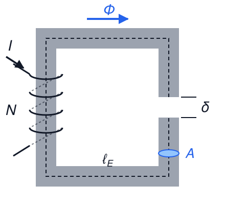
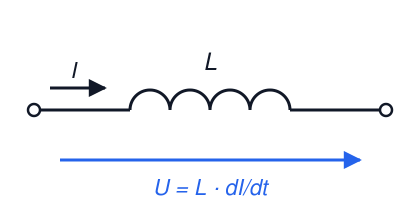
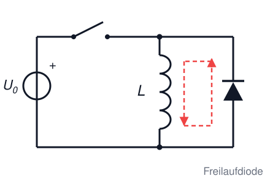
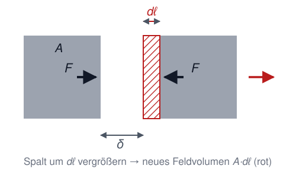
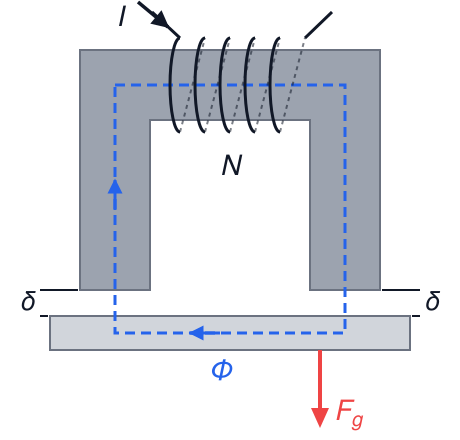

# Elektrotechnik – 5. Elektromagnetische Induktion II

**Luft- und Raumfahrttechnik Bachelor, 1. Semester**

David Straub

## 5. Elektromagnetische Induktion

1. Induktionsgesetz
2. **Selbstinduktion**
3. **Energie des magnetischen Feldes**
4. **Kräfte an Grenzflächen**

### Selbstinduktion

- Strom durch eine Spule erzeugt einen eigenen Fluss: $\Phi \sim I$
- Ändert sich $I$, ändert sich $\Phi$, und in **derselben** Spule wird eine Spannung induziert.

**Selbstinduktion:** Die Spule induziert eine Spannung in sich selbst. Nach Lenz wirkt sie der Stromänderung entgegen.

### 🗳️ Doppelte Windungszahl

Eine Spule auf einem Eisenkern wird mit doppelter Windungszahl neu gewickelt. Kern und Stromänderung $\frac{dI}{dt}$ bleiben gleich.

Wie ändert sich die selbstinduzierte Spannung?

A) bleibt gleich

B) verdoppelt sich

C) vervierfacht sich

D) verachtfacht sich

### Induktivität

Fluss aus dem magnetischen Kreis: $\Phi = \frac{N \cdot I}{R_m}$

Eingesetzt in das Induktionsgesetz:

$$U_\text{ind} = -N \cdot \frac{d\Phi}{dt} = -\frac{N^2}{R_m} \cdot \frac{dI}{dt}$$

**Induktivität** (*inductance*): $\boxed{L = \frac{N^2}{R_m}}$

Einheit: $[L] = \frac{\text{V} \cdot \text{s}}{\text{A}} = \text{H}$ (Henry), damit $[R_m] = \frac{\text{A}}{\text{Wb}} = \frac{1}{\text{H}}$

### Klemmenspannung der Spule

In Schaltungen zählt man die Spannung an den Klemmen, im Verbraucherzählpfeilsystem (Vorzeichen umgekehrt zu $U_\text{ind}$):

$$\boxed{U = L \cdot \frac{dI}{dt}}$$

- Steigender Strom: $U > 0$, die Spule nimmt Energie auf
- Fallender Strom: $U < 0$, die Spule gibt Energie ab
- Konstanter Strom: $U = 0$, die ideale Spule wirkt wie ein Draht

### 🗳️ Luftspalt in der Spule

Eine Spule hat einen geschlossenen Eisenkern ($\mu_r = 2000$, $\ell_E = 30 \, \text{cm}$). In den Kern wird ein Luftspalt $\delta = 1 \, \text{mm}$ gesägt.

Wie ändert sich die Induktivität $L$?

A) sie steigt

B) sie bleibt etwa gleich

C) sie sinkt auf etwa ein Achtel

D) sie sinkt auf null

### Spulen mit Luftspalt

$$L = \frac{N^2}{R_{m,E} + R_{m,L}} = \frac{N^2 \mu_0 A}{\frac{\ell_E}{\mu_r} + \delta} \approx \frac{N^2 \mu_0 A}{\delta}$$

- Ohne Luftspalt hängt $L$ über $\mu_r$ vom Strom ab (Sättigung, Hysterese).
- Mit Luftspalt bestimmt fast nur $\delta$ die Induktivität: $L$ ist konstant und genau einstellbar.
- Für dasselbe $L$ braucht man dann mehr Windungen.

**Anwendung:** Drosselspulen in Netzteilen und Umrichtern

### Reihen- und Parallelschaltung

**Reihe:** gleicher Strom, die Spannungen addieren sich

$$L_\text{ges} = L_1 + L_2 + \ldots$$

**Parallel:** gleiche Spannung, die Ströme teilen sich

$$\frac{1}{L_\text{ges}} = \frac{1}{L_1} + \frac{1}{L_2} + \ldots$$

Wie bei Widerständen, umgekehrt zu Kondensatoren. Gilt, solange sich die Spulen nicht magnetisch koppeln.

### 📝 Aufgabe 15: Drosselspule

Eine Drosselspule hat einen Eisenkern ($\mu_r = 4000$, $\ell_E = 20 \, \text{cm}$, $A = 4 \, \text{cm}^2$) mit Luftspalt $\delta = 0{,}5 \, \text{mm}$. Wicklung: $N = 50$, Strom $I = 2 \, \text{A}$; $\mu_0 = 1{,}25 \cdot 10^{-6} \, \frac{\text{Vs}}{\text{Am}}$.

a) Berechnen Sie $R_{m,E}$ und $R_{m,L}$. Welcher Anteil dominiert?
b) Wie groß ist der magnetische Fluss $\Phi$?
c) Wie groß sind $B$ sowie $H$ im Eisen und im Luftspalt?
d) Wie groß ist die Induktivität $L$ der Spule?

### Energie in der Spule

Maschengleichung des RL-Kreises:

$$U_0 = R \cdot I + L \cdot \frac{dI}{dt}$$

Mit $I \, dt$ multipliziert:

$$U_0 \, I \, dt = \underbrace{I^2 R \, dt}_{\text{Wärme}} + \underbrace{L \, I \, dI}_{\text{Magnetfeld}}$$

Gespeicherte Energie:

$$\boxed{W_m = \int_0^I L \, I' \, dI' = \frac{1}{2} L I^2}$$

Analog beim Kondensator: $W_e = \frac{1}{2} C U^2$

### 🗳️ Schalter öffnen

Durch eine Spule ($L = 1 \, \text{H}$) fließt $I = 0{,}4 \, \text{A}$. Der Schalter wird schlagartig geöffnet.

Was passiert?

A) Der Strom ist sofort null, sonst passiert nichts.

B) An der Spule entsteht eine sehr hohe Spannung, am Schalter ein Funke.

C) Die Energie bleibt in der Spule gespeichert.

D) Die Spulenspannung bleibt gleich $U_0$.

### Abschalten einer Spule

- Schlagartiges Öffnen heißt: $\frac{dI}{dt}$ und damit $U = L \frac{dI}{dt}$ werden sehr groß.
- Die Spannung zündet einen Funken am Schalter. Dort wird die Energie $\frac{1}{2} L I^2$ frei.
- Abhilfe: **Freilaufdiode** parallel zur Spule. Der Strom fließt im Kreis weiter und klingt ab.
- Gezielt genutzt: Zündspule im Benzinmotor, Weidezaungerät

### Energiedichte des Magnetfelds

Im homogenen Feld mit Volumen $V$:

$$W_m = \frac{1}{2} B H \cdot V = \frac{B^2}{2 \mu_0 \mu_r} \cdot V$$

**Energiedichte** (Energie pro Volumen): $\boxed{w_m = \frac{1}{2} B H}$, analog zu $w_e = \frac{1}{2} E D$

Bei gleichem $B$ ist die Energiedichte im Luftspalt $\mu_r$-mal größer als im Eisen: Die Energie sitzt im Luftspalt.

### Kraft am Luftspalt

Spalt bei konstantem Fluss um $d\ell$ vergrößern: neues Feldvolumen $A \cdot d\ell$

$$dW = \frac{B^2}{2 \mu_0} \cdot A \cdot d\ell = F \cdot d\ell \quad\Rightarrow\quad \boxed{F = \frac{B^2 A}{2 \mu_0}}$$

**Maxwell’sche Zugspannung** (Kraft pro Fläche): $\sigma = \frac{F}{A} = \frac{B^2}{2 \mu_0}$

Bei $B = 1 \, \text{T}$: $\sigma \approx 40 \, \frac{\text{N}}{\text{cm}^2}$

### 📝 Aufgabe 16a: Elektromagnet

*Fortsetzung von Aufgabe 13 (Kapitel 4):* $N = 1000$ Windungen, $R_{m,\text{ges}} = 10^6 \, \text{H}^{-1}$, Betriebsstrom $I = 0{,}4 \, \text{A}$.

a) Welche Induktivität $L$ hat die Spule?
b) Beim Einschalten steigt der Strom konstant mit $0{,}5 \, \frac{\text{A}}{\text{ms}}$. Welche Spannung liegt dabei an der Induktivität?
c) Welche Energie ist beim Betriebsstrom im Magnetfeld gespeichert?
d) Warum wird $L$ in der Realität auch für einen Luftspalt $\delta \to 0$ nicht beliebig groß?
e) An die Spule wird $U_1$ für die Dauer $t_1$ angelegt, danach $0$. Skizzieren Sie $i(t)$.

### 📝 Aufgabe 16b: Relais

Ein Relais zieht seinen Anker an. Dabei schließt sich der Luftspalt von $\delta_1 = 2 \, \text{cm}$ (Ruhelage) auf $\delta_2 = 1 \, \text{mm}$. Luftspaltfläche $A = 5 \, \text{cm}^2$, $\mu_r \to \infty$, $\mu_0 = 1{,}25 \cdot 10^{-6} \, \frac{\text{Vs}}{\text{Am}}$. In der Ruhelage ist zum Anziehen die Kraft $F_1 = 50 \, \text{N}$ nötig.

a) Berechnen Sie $R_m$ in beiden Stellungen.
b) Welche Flussdichte $B$ und welcher Fluss $\Phi$ sind in der Ruhelage nötig?
c) Wie viele Windungen braucht die Spule mindestens bei $I = 5 \, \text{A}$?
d) Wie groß ist $L$ in beiden Stellungen?
e) Welcher Strom genügt im angezogenen Zustand für dieselbe Kraft $F_1$?

### Zusammenfassung

- Selbstinduktion: $L = \frac{N^2}{R_m}$, Einheit Henry
- Klemmenspannung $U = L \frac{dI}{dt}$ im Verbraucherzählpfeilsystem
- Ein Luftspalt macht $L$ kleiner, aber konstant.
- Reihen- und Parallelschaltung wie bei Widerständen
- Energie $W_m = \frac{1}{2} L I^2$, Energiedichte $w_m = \frac{1}{2} B H$; beim Abschalten schützt eine Freilaufdiode.
- Kraft am Luftspalt: $F = \frac{B^2 A}{2\mu_0}$
