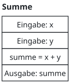
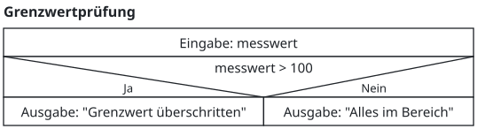
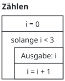
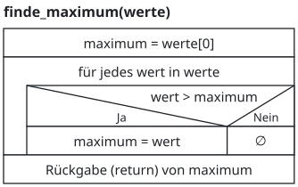
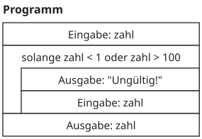

# Programmieren – 9. Funktionen 2 und Struktogramme

**Ingenieurinformatik Teil 1, Wintersemester 2026/27**

David Straub

### Warm-up: Was gibt der Code aus?

Aufschreiben, dann ausführen:

```python
txt = "SENSOR"
print(txt[1:4])
print(txt[-2:])
print(len(txt[2:]))
```

### Heute lernen Sie

- Funktionen mit **mehreren Parametern** und **mehreren Rückgabewerten**
- Was in der Funktion bleibt: **lokale Variablen**, und die Ausnahme `global`
- Probleme **zerlegen**: Hauptfunktion und Hilfsfunktion
- **Struktogramme**: Programme auf Papier

## Funktionen mit mehr Möglichkeiten

### Zwei Parameter

```python
def ladezeit(energie, leistung):
    return energie / leistung

print(ladezeit(55, 11))
print(ladezeit(55, 22))
print(ladezeit(leistung=11, energie=55))
```

- In Woche 6 war die Ladeleistung fest eingebaut (11 kW). Jetzt ist sie ein zweiter Parameter
- Parameter durch Komma getrennt. Die Werte werden der Reihe nach zugeordnet: der erste an `energie`, der zweite an `leistung`
- Mit Namen übergeben, wie bei `print(..., end="")`, ist die Reihenfolge egal

### Mini-Aufgabe (4 min)

Machen Sie aus diesem Skript **eine Funktion mit zwei Parametern** und **zwei Aufrufe**:

```python
kapazitaet_a = 4800
strom_a = 350
laufzeit_a = kapazitaet_a / strom_a
print(f"Gerät A: {laufzeit_a:.1f} h")

kapazitaet_b = 2200
strom_b = 150
laufzeit_b = kapazitaet_b / strom_b
print(f"Gerät B: {laufzeit_b:.1f} h")
```

Vertauschen Sie dann bei einem Aufruf die beiden Werte. Was passiert?

### Mehrere Rückgabewerte

```python
from math import sin, cos

def sin_cos(x):
    return sin(x), cos(x)

s, c = sin_cos(0.5)
print(f"sin: {s:.3f}, cos: {c:.3f}")
print(sin_cos(0.5))
```

- `return a, b` gibt **beide** Werte zurück
- Links stehen entsprechend **zwei** Variablen, durch Komma getrennt
- Mit nur einer Variable kommen beide Werte zusammen an, in runden Klammern

### Lokale Variablen

```python
def laufzeit(kapazitaet, strom):
    stunden = kapazitaet / strom
    return stunden

print(laufzeit(4800, 350))
print(stunden)
```

```
NameError: name 'stunden' is not defined
```

- Variablen, die **in** einer Funktion entstehen, gibt es nur **während des Aufrufs**
- Austausch mit dem Rest des Programms nur über zwei Wege: Parameter hinein, Rückgabe (`return`) heraus
- Das nennt man **Kapselung**: Was in der Funktion passiert, bleibt in der Funktion

### Die Ausnahme: `global`

```python
zaehler = 0

def erhoehe():
    global zaehler
    zaehler = zaehler + 1
```

- Eine äußere Variable **lesen** kann jede Funktion. Zum **Verändern** braucht sie `global`
- Der Aufruf `erhoehe()` verändert eine Variable außerhalb, ohne dass es an der Aufrufstelle zu sehen ist. Bei Parameter und `return` steht dort alles, was passiert
- Deshalb: `global` in fremdem Code lesen können, im eigenen Code Parameter und `return` verwenden

### Vorhersage-Aufgabe (4 min)

Aufschreiben, in der **richtigen Reihenfolge**, dann ausführen:

```python
def f1():
    x = 20
    print("a:", x)

def f2():
    global x
    x = 30
    print("b:", x)

x = 10
print("c:", x)
f1()
print("d:", x)
f2()
print("e:", x)
```

### Zerlegen: Hauptfunktion denkt Hilfsfunktion mit

Aufgabe: ein Messbericht. Zuerst die **Hauptfunktion**. Die Hilfsfunktion `mittelwert` gibt es dabei noch nicht:

```python
def bericht(werte):
    m = mittelwert(werte)
    return f"{len(werte)} Werte, Mittelwert {m:.1f}"
```

- Beim Schreiben von `bericht` reicht es zu wissen, **was** `mittelwert` zurückgibt
- Wie `mittelwert` das berechnet, entscheiden Sie im nächsten Schritt

### Zerlegen: die Lücke füllen

Jetzt die Hilfsfunktion, mit dem Mittelwert aus Woche 7:

```python
def mittelwert(werte):
    summe = 0
    for wert in werte:
        summe += wert
    return summe / len(werte)

print(bericht([4, 9, 2]))
```

- Vorhanden sein muss die Hilfsfunktion erst beim **Aufruf** von `bericht`

### Debug-Check

Wenn ein Programm nicht tut, was es soll, der Reihe nach:

1. Was **soll** es tun?
2. Was tut es **stattdessen**?
3. Welche Stelle ist **verdächtig**: welche Bedingung, welche Variable?
4. Welcher **kleinste Test** entscheidet? Oft: ein `print` an der richtigen Stelle

### Debug-Aufgabe (4 min)

`min_max([4, 9, 2])` soll `2` und `9` zurückgeben, liefert aber `4` und `4`. Gehen Sie den Debug-Check durch und beheben Sie den Fehler:

```python
def min_max(werte):
    kleinster = werte[0]
    groesster = werte[0]
    for wert in werte:
        if wert < kleinster:
            kleinster = wert
        if wert > groesster:
            groesster = wert
        return kleinster, groesster

print(min_max([4, 9, 2]))
```

### Mini-Aufgabe (4 min): Zerlegen

Erweitern Sie `bericht`: Der Bericht nennt zusätzlich den kleinsten und den größten Wert.

```
3 Werte, Mittelwert 5.0, Bereich 2 bis 9
```

1. Schreiben Sie zuerst die neue Zeile in `bericht`, die `min_max` aufruft
2. Dann die neue Ausgabe
3. Testen Sie mit Ihrer korrigierten `min_max`

## Struktogramme

### Programme auf Papier: Struktogramme

In technischer Dokumentation werden Algorithmen manchmal **sprachunabhängig** festgehalten. Struktogramme sind eine klassische Notation dafür.

- Sie begegnen Ihnen in Spezifikationen und älterer Dokumentation. Die Kernfertigkeit: **lesen** und in Code **umsetzen**
- **Zeichnen** brauchen Sie, wenn eine Dokumentation (oder die Klausur) es verlangt

Drei Grundformen, alle drei kennen Sie aus Python:

1. **Anweisungsfolge**: Kästen untereinander
2. **Verzweigung**: Diagonalen mit Ja/Nein
3. **Schleife**: das umgekehrte L



### Grundform Verzweigung

Diagonalen teilen die Bedingung in **Ja** (links) und **Nein** (rechts), darunter die beiden Zweige.

Das Beispiel kennen Sie aus Woche 3:

```python
messwert = float(input("Messwert: "))
if messwert > 100:
    print("Grenzwert überschritten")
else:
    print("Alles im Bereich")
```



### Grundform Schleife

Kopfzeile mit der Bedingung, der Schleifenkörper hängt im **umgekehrten L**.

Aus Woche 5:

```python
i = 0
while i < 3:
    print(i)
    i = i + 1
```

Für `for`-Schleifen: gleiche Form, Kopfzeile z. B. „für jedes wert in werte“.



### Alles zusammen: ein alter Bekannter

Eine Verzweigung **in** einer Schleife: die Maximum-Suche aus Woche 7, als Funktion.

- Der leere Nein-Zweig bekommt das Zeichen ∅
- Zuweisungen schreiben wir mit `=`, Rückgaben als „Rückgabe (return) von …“



### Lese-Übung (4 min): Struktogramm → Python

Übersetzen Sie exakt in Python:



Tipp: Sie kennen dieses Programm.

### Zeichen-Übung (5 min, auf Papier): Python → Struktogramm

Zeichnen Sie das Struktogramm zu diesem Programm. Alle Kontrollstrukturen müssen erkennbar sein:

```python
n = 5
while n > 0:
    print(n)
    n -= 1
print("Start!")
```

Zusatz: das Struktogramm zur Vorhersage-Aufgabe aus Woche 8 mit der Schleife in der Schleife

### Mini-Check

Ohne Computer:

1. `a, b = f(...)`: Was muss `f` dafür tun?
2. Eine Variable wird in einer Funktion angelegt, ohne `global`. Ist sie draußen sichtbar?
3. Welche Form hat eine Schleife im Struktogramm?
4. Ein Ergebnis ist falsch, es gibt aber keine Fehlermeldung. Wie finden Sie die Stelle?

### Bis nächste Woche!

Nächste Woche: **Diagramme mit matplotlib**, Ihre Daten als Bild

- Üben: KI-Quizze auf OneTutor: https://link.hm.edu/vkej
- Fragen: jederzeit im Matrix-Chat
