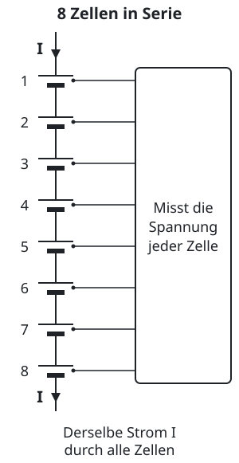

# Programmieren – Praktikum 3

**Ingenieurinformatik Teil 1, Wintersemester 2026/27**

David Straub

### Ein simuliertes Batteriepack

Bisher hatten Sie eine einzelne, selbst gewählte Zelle. Ab heute arbeiten Sie mit einem simulierten Pack aus acht Zellen. Ein Modul liefert die Zellspannung. Sie hängt vom Ladezustand **und** von der Stromstärke ab:

```python
from zelle import lese_spannung

u = lese_spannung(3, 0.5, 1.0)   # Zelle 3, Ladezustand 50 %, 1.0 A
print(u)
```

- `nummer`: Zelle 1 bis 8
- `ladezustand`: 1.0 (voll) bis 0.0 (leer)
- `strom_A`: Entladestrom in A. Je höher der Strom, desto tiefer sinkt die Spannung; Ursache ist der Innenwiderstand der Zelle
- Gleiche Eingaben ergeben immer dieselbe Ausgabe

### So bekommen Sie das Modul

1. Herunterladen: https://raw.githubusercontent.com/DavidMStraub/teaching-materials/main/programmieren/zelle.py
2. Datei unter dem Namen `zelle.py` **im selben Ordner** speichern wie Ihre Skripte
3. Testen Sie mit dem Code von der vorigen Folie: Er gibt `3.518` aus

`zelle.py` ist ein Modul wie `math`. Python findet es, weil es im selben Ordner liegt wie Ihr Skript.

Fehlermeldung `ModuleNotFoundError: No module named 'zelle'`? Dann liegt die Datei im falschen Ordner oder heißt anders.

Legen Sie für jede Aufgabe eine eigene Datei an (`aufgabe1.py`, `aufgabe2.py`, …). Funktionen, die Sie weiterverwenden, kopieren Sie in die nächste Datei.

### Aufgabe 1: Eine Zelle entladen

Simulieren Sie, wie die Spannung einer Zelle sinkt, während sie entladen wird. Die Zelle hat eine Kapazität von `kapazitaet_Ah = 3.5`. Pro Zeitschritt `zeitschritt_h = 0.1` sinkt der Ladezustand um `strom_A * zeitschritt_h / kapazitaet_Ah`.

1. Legen Sie Variablen an: `ladezustand = 1.0` (voll), `strom_A` mit einem Wert zwischen 0.5 und 5.0, dazu `kapazitaet_Ah` und `zeitschritt_h` wie oben
2. Schreiben Sie eine `while`-Schleife, die läuft, solange `ladezustand` über 0 liegt. In jedem Durchlauf:
   - Spannung auslesen: `lese_spannung(1, ladezustand, strom_A)`
   - Ladezustand und Spannung mit drei Nachkommastellen ausgeben (`print`)
   - `ladezustand` nach der Formel oben verringern
3. Bei welchem Ladezustand fällt die Spannung am stärksten ab?
4. Verdoppeln Sie `strom_A`: Was ändert sich am Verlauf, was bleibt gleich?

### Aufgabe 2: Grenzwerte prüfen

1. Schreiben Sie eine Funktion `bewertung(spannung_V)`, die ein Urteil zurückgibt (`return`): unter 3,0 V `kritisch`, sonst `ok`
2. Testen Sie die Funktion einzeln: `bewertung(2.9)` und `bewertung(3.0)`
3. Bauen Sie das Urteil als dritte Spalte in Ihre Ausgabe aus Aufgabe 1 ein
4. Bei welchem Ladezustand wird Zelle 1 kritisch, bei 1,0 A und bei 3,0 A? Notieren Sie beide Werte, Sie brauchen sie in Aufgabe 4

### Aufgabe 3: Alle acht Zellen vergleichen

1. Wählen Sie einen festen Ladezustand und einen festen Strom. Lesen Sie die Spannung aller acht Zellen aus und geben Sie sie aus (`print`), mit einer Schleife über die Zellnummern
2. Bestimmen Sie die **niedrigste** Spannung und die **Nummer** der zugehörigen Zelle. Merken Sie sich dazu in zwei Variablen die bisher niedrigste Spannung und die Nummer dieser Zelle; starten Sie mit den Werten von Zelle 1
3. Wiederholen Sie mit 5,0 A: Wie weit liegt die schwächste Zelle jetzt unter den anderen? Wie lautet ihre Bewertung?

### Aufgabe 4: Wann muss das Pack abschalten?



Das Pack muss abschalten, sobald **eine** seiner Zellen kritisch ist.

1. Packen Sie Ihre Lösung aus Aufgabe 3 in eine Funktion, die die niedrigste Zellspannung zurückgibt (`return`). Mehrere Parameter trennen Sie mit Komma, wie beim Aufruf: `def niedrigste_spannung(ladezustand, strom_A):`
2. Simulieren Sie die Entladung wie in Aufgabe 1, jetzt für das ganze Pack: Geben Sie pro Schritt Ladezustand, niedrigste Spannung und Bewertung aus (`print`)
3. Beenden Sie die Schleife, sobald die Bewertung `kritisch` lautet
4. Bei welchem Ladezustand schaltet das Pack ab, bei 1,0 A und bei 3,0 A? Vergleichen Sie mit Zelle 1 allein aus Aufgabe 2 und erklären Sie den Unterschied mit Ihrem Ergebnis aus Aufgabe 3

### Aufgabe 5 (falls Sie Listen schon hatten): Der Entladeverlauf als Liste

1. Simulieren Sie die Entladung von Zelle 1 wie in Aufgabe 1. Sammeln Sie die Spannungen in einer Liste (`append`), statt sie auszugeben
2. Schreiben Sie eine Funktion `anzahl_kritisch(werte)`, die zurückgibt (`return`), wie viele Spannungen der Liste kritisch sind. Nutzen Sie dafür `bewertung` aus Aufgabe 2
3. Bestimmen Sie den größten Spannungsabfall zwischen zwei aufeinanderfolgenden Werten der Liste. Dafür brauchen Sie eine Schleife über die Indizes (`range`). Passt das Ergebnis zu Ihrer Antwort aus Aufgabe 1, Schritt 3?

### Zusatz 1: Wie lange hält das Pack?

1. Schreiben Sie eine Funktion `laufzeit_h(strom_A)`: Sie simuliert die Entladung des Packs wie in Aufgabe 4, ohne Ausgabe, und gibt zurück (`return`), wie viele Stunden das Pack bis zur Abschaltung läuft (Anzahl der Schritte mal `zeitschritt_h`)
2. Vergleichen Sie bei 1,0 A, 3,0 A und 5,0 A mit der idealen Laufzeit `kapazitaet_Ah / strom_A`. Welchen Anteil der Kapazität nutzt das Pack?
3. Zelle 6 wird gegen eine gute Zelle getauscht: Lassen Sie Zelle 6 in `niedrigste_spannung` aus. Wie lange hält das Pack jetzt?

### Zusatz 2: Wie viel Strom verträgt das Pack?

Das Pack soll mindestens bis zu einem Ladezustand von 20 % nutzbar sein: Bei `ladezustand = 0.2` darf noch keine Zelle kritisch sein.

1. Bestimmen Sie den größten Strom, bei dem das gilt. Erhöhen Sie den Strom dazu in einer Schleife in Schritten von 0,1 A
2. Wie viel Strom verträgt das Pack ohne Zelle 6?

### Zusatz 3: Jede Zelle einzeln

- Schreiben Sie `ladezustand_bei_grenze(nummer, strom_A)`: Die Funktion simuliert die Entladung einer Zelle in Schritten von 0.001 und gibt zurück (`return`), bei welchem Ladezustand die Zelle 3,0 V unterschreitet
- Vergleichen Sie damit alle acht Zellen, bei 0,5 A und bei 5,0 A: Wie stark unterscheiden sich die Zellen jeweils?
- Öffnen Sie `zelle.py` und lesen Sie den Code: Was verstehen Sie schon, was noch nicht?
